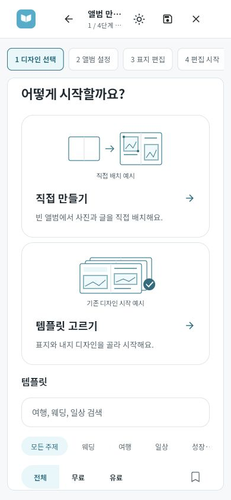
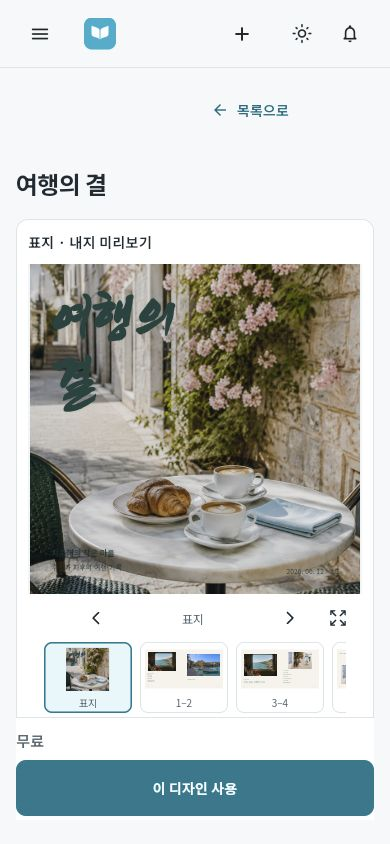
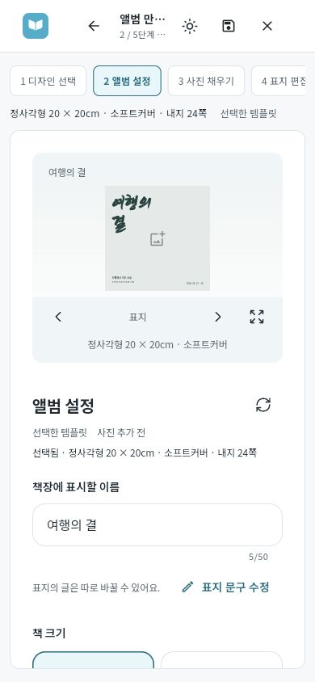
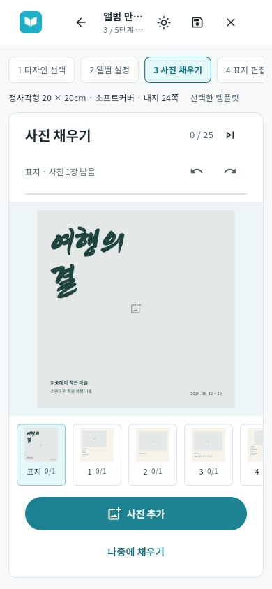
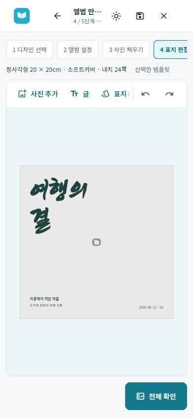
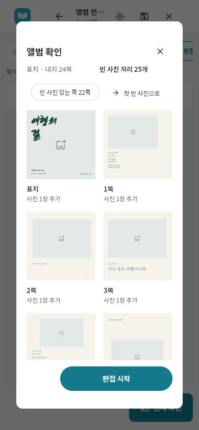

# 앨범 제작 흐름 — 다음 디자인 점검

2026-11-11. 처음에는 배포 웹의 `/create`를 390×844 화면에서 점검했다. 이후 사용자가 수정 시안을 승인하고 **카테고리 스크롤 표시만 제거**하도록 요청해 Flutter 제품 소스에 반영했다. 아래 과거 시안·웹 점검 이력과 최신 구현 상태를 구분한다. 최신 검증 기록은 `design-qa.md`와 `docs/verification/creation-catalog-2026-11-11/`에 둔다. 전체 앱 빌드·운영 배포는 이번 작업 범위에 포함하지 않았다.

## 최신 사용자 요구 — 카테고리 통합·두 줄 가로 스크롤

사용자는 `전체·추천·인기`를 주제와 분리하지 않고 **같은 카테고리 목록에 포함**하도록 요청했다. 카테고리는 좌우 슬라이드로 탐색하고 최대 두 줄로 제한하는 방향으로 다시 확인한다. 아래의 이전 분리 탐색 메뉴·전체 주제 시트 제안보다 이 요구가 우선한다.

| 요소 | 최신 제안 |
| --- | --- |
| 카테고리 | 전체·추천·인기와 기존 11개 주제를 한 선택 목록으로 통합 |
| 배치 | 최대 두 줄의 칩이 하나의 가로 스크롤 위치로 함께 이동 |
| 처음 보이는 항목 | 위줄 전체·추천·인기, 아래줄 일상·여행·동아리. 나머지는 옆으로 이동해 탐색하는 시안 |
| 가격 | 아래의 별도 전체·무료·유료 선택 유지 |
| 검색·즐겨찾기 | 카테고리와 독립적으로 조합·유지 |
| 시작 화면 | 직접 만들기와 디자인 시작을 동등한 상단 진입 버튼으로 유지 |
| 현재 상태 | 사용자 승인 후 제품 소스 반영. 두 줄 스와이프 유지, 스크롤 막대·트랙 제거. 최종 검증은 별도 기록 |

카테고리는 전체 목록에서 하나만 선택한다. 예를 들어 인기에서 동아리로 바꾸면 인기 선택을 해제하고 동아리를 선택한다. 카테고리 전체는 검색·가격·즐겨찾기를 임의로 초기화하지 않는다. 이전 추천/인기나 주제가 보이지 않는 조건으로 남아 결과를 중복 제한하지 않도록 한다.

현재 기본 목록은 탐색 3개와 주제 11개인 14개이며, 공급 데이터에 추가 주제가 생겨도 가로 목록에 유지한다. 이는 표시용 분류이며 기존 문서 제작 인덱스 `templateTopicOrder`를 재정렬하라는 지시가 아니다. 추천/인기의 데이터·로딩·실패·집계 없음 처리와 가격/보유권 구분은 그대로 검증한다.

두 행은 독립적으로 움직이는 두 필터가 아니다. 두 행을 함께 스크롤하며 선택은 하나이고, 화면 밖 항목도 접근 가능해야 한다. 선택 위치·상세 복귀 시 가로 위치를 복원하고 작은 화면·큰 글자에서는 글자나 터치 영역을 줄이지 않은 채 옆으로 스크롤하게 한다. 두 줄의 높이는 텍스트 배율에 대응하며 각 터치 영역은 최소 48px로 구현한다. 이 내용은 후속 구현 검증 기준이고 정적인 생성 이미지가 실제 스와이프 동작을 증명하지 않는다.

사용자는 이 시안을 승인하면서 가로 스크롤 표시만 빼도록 요청했다. 따라서 시안에 그려진 막대와 트랙은 실제 구현에 넣지 않는다.

최신 단일 수정 시안은 `/Users/devsheep/SnapFit/generated_images/exec-6e62b216-381d-452a-917e-331c7c8ea444.png`다. 이전 디자인 선택 시안을 바탕으로 별도 탐색 탭과 주제 메뉴를 두 줄의 통합 카테고리 영역으로 바꿨다. 직접 만들기 진입 화면은 이전 수정 결과 `exec-b576c1e2-4292-4765-9d17-b49031e22262.png`를 유지한다. 최신 시안에서도 상품 이미지·가격·보유 표시는 배치 예시이며 실서비스 값 검증을 대신하지 않는다.

## 실행으로 확인한 여섯 단계

| 단계 | 화면 | 상태와 관찰 |
| --- | --- | --- |
| 1 | 제작 시작 | 보완 우선. 큰 시작 카드 두 개가 화면 대부분을 사용해 실제 템플릿은 첫 화면 아래로 밀린다. 상단 제작 제목도 줄임표로 표시된다. |
| 2 | 무료 템플릿 상세 | 큰 정사각형 표지와 내지 썸네일은 명확하다. 제작용 헤더가 전체 메뉴·새 앨범 헤더로 바뀌므로 진행 중인 제작 흐름의 위치를 더 명확히 연결할 여지가 있다. |
| 3 | 앨범 설정 | 보완 우선. 규격 요약·미리보기·선택 정보가 반복되며, 책 크기는 첫 화면 아래에서 시작한다. 책장 이름과 표지 글은 별개인 현재 안내를 유지하면서 설정을 압축할 수 있다. |
| 4 | 사진 채우기 | 대체로 명확하다. 현재 지면과 썸네일, 빈 자리 수, 사진 추가·나중에 채우기가 보인다. 사진을 고르거나 업로드하지 않고 나중에 채우기로 이동했다. |
| 5 | 표지 편집 | 모바일 웹에서 긴 도구 행 일부만 한 번에 보인다. 사진 추가·글·표지 테마와 나머지 도구의 발견성을 개선할 후보이다. 네이티브 표지와 내지의 메뉴 구조는 별도 코드 검토 사항이다. |
| 6 | 앨범 전체 확인 | 빈 사진 자리 25개와 해당 22쪽을 구분하고 바로 돌아가는 행동을 제공한다. 실제 앨범 생성 전 여기서 검토를 종료했다. |

선택 전에는 4단계, 템플릿 선택 후에는 사진 채우기가 추가된 5단계였다. 기능상의 오류라고 단정하지 않으며, 새 시안에서는 전체 단계 수보다 현재 선택을 먼저 읽게 하는 방향을 비교한다.

## 시안의 공통 조건

- 첫 시안 대상은 제작 시작 화면이다. 큰 책 미리보기·간결한 보조 행동·기존 청록색과 한글 서체를 이어간다.
- 홈의 매일 사진 기록·월 완주 1,000P·큰 앨범과 작은 썸네일 방향을 보존한다. 홈 개편 시안이 아니다.
- 책과 사진을 늘이지 않는다. 신규 책은 정사각형 또는 가로형이며, 세로 책을 신규 기본 규격으로 제안하지 않는다.
- 실제 신규 규격은 정사각형 20/25/30cm, 가로형 20×15/25×20cm다. 표지는 소프트/하드커버, 내지는 표지 별도 20~80쪽·2쪽 단위다.
- 직접 만들기, 디자인 선택, 검색·주제·가격·즐겨찾기, 사진을 나중에 채우는 경로를 보존한다. 기능을 첫 화면에 모두 펼칠 필요는 없다.
- 대각선 이동 화살표를 사용하지 않는다. 상단에 거대한 새 앨범 만들기 버튼을 반복하지 않는다.
- 책장 이름과 표지 글을 구분하고, 임시 저장과 전체 앨범 저장을 혼동시키지 않는다. 무료·유료·보유 여부는 실제 서버 상태를 따른다.

## 비교할 세 방향

- **한 권 미리보기:** 선택한 디자인의 책을 크게 보고 아래의 작은 디자인 목록에서 바꾼다. 이미 선호한 내 앨범 감상 방식과 자연스럽게 이어진다.
- **디자인 서가:** 검색·주제와 정돈된 두 열의 표지를 먼저 보여준다. 여러 디자인 비교에 유리하지만 한 권을 감상하는 공간은 작아진다.
- **시작 안내:** 직접 만들기와 디자인 사용을 간결한 두 행으로 먼저 고르고 다음 행동 하나로 이어간다. 처음 사용하는 사람이 이해하기 쉽지만 전체 디자인을 보기까지 한 번 더 이동한다.

세 방향 모두 390×844 앱 콘텐츠 기준으로 비교하며, 실제 첫 화면·템플릿 상세·완료한 노트 작성 화면을 시각 참고로 사용한다. 생성 이미지는 디자인 제안이며 실제 구현 화면이 아니다. 선택 후 구현 범위를 확정한다.

### 이 대화의 실제 시안 표시 순서

아래 번호는 계획 순서가 아니라 이 대화에 생성 이미지가 표시된 순서다. 후속 선택은 반드시 이 표와 대조한다.

| 표시 번호 | 방향 | 정확한 생성 결과 |
| --- | --- | --- |
| 1 | 디자인 서가 | `/Users/devsheep/SnapFit/generated_images/exec-46da209f-d660-4d68-8481-4e87d244e5a9.png` |
| 2 | 시작 안내 | `/Users/devsheep/SnapFit/generated_images/exec-4ea48b92-4f58-4bad-a87e-d36d0ca65b22.png` |
| 3 | 한 권 미리보기 | `/Users/devsheep/SnapFit/generated_images/exec-d8a5418d-13d3-4513-9d73-080ed5bcb53a.png` |

표지의 세부 문구·날짜·대체 사진은 생성 시안의 표현이다. 실제 구현에서는 해당 상품의 원본 표지·사진·서체·날짜와 실제 가격·보유 정보를 사용해야 한다.

## 사용자 피드백 — 시작 안내 수정

사용자는 위 표시 순서의 **2번 시작 안내**를 선호하지만 `직접 만들기`가 작고 덜 보인다고 피드백했다. 디자인 목록에는 무료·유료 필터가 반드시 보여야 하고, 전체·추천·인기·동아리 등을 포함한 폭넓은 분류도 유지해야 한다. 아직 제품 코드 적용을 승인한 최종 시안은 아니다.

수정 제안은 하나의 흐름을 보여주는 세 화면이다. 새로운 세 가지 대안을 다시 고르는 구성이 아니다.

1. **제작 시작:** `직접 만들기`와 `디자인으로 시작`을 위쪽의 동등한 크기·명암·글자 크기의 독립 진입 버튼으로 배치한다. 완성 예시는 그 아래로 줄이고 중복된 큰 시작 버튼을 없앤다.
2. **디자인 선택:** `전체·추천·인기` 탐색 메뉴, 검색, 가로 주제 목록/전체 보기, 항상 보이는 `가격: 전체·무료·유료`를 둔다. 즐겨찾기와 미리보기, 각 디자인의 가격·보유 상태를 보존한다.
3. **전체 주제 보기:** 모든 표준 주제를 빠짐없이 볼 수 있는 시트와 현재 선택을 표시한다. 동아리를 포함한 각 주제는 직접 선택 가능하며, 데이터에 추가되는 주제도 동적으로 유지한다.

확인한 표준 주제는 `웨딩`, `여행`, `일상`, `성장·육아`, `가족·친구`, `커플·기념일`, `반려동물`, `스포츠·도전`, `졸업·새출발`, `동아리`, `취미·기록`의 11개다. `모든 주제`는 해제 선택이며, `전체·추천·인기`는 주제가 아닌 탐색 기준으로 분리한다.

기존 제작 화면은 가격·주제·즐겨찾기와 보유 키를 이미 사용한다. 추천과 인기의 현재 구현은 스토어에 있으며 제작 목록에 연결하는 작업이 필요하다. 추천은 기존 큐레이션/추천 함수, 인기는 서버의 검증된 순위를 사용하며 상품의 임의 순서를 인기처럼 표시하지 않는다. 해당 데이터가 없을 때는 실제 빈 상태/대체 상태를 설명한다.

유료 상품을 보유해도 무료 상품으로 분류하지 않는다. 상품 가격과 `구매 완료` 상태를 따로 유지하며, 미확인 가격은 무료로 표시하지 않는다. 시안의 포인트 금액은 실제 운영 가격 확인을 대신하지 않는다. 구현에서는 원래 `templateTopicOrder` 제작 인덱스를 바꾸지 않고 화면에 맞는 주제 순서와 데이터 공급을 사용한다.

### 구현 전 고정할 상태·검증 항목

- 두 시작 버튼은 선택 후 큰 공통 버튼을 다시 누르는 방식 대신 각각 직접 진입하는 동등한 행동으로 제안한다. 기존 임시 앨범 복원·새 작업 선택 보호는 계속 사용한다.
- `전체`는 검증된 공개일 기준 최신순을 기본으로 제안한다. `인기`는 서버 집계 우선과 설명 있는 대체 상태를 사용한다. 즐겨찾기를 앞세우는 기존 정렬이 인기 순위를 덮어쓰지 않도록 조합 순서를 검증한다.
- 추천 큐레이션·인기 집계의 로딩·조회 실패·실제 빈 결과를 구분한다. 근거가 없으면 가짜 인기 순위나 BEST 배지를 넣지 않는다.
- 가격 확인 중·확인 실패/재시도·판매 불가를 구분한다. 서버 미확인 상태를 무료 확정으로 표시하지 않는다. 보유한 유료 상품을 무료 필터에 섞지 않는다.
- 검색·주제·가격·즐겨찾기·탐색은 조합 가능하다. 즐겨찾기 자체가 없음과 현재 조건에서 결과가 없음은 다른 안내이며, 조건 해제 행동을 제공한다.
- 전체 주제 시트를 닫거나 주제를 바꿔도 다른 필터를 임의 초기화하지 않는다. 데이터에 추가되는 새 주제와 상품 0개의 상태도 처리한다.
- 디자인은 상세에서 표지·내지·실제 가격을 확인한 뒤 명시적으로 사용한다. 상세 닫기·구매 취소 후에는 검색·주제·가격·즐겨찾기·탐색과 스크롤 위치를 유지한다.

이 항목들은 코드·기존 동작을 검토해 정한 후속 구현 검증 대상이다. 수정 시안 이미지가 해당 동작의 실행 통과를 증명하는 것은 아니다.

### 피드백 반영 시안의 화면 식별

이번 세 이미지는 서로 다른 대안이 아니라 **선호한 시작 안내 수정안의 연속 화면**이다. 이전 1·2·3 선택지 번호를 이 표의 화면 번호로 바꾸어 해석하면 안 된다.

| 화면 | 역할 | 정확한 생성 결과 |
| --- | --- | --- |
| 제작 시작 수정 | 직접 만들기와 디자인 시작을 동등한 상단 버튼으로 제안 | `/Users/devsheep/SnapFit/generated_images/exec-b576c1e2-4292-4765-9d17-b49031e22262.png` |
| 디자인 선택 수정 | 전체·추천·인기, 검색, 주제, 가격 전체·무료·유료, 즐겨찾기와 가격/보유 표시 | `/Users/devsheep/SnapFit/generated_images/exec-5285a0c4-cb4a-47cb-b0ad-26eef463be07.png` |
| 전체 주제 시트 | 모든 주제 해제와 11개 표준 주제, 동아리 선택 예시 | `/Users/devsheep/SnapFit/generated_images/exec-d366dc27-76e1-4647-b51c-597c609b66aa.png` |

디자인 목록 시안의 일부 상품명·1,800P 금액·보유 상태는 배치 설명을 위한 예시이며 실제 운영 상품이나 사용자 구매 내역을 의미하지 않는다. 동아리 예시 사진은 기존 앱의 `story-club-photowalk/01.jpg`를 시각 참고로 사용했다. 실제 구현은 상품 원본·운영 가격·현재 계정 보유권을 사용하고, 이미지가 표현한 정확하지 않은 터치 크기는 최소 48px과 큰 글자 레이아웃 검증으로 보정한다.

## 소스에서만 확인한 사항

- 정상 제작 완료는 `PageEditorScreen`으로 이동한다. 남아 있는 초대용 분기를 정상 필수 단계로 가정하지 않는다: `album_create_flow_screen.dart:3185`.
- 표지 `전체 확인`과 실제 생성 `편집 시작`은 서로 다른 행동이다: `add_cover_screen.dart:447`.
- 네이티브 표지 도구와 내지 컨텍스트 도크는 배치와 명칭이 다르다. 이는 다음 편집기 시안의 후보이며, 현재 네이티브 실행에서 관찰한 결함으로 단정하지 않는다: `editor_context_dock.dart:185`.
- 페이지의 저장은 전체 앨범 저장이며, 임시 저장은 연결된 생성 초안의 기기 체크포인트다: `page_editor_screen.dart:415`, `:583`.

## 한계와 정리

실기기·스크린리더·키보드 전체·큰 글자·가로·다크의 접근성 검증은 하지 않았다. 좁은 헤더의 줄임표와 아이콘 중심 행동의 발견성은 보였지만 대비 수치나 접근성 적합성 전체를 주장하지 않는다.

한 캡처에서 화면이 작게 그려진 상태가 생겨 이를 기각했고, 표시 크기를 복구한 뒤 정상 캡처만 보관했다. 제품 결함으로 단정하지 않았다. 검토용 새 세션은 `저장 안 함`으로 종료하고 브라우저 크기를 복구했다. 개인 사진 업로드·구매·실제 앨범 생성·운영 배포는 수행하지 않았다.
