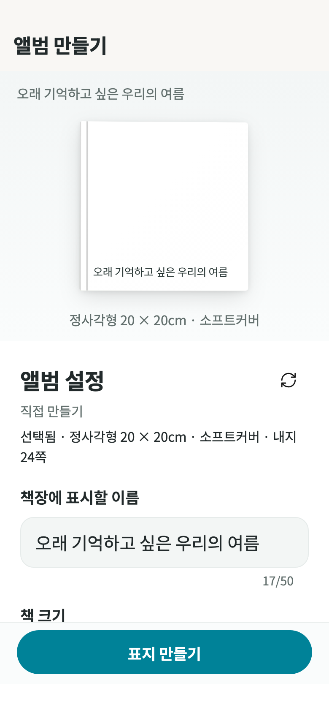
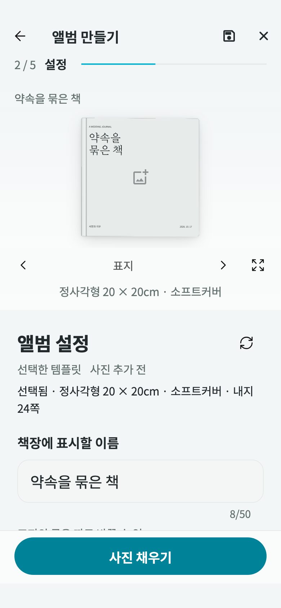
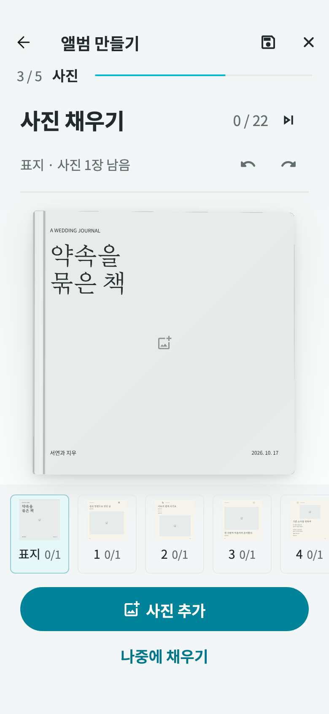

# 앨범 설정 — 현재 화면 점검과 시안 제안

2026-11-11, 한국 시간 기준. 앞서 적용한 제작 시작·디자인 목록 다음 단계다. **사용자가 선택한 2번과 업체 커버 설명·사진 제안을 승인하여 제품 소스에 반영했다. 아래 초기 점검과 시안 이력은 변경 전 근거다.**

## 최종 반영

- 최신 시각 기준: `/Users/devsheep/SnapFit/generated_images/exec-89eedb83-2a00-48eb-b57b-1aedba7014df.png`.
- 책장 이름 / 책 크기·커버 / 내지 중 한 번에 하나를 펼친다. 빈 이름이면 이름부터, 복원·템플릿 이름이 있으면 크기·커버부터 시작한다.
- 현재 문서 미리보기와 페이지 탐색·확대는 유지하고 중복 요약과 바깥 카드 여백을 줄였다. 다섯 크기를 기본 390px에서 한 줄로 비교하고, 큰 글자·좁은 폭에서는 줄을 바꾼다.
- 공식 120×120 커버 원본을 `assets/print/cover_types/`에 포함하고 원본 비율을 유지한다. 출처·해시는 `verification/album-settings-design-2026-11-11/supplier-cover-assets.json`에 기록했다.
- 커버 차이는 선택 카드의 두 줄 설명과 작은 `자세히 보기`로 나눴다. 주문 적용 안내는 작은 회색 글자로 표시한다. 미확정 면지·가격·두께·방수 보장은 추가하지 않았다.
- 표지 문구 수정은 책장 이름을 펼치면 제공한다. 실제 표지·서체·사진·크기별 문서를 임의의 시안 사진으로 교체하지 않는다.
- 큰 글자에서 항목을 펼친 후 제목이 화면 밖으로 밀리지 않도록 보정한다. 80쪽 초과 디자인의 진행 불가 이유는 접힌 내지와 관계없이 하단에 표시한다.
- 네이티브 실제 컴포넌트와 실제 제작 부모 여정을 검증한다. 전체 앱 빌드·브라우저 실행·운영 배포를 뜻하지 않는다.

## 검증 결과

83개 범위 테스트 통과, 실패0개. 실제 컴포넌트 캡처7개, 변경 범위13개 Dart 파일 분석 문제0개, 독립 소스 리뷰를 완료했다. 자세한 범위/한계와 로그는 `verification/album-settings-design-2026-11-11/validation.md`를 참조한다. 전체 앱 빌드·실기기·브라우저 확인·운영 배포는 미실행이다.

## 공급업체 설명 확인 후 문구 제안

사용자가 주문할 업체의 소프트/하드커버 툴팁을 제공했다. 이 자료가 앞선 일반적인 느낌 표현보다 우선한다. 아래 문구와 공식 커버 선택 사진을 최신 시안 및 제품 코드에 적용했다.

| 커버 | 선택 버튼 첫 줄 | 둘째 줄 |
| --- | --- | --- |
| 소프트커버 | 유연한 종이 표지 | 일반 책·잡지 같은 형태 |
| 하드커버 | 단단한 보드 표지 | 오래 간직하기 좋은 형태 |

업체 캡처는 소프트를 일반 책·잡지에 쓰이는 표지로, 하드를 하드보드와 인쇄 용지를 합지한 보관용 커버로 설명한다. 임의의 두께·무게 수치와 `가볍게 들고 보기` 같은 느낌 표현을 추가하지 않는다. 선택지에는 같은 책 아이콘보다 실제 주문 커버의 사진을 활용하는 방향을 제안한다. 기존의 작은 회색 `앨범 주문 시 적용` 안내는 유지한다.

`단면 인쇄`와 `앞쪽 면지: 흰색 모조 220g`은 별도 제작 사양이다. 선택 버튼에 모두 넣지 않고 자세한 안내와 주문 확인 영역으로 분리하는 방향이다. `단면`을 `앞표지만 인쇄`로 임의 해석하지 않는다. 프로젝트 기록은 PHBKMYB의 스노우 180g 이미지랩 방식이며, 개별 면지 사양은 실제 주문 옵션에 대조한 뒤 확정한다. 표지를 싸는 인쇄 용지와 면지의 종이 사양을 혼동하지 않는다.

공식 확인: https://www2.redprinting.co.kr/ko/product/item/PH/PHBKMYB — 종이커버/하드커버 이미지랩 구분과 재질 안내. 기존 연동 근거: `docs/print/vendors/redprinting/research-2026-09-08.md`, `tool/validate_supplier_quote_matrix.py`. 해당 페이지의 제품 구성은 확인했지만 동적 툴팁의 면지 문구까지 외부 조회에서 확인한 것으로 보고하지 않는다.

## 이전 수정 이력 — 업체 자료 확인 전

선택 방향은 최초 표시 순서 **2번**이다. 사용자는 후속 수정에서 커버 차이가 더 분명해야 하고, `실물`이라는 단어와 큰 안내 글자를 빼도록 요청했다. 기존 아코디언 구성을 유지한 단일 수정 시안이다.

- 기준 시안: `/Users/devsheep/SnapFit/generated_images/exec-729bd13b-2e9e-4822-ad39-b1c4c0ae8cf1.png`
- 앞선 안내 수정: `/Users/devsheep/SnapFit/generated_images/exec-8ca357a2-1e69-428b-8126-e4278691b7a5.png`
- 업체 자료 확인 전 수정 결과: `/Users/devsheep/SnapFit/generated_images/exec-9ba46d83-1a58-4574-b081-80ab63171d3c.png`
- 소프트커버: `얇고 유연한 표지` / `가볍게 들고 보기 좋아요`
- 하드커버: `두껍고 단단한 표지` / `탄탄한 책 느낌이에요`
- `커버 종류` 제목 오른쪽의 작은 회색 안내: `앨범 주문 시 적용`

큰 전체 폭 안내 문장과 청록색 굵은 강조를 없앴다. UI 문구에서 `실물`을 제거했다. 설명은 선택 버튼 안에서 두 줄로 비교하고, 커버 이름보다 작은 보조 글자로 표시한다. 터치 영역은 유지하면서 전체 본문·설명의 글자 위계를 차분하게 낮췄다. 표지 디자인/문구와 주문 시의 커버 종류를 구분한다. 코팅·방수·수명·가격·배송 보장은 추가하지 않는다. 이 이미지는 디자인 수정안이며 제품 코드 적용이나 주문 운영 검증을 뜻하지 않는다.

## 근거와 범위

- 공개 웹의 `/create`는 현재 앱 내 브라우저에서 로그인으로 이동했다. 로그인하지 않았으며 실제 계정의 설정 화면을 점검했다고 주장하지 않는다.
- 현재 Flutter 소스의 기존 제작 여정 테스트를 네이티브 엔진에서 새로 실행해 캡처했다. 전체 앱 빌드·서버·배포는 실행하지 않았다.
- `book-led complete creation presentation Size(390.0, 844.0) dark=false`, `real creation shell setup to photos and back Size(390.0, 844.0) dark=false` 두 실행이 통과했다. 로그: `verification/album-settings-design-2026-11-11/native-capture.log`.
- 논리 화면 390×844, PNG 780×1688, 2배 밀도. 실제 앱의 폰트·표지 렌더러를 사용했다. 테스트용 이름·문서·인증 대역을 썼으며 실제 사용자 앨범이나 운영 상태가 아니다.
- 이번 실행에서 저장한 캡처만 점검 근거로 썼다. 기존 제작 시작 이미지는 후속 시안의 시각적 연결을 위한 참고다.

## 확인한 화면

| 단계 | 관찰 화면 | 상태 | 근거 |
| --- | --- | --- | --- |
| 1 | 직접 만들기 설정 컴포넌트 | 기본 행동은 정상, 정보 위계 보완 필요 | `01-manual-settings.png` |
| 2 | 선택한 디자인의 설정 컴포넌트와 실제 제작 셸 | 보완 우선. 미리보기·요약이 설정 입력을 아래로 민다 | `02-template-example-settings.png`, `03-template-current-settings.png` |
| 3 | 설정에서 다음 사진 채우기로 이동 | 전환 정상. 사진이 없다는 상태와 다음 할 일이 구분된다 | `04-next-photo-fill.png` |

모든 파일은 `docs/verification/album-settings-design-2026-11-11/`에 있다. 예시 사진이 있는 컴포넌트 캡처와 사진이 지워진 실제 제작 셸의 캡처는 서로 다른 상태로 구분한다.

## 핵심 발견

1. **미리보기가 설정을 밀어낸다.** 1·2단계의 첫 화면 대부분을 책과 책 제목이 사용한다. 이름 아래에서야 `책 크기`가 시작하거나 화면 밖에 남는다. 설정 화면에서는 선택할 항목과 현재 값이 더 빨리 보여야 한다.
2. **선택한 규격이 반복된다.** 책 아래의 `정사각형 20×20cm · 소프트커버`와 설정 상단의 `선택됨 · … · 내지 24쪽`이 중복된다. 개별 선택 표시를 유지하면서 요약은 한 곳으로 모을 수 있다.
3. **책장 이름과 표지 글은 구분해야 한다.** 이름 입력은 명확하지만 실제 표지 제목과 같은 값으로 보이면 역할을 오해할 수 있다. 짧은 안내와 조건부 `표지 문구 수정`을 가까이 배치한다.
4. **디자인 변경·크게 보기의 뜻을 더 명확히 할 수 있다.** 새 시안에는 순환 화살표 대신 `디자인 변경` 텍스트, 대각선 펼침 아이콘 대신 돋보기/`크게 보기`를 제안한다.
5. **다음 행동은 잘 구분된다.** 직접 만들기는 `표지 만들기`, 디자인 선택 후에는 `사진 채우기`를 유지한다. 큰 중복 CTA를 추가하지 않는다.

접근성: 한글 라벨과 다음 행동은 읽기 쉽다. 반복 요약은 화면 읽기 순서를 길게 만들 수 있다. 원본 캡처는 130% 글자 설정의 테스트 상태다. 키보드·스크린리더·큰 글자 전체 준수·대비 수치를 이번 캡처만으로 판정하지 않는다. 새 시안은 터치 영역 최소 48px, 본문 14~16px를 기준으로 한다.

## 시안에서 유지할 실제 제약

- 책장 이름: 50자, 공백만 입력하면 다음 불가. 이름은 표지 문구와 별개다.
- 크기 5종: 정사각형 20×20 / 25×25 / 30×30cm, 가로형 20×15 / 25×20cm. 세로형을 새 선택지로 만들지 않는다.
- 소프트커버·하드커버를 크기와 별도로 선택한다.
- 내지: 표지 별도 20~80쪽, 2쪽 단위. 템플릿 내용을 임의로 줄이지 않는다. 추가 분량은 빈 페이지이고 그 구성은 쪽수 조절부에서 안내한다.
- 예시 기본값은 정사각형 20×20cm·소프트커버·내지 24쪽. 시안의 책 예시는 현재 사용자 사진으로 오해하지 않게 표시한다.
- 다음은 디자인 사용 시 `사진 채우기`, 직접 만들기 시 `표지 만들기`다.
- 디자인 변경·규격 변경 시 기존 제목·사진 보호, 임시 저장·복귀·한글 입력 조합·포커스 유지가 후속 구현 조건이다.
- 커버 종류만 바꾸는 동작과 실물 크기 변경을 구분한다. 표지 문구 변경이 다른 크기에서도 유지되어야 한다.
- 기존 앱의 밝은 종이색·청록색·한글 서체를 이어간다. 사진·책을 찌그러뜨리지 않는다. 대각선 화살표를 사용하지 않는다.

## 세 방향의 비교 목표

- **한눈에 설정:** 책 예시를 작게 두고 이름·크기·커버·쪽수를 한 화면에 정리한다. 비교가 빠르지만 책 감상 공간은 작다.
- **한 항목씩 펼치기:** 적당한 책 미리보기와 요약된 선택 행을 두고 편집 중인 항목만 펼친다. 한 화면의 복잡함을 줄이며 추가 탭이 필요하다.
- **책 미리보기 중심:** 책 한 권을 크게 보면서 아래의 간결한 설정 행을 수정한다. 앨범 느낌이 강하고 세부 선택은 별도 시트에서 한다.

이는 비교할 디자인 제안이다. 생성 결과의 화면 표시 순서가 최종 선택 번호의 기준이며, 사용자가 선택한 시안 전에는 제품 UI를 구현하지 않는다.

## 이번 표시 순서

번호는 생성 이미지가 대화에 실제 표시된 순서다. 이전 제작 시작 화면의 번호와 섞지 않는다.

| 표시 번호 | 방향 | 정확한 생성 결과 |
| --- | --- | --- |
| 1 | 한눈에 설정 | `/Users/devsheep/SnapFit/generated_images/exec-ab7458a6-9923-4355-9dba-0dfc3b6d9333.png` |
| 2 | 한 항목씩 펼치기 | `/Users/devsheep/SnapFit/generated_images/exec-729bd13b-2e9e-4822-ad39-b1c4c0ae8cf1.png` |
| 3 | 책 미리보기 중심 | `/Users/devsheep/SnapFit/generated_images/exec-3843c31f-e07f-459c-bb50-7a3d59d5a6af.png` |

세 이미지는 UI 배치 시안이며 실제 동작·접근성·페이지 최소값 통과를 증명하지 않는다. 후속 구현은 실제 원본 표지와 규격을 사용한다. 첫 시안의 24쪽 감소 버튼은 템플릿 최소값에서 비활성화해야 하고, 둘째 시안의 정사각형 크기 선택 그림은 세로로 보이지 않도록 1:1로 맞춰야 한다. 선택한 방향을 구체화할 때 이 세부 사항을 수정한다.
