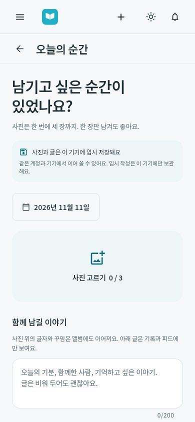
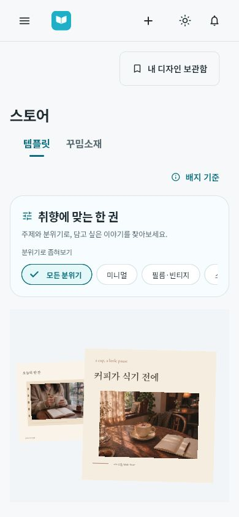

# SnapFit 전체 디자인 1차 점검 — 2026-11-11

> 후속 재점검: [현재 화면으로 확인한 우선 개선 3곳](verification/whole-ux-audit-2026-11-11/README.md). 아래는 초기 점검 기록이며 이미 수정된 항목과 미확인 가설을 포함합니다.

## 결론과 범위

현재 소스에는 제작·편집·협업·스토어·주문과 공통 디자인 기반이 이미 많이 구현돼 있다. 화면별 메시지, 주요 행동의 순서, 편집 조작의 공통성, 상태 표현을 먼저 맞추는 것이 적절하다. 이번 작업은 점검과 디자인 제안이며 제품 코드·서버 정책을 추가 변경하지 않았다.

**전체 실행 검증 완료를 뜻하지 않는다.** 13개 영역을 현재 코드로 1차 검토했다. 로그인된 Chrome의 모바일 크기(390×844)에서 첫 소식 안내, 웹 홈, 메뉴, 월간 기록, 기록 작성, 스토어를 확인했다. `/create` 이동은 전환 중 홈만 관찰됐고 브라우저 종료로 최종 화면을 확인하지 못했다. 이후 피드·마이·주문·편집기 실행 캡처도 확보하지 못했다. 앱 네이티브 홈과 웹 홈은 서로 다른 구현이므로 동일 화면으로 간주하지 않는다.

기존 golden과 10월 캡처는 참고 자료이며 현재 실행의 증거가 아니다. 초기 로딩 중 추천 상품이 빠진 스토어 캡처는 기각하고 로딩 후 캡처로 교체했다. 개인 앨범·사진이 보이는 캡처는 내부 검토에만 사용하고 이 문서에 포함하지 않는다.

## 유지할 확정 방향

- 홈은 매일 사진·한 줄 기록 → 이번 달 기록 축적 → 사용자가 사진을 골라 월간 앨범으로 엮는 흐름을 우선한다.
- 선택한 앨범 한 권을 크게, 아래에는 다른 앨범을 고르는 작은 썸네일을 둔다.
- 사진·편집 지면·책의 원래 비율을 보존한다.
- 이동은 대각선 화살표 대신 일반 꺾쇠·명확한 문구를 사용한다.
- 기록 보상은 KST 당일 사진, 달력 전체 날짜 완주 시 1,000P 월 1회다. 기존 출석·초대 혜택과 구분한다.
- 글 입력란의 메모와 사진 안의 글·꾸밈이 앨범에 반영되는 범위는 실제 기능과 맞게 안내한다.

## 이번 실행에서 확인한 단계

| 단계 | 화면 | 확인 결과 |
|---|---|---|
| 1 | 11월 돌아보기 소식 모달 | 월간 기록의 가치를 명확히 안내. 앱 전체 온보딩과는 다른 화면이다. 개인정보 없는 모달 부분만 캡처했다. |
| 2 | 로그인된 웹 내 앨범 홈 | 검색·상태 필터·앨범 목록·이어서 만들기 진입 확인. 네이티브 홈 및 미배포 변경과 구분한다. 개인 작품 캡처는 공개하지 않는다. |
| 3 | 전체 메뉴 | 공간/만들기/계정으로 구분된 탐색 확인. 명칭 통일 후보는 코드 기준으로 정리했다. |
| 4 | 나의 기록 | 날짜별 기존 기록·월 이동·새 기록 진입 확인. 개인 사진은 문서에 포함하지 않는다. 사진 선택이나 저장은 실행하지 않았다. |
| 5 | 오늘의 순간 작성 | 빈 입력·사진 선택·메모·임시 보관 안내 확인. 설명 밀도 개선 후보. 입력·업로드·저장·공개 동작은 수행하지 않았다. |
| 6 | 스토어 | 로딩 후 분위기·추천 책·소재·검색·주제·필터 위치 확인. 상품 탐색 우선순위 개선 후보. 구매는 수행하지 않았다. |
| 중단 | 앨범 제작 진입과 이후 화면 | 브라우저가 종료돼 최종 제작 화면과 이후 대상의 실행 검토는 완료하지 못했다. |

이번 화면 확인만으로 대비 수치, 키보드·스크린리더 동작, 큰 글자·가로·다크 테마의 접근성 적합성을 주장하지 않는다.

## 영역별 점검표

| # | 영역 | 검토 근거 | 상태와 개선 방향 |
|---|---|---|---|
| 1 | 온보딩·첫 홈 가이드 | 현재 코드 + 기존 단독 golden | 우선 개선. 기존 디자인 선택/첫 앨범 안내를 매일 기록과 월간 앨범 흐름에 맞춘다. 이번에 본 소식 모달은 월간 기록을 이미 안내하므로 서로 연결해야 한다. |
| 2 | 로그인·가입·인증·복구 | 현재 코드 | 소셜/이메일/동의·오류 복구 경로 존재. 최신 실행 화면과 키보드·오류 상태 검증은 남아 있다. |
| 3 | 홈·월간 기록 | 웹 실행 + 현재 네이티브 코드 | 확정한 네이티브 홈 방향 유지. 웹 홈의 앨범 작업공간과 별도인 점을 제품 의도에 맞춰 정리한다. 현재 배포 웹과 작업 중 앱 소스를 혼동하지 않는다. |
| 4 | 사진·한 줄 작성 | 현재 웹 실행 + 코드 | 우선 개선. 사진 선택 앞의 제목·설명·임시저장 안내·날짜 영역을 압축하고 주 행동을 앞당긴다. 현재 날짜 잠금 정책을 유지한다. |
| 5 | 월간 앨범 미리보기·엮기 | 현재 코드 | 사진 직접 선택과 편집 가능한 앨범 연결 존재. 자동 완성·자동 인쇄로 오인시키지 않는 설명을 유지한다. 실행 검증 필요. |
| 6 | 제작 시작·규격·사진 채우기 | 현재 코드 + 단독 golden | 단계 요약과 선택 상태를 공통화한다. `/create` 최종 진입은 이번 실행에서 미확인. |
| 7 | 표지·내지 편집 | 현재 코드 + 단독 golden | 우선 개선. 표지와 내지, 세로와 가로에서 같은 명령의 이름·위치·선택 상태를 일치시킨다. 실제 복잡한 문서 실행 검증 필요. |
| 8 | 앨범 리더·초대·멤버 | 현재 코드 | 큰 책·썸네일 구조 유지. 리더/초대와 멤버 관리의 웹 프레임·폭·헤더를 통일하는 후보. 현재 실행 미확인. |
| 9 | 스토어·템플릿·소재 상세 | 현재 웹 스토어 + 코드 | 상품 표지는 중요하게 유지하고 검색을 더 빨리 찾게 한다. 분위기·주제·추천·소재·가격 필터의 순서를 정리한다. 상세 최신 실행은 미확인. |
| 10 | 디자인 보관함·저장 작품 | 현재 코드 | ‘디자인 보관함’과 ‘저장한 기록·앨범’ 명칭을 고정해 구분한다. 최신 실행 미확인. |
| 11 | 피드·검색·작품·마이 | 현재 코드 + 과거 샘플 캡처 참고 | 개인 마이와 공개 프로필은 이미 분리돼 있다. 검색 입력·표면색·섹션 간격을 공통화하고, 공유앨범 미확인을 0개로 표시하는 경로를 정리한다. |
| 12 | 포인트·출석·초대 혜택 | 현재 코드 | 혜택 조건을 분리하고 포인트 내역의 적립/사용 용어를 통일한다. 남은 대각선 금액 아이콘은 +/− 등으로 교체하는 후보. |
| 13 | 인쇄·주문·설정·알림·지원 | 현재 코드 | 주문 단계·로딩/빈 상태/오류 처리는 이미 존재한다. 주문 가용 여부를 주소 작성 전에 요약하고 일반 문의 접수 후 확인·회신 경로를 명확히 한다. 운영 상태는 서버 readiness로 판단한다. |

## 우선 개선 사항과 근거

### A. 첫 경험과 서비스 중심 맞추기 — P1, 코드 관찰

온보딩의 ‘디자인부터 골라요’와 첫 홈 가이드의 제작 버튼 안내가 현재 확정한 기록 중심 홈과 다르다. 소개는 ‘오늘 한 장 → 한 달의 기록 → 나의 앨범’으로 연결하고 첫 동작은 사진 기록으로 안내하는 것을 제안한다.

- `lib/features/onboarding/presentation/app_introduction_screen.dart:246`
- `lib/features/onboarding/presentation/widgets/first_home_guide.dart:154`
- 실제 소식 모달은 월간 기록을 안내한다. 이 모달을 현재 온보딩 전체의 증거로 확대하지 않는다.

### B. 기록 작성의 설명 밀도 줄이기 — P1, 실행 화면 관찰

현재 작성 화면은 제목·설명·임시 보관 안내·날짜 뒤에 사진 선택이 나온다. 주 행동인 사진 선택을 헤더 바로 아래에 배치하고, 기기 보관 설명은 작은 한 줄과 상세 안내로 정리하는 것을 제안한다. 날짜는 고정된 서버 기준 날짜로 표시하며 사진 1~3장·선택 공개·200자 메모의 실제 조건을 보존한다.

### C. 편집기 공통 명령 정리 — P1, 코드 관찰에서 도출한 UX 가설

표지는 atelier 액션 바와 떠 있는 레이어 패널, 내지는 컨텍스트 도크/가로 메뉴를 사용한다. 사진 교체·글 수정·꾸미기·레이어·되돌리기 같은 명령은 같은 이름과 상태 표현을 갖게 하되, 책/사진의 지면과 비율을 바꾸지 않는다.

- `lib/features/album/presentation/views/add_cover_screen.dart:439`
- `lib/features/album/presentation/views/page_editor_screen.dart:1285`
- 현재 대표 golden은 단순 fixture이므로 실제 사진과 복잡한 페이지의 시각 품질을 증명하지 않는다.

### D. 스토어 탐색 우선순위 정리 — P2, 실행 화면 + 코드

스토어는 보관함 진입·탭·분위기 패널·추천 책·소재·검색·주제·필터·목록으로 여러 탐색 장치가 이어진다. 검색과 주제 한 줄을 상단에 두고 분위기·가격 등은 보조 필터에 묶는 방향을 제안한다. 추천 책은 원본 비율과 감상 공간을 유지한다.

- `lib/features/store/presentation/widgets/store_design_discovery.dart:37`
- `lib/features/store/presentation/views/store_screen.dart:967`

### E. 공통 표현·상태 정리 — P2, 코드 관찰

- 소셜 `SocialTheme`과 `SocialStyle`이 paper/line 색을 따로 정의한다. 의미 토큰으로 통합하는 후보: `social_theme.dart:13`, `social_widgets.dart:16`.
- 구매/보유 디자인과 저장 작품의 보관함 명칭을 고정한다: `store_hub_screen.dart:243`, `social_profile_personal_area.dart:241`.
- 공유앨범 로딩·오류를 빈 배열로 치환한 뒤 0개로 표시하는 경로를 구분한다: `social_profile_personal_area.dart:167`, `:306`.
- 포인트 내역의 대각선 적립/차감 아이콘은 사용자 선호와 다르다: `billing_management_screen.dart:772`.
- `open_in_full` 확대 아이콘 3곳은 대각선형 대신 모서리형 확대 아이콘+문구로 정리하는 후보다. 이는 일반 화면 이동 화살표와 별개인 잔여 확대 조작이다.

### F. 주문·문의의 다음 단계 명확화 — P2, 코드 관찰에서 도출한 UX 가설

- 인쇄 미리보기의 ‘배송지 입력하기’ 근처에서 현재 주문 가능/추가 확인 필요 상태를 먼저 요약한다. 실제 상태는 서버 값이며 임의의 판매 가능 상태를 만들지 않는다: `print_order_preview_screen.dart:954`.
- 일반 문의 성공 후 snack 안내와 닫기로 끝나는 흐름에 확인/회신 위치를 명시한다. 주문 문의는 별도 상태 조회가 있으므로 고객지원 전체가 미구현이라는 뜻은 아니다: `support_inquiry_screen.dart:141`, `support_inquiry_repository.dart:14`.

## 공통 디자인 방향 제안

이미 구현된 공통 위젯을 활용한다. NotoSans와 기존 청록색을 유지하고 제목/섹션/본문/보조 문구 4단계, 본문 여백 20px·섹션 간격 24px, 주요 터치 영역 48px, 컨트롤/정보 표면 2종의 라운드를 기준으로 일치시킨다. 사진과 책을 중심에 두고 설명 카드·안내 배너의 중첩을 줄인다. 이런 수치는 제안 기준이며 이미 모든 화면에 적용됐다고 주장하지 않는다.

## 다음 디자인 제안

전체 점검 다음의 첫 시안 대상은 사용 빈도가 높은 ‘오늘의 순간 작성’ 화면이다. 같은 날짜·사진 선택 전·비공개 기본 상태에서 세 가지 구조를 비교한다. 기존 홈과 큰 앨범/하단 썸네일 방향은 변경하지 않는다. 새 이미지들은 구현 결과나 실제 계정 화면이 아닌 디자인 제안이다.

## 미확인 범위

- 네이티브 앱의 최신 전체 실행 화면, 실제 기기 사진 선택·권한·키보드, 복잡한 편집 문서, 가로/다크/큰 글자 전 화면.
- `/create`의 최종 진입 상태, 리더·멤버·초대의 실행 연속성, 마이·피드·결제·주문 상세의 현재 실행 상태.
- 이미지의 실제 대비 수치·스크린리더/키보드·접근성 전체 적합성.
- 브라우저 종료 이후 추가 캡처는 하지 않았다. 테스트·앱 빌드·운영 변경도 하지 않았다.
