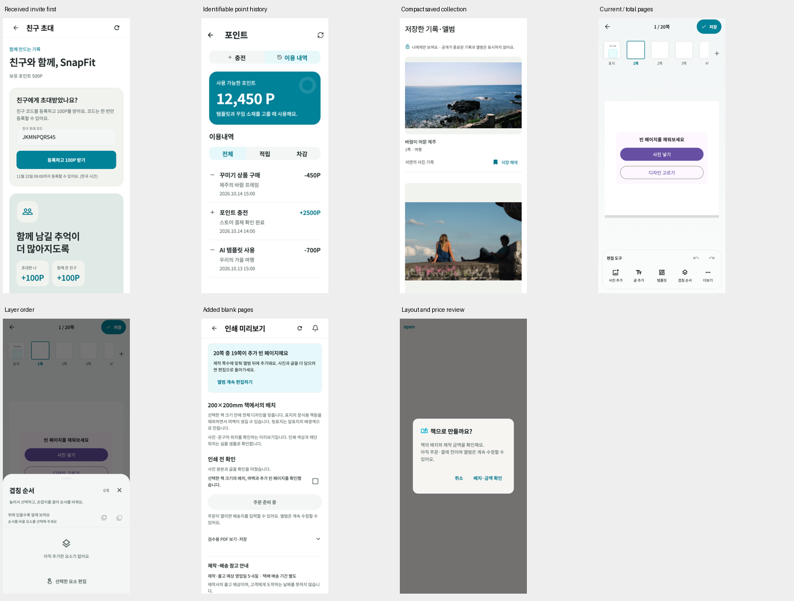

# 승인된 UX 개선 적용 결과 — 2026-11-16

앱 코드의 요청 항목을 모두 반영했다. 후속 사용자 승인으로 AI 제목 보존 SQL도 SnapFit 운영 DB에 적용했다. 운영 함수 본문·실행 권한·마이그레이션 기록을 확인했다.

## 반영 내역

| 요청 | 결과 |
|---|---|
| 받은 초대의 등록 우선 | 유효한 받은 코드가 있고 등록 가능한 경우 등록 카드·기한을 먼저 보여준다. 일반 진입·자기 코드·잘못된 코드·기간 종료는 기존 순서를 유지하며, 수동 입력 중 카드가 이동하지 않는다. |
| 포인트 사용처 | 기존 원장의 metadata.title을 조회해 구매 상품명·생성 AI 템플릿명을 표시한다. 금액은 오른쪽에 정렬한다. 없는 제목·잘못된 타입·무관한 적립 메타데이터는 기존 안내를 유지한다. 추가 항목별 서버 조회는 없다. |
| 저장 목록 상단 | 모바일 중복 제목·소개를 없애고 비공개·공개 종료 안내를 짧게 유지했다. 큰 이미지·비율은 보존했다. 웹 본문 제목은 유지한다. |
| 저장 해제 복구 | 성공 알림에 되돌리기 제공. 계정·화면 생명주기·요청 중복을 가드하고 복구 실패를 안내한다. 연속 해제 시 안내를 즉시 교체해 이전 계정 알림이 대기열에 남지 않는다. |
| 편집기 쪽수 | 모바일 내지를 현재 / 전체 형식으로 표시한다. 1 / 20쪽, 20 / 20쪽, 페이지 추가 후 21 / 22쪽을 검증했다. 표지는 표지로 표시한다. |
| 빈 페이지 안내 | 제작 구성 옆에 전체 중 추가되는 빈 페이지 수를 강조하고 앨범 계속 편집하기를 가까이 배치했다. 기존 edit_album 반환 경로를 공유하며 인쇄 쪽수 정책은 바꾸지 않았다. 추가 빈 페이지가 없으면 강조 카드를 표시하지 않는다. |
| 도구·인쇄 문구 | 실제 레이어 도구를 겹침 순서로 통일하고, 현행 인쇄 진입 확인창은 배치·금액 확인으로 변경했다. 다음 화면 설명을 짧게 줄이면서 아직 주문·결제 전이고 편집 가능함을 유지한다. |

## 검증

- 관련 네이티브 테스트 **219개 통과**, 웹 전용 1개 제외. 서버 SQL 회귀 **17개 통과**. 별도 화면 캡처 사례 9개 통과.
- 컴파일 오류 0. 변경 Dart 30파일 정적 분석 오류·경고 0, 기존 createState 관련 정보 수준 안내 1개. 해당 createState 코드는 이번 변경 대상이 아니다.
- 쪽수 표시·추가, 빈 페이지 편집 복귀 및 주문/PDF 미생성, 받은 코드 우선순위, 원장 필터·페이지네이션·계정 전환, 저장 해제/복구 실패·늦은 응답·연속 알림을 확인했다.
- 편집기/도구 기준 이미지 3장을 새 문구로 갱신하고 실제 LocalFileComparator로 재비교했다. 새 캡처도 직접 확인했다.
- 독립 리뷰에서 연속 해제 알림 큐 문제를 찾아 수정했고, 재검토에서 추가 차단 문제가 없었다.
- Flutter SDK 캐시/소켓 제약 때문에 직접 flutter_tester로 직렬 실행했다. 편집 패널 캡처 대역은 이미 요청된 이미지의 fake-clock 대기를 피하도록 임시 테스트 복사본의 대기만 조정했다. 제품 코드를 테스트 환경 때문에 변경하지 않았다.
- 검증 중 초대 입력 우선순위·저장 해제 버튼의 뷰포트 대기·페이지 최소 수·페이지 추가 화면 갱신·캡처용 파일 import/폰트 대기 문제를 수정하고 재실행했다. 최종 로그와 오류 0 커널 결과를 보관했다.

## AI 제목 보존 SQL 및 운영 상태

`supabase/migrations/20261115162020_point_ledger_ai_title_snapshot.sql`을 추가했다. 기존 서버 검증·락·금액·멱등성·권한을 유지하고, 서버 생성 결과에 있는 실제 템플릿 제목만 metadata에 보존한다. 남아 있는 과거 생성 결과는 같은 소유자·draft만 제목을 보강하며 기존 제목·금액·잔액은 변경하지 않는다. 이미 삭제된 생성 결과는 복구 근거가 없어 일반 안내를 유지한다.

이전 작업에서는 운영 집계 조회가 자동 승인 검토에서 거절돼 적용을 보류했으나, 사용자의 명시적인 운영 적용 승인 후 준비된 SQL을 적용했다. 운영 지갑·원장 집계는 재조회하지 않았다.

운영 마이그레이션 `20261115162020`의 적용 성공과 이력 기록을 확인했다. 운영 함수 본문이 로컬 검증 SQL과 정확히 일치하고, 빈 search_path와 기존 익명 실행 금지·인증 사용자 실행 허용이 유지된다. 운영 함수 자체를 실행해 실제 포인트를 차감하는 검증은 하지 않았다. 유료·무료·멱등성·백필 범위 등 서버 회귀 17개를 다시 통과했다.

운영 적용 도구가 부여한 버전에 맞춰 로컬 SQL 파일명과 서버 테스트 참조를 동기화했다. SQL 내용의 SHA-256은 승인·리뷰한 값과 같다. 서버 보안 진단도 확인했다. 인증된 사용자용 SECURITY DEFINER RPC 안내는 기존 속성으로, 이번 변경에서 실행 권한을 넓히지 않았다. 그 외 프로젝트 진단은 이번 변경 범위 밖이므로 변경하지 않았다. 세부 검증 상태는 `deployment.json`에 기록했다.

## 범위와 한계

사진·포인트·코드·가격·거래는 로컬 가상 데이터다. 인쇄 캡처는 주문 준비 중 대역이며 운영 주문 가능 여부나 실제 견적을 검증한 것이 아니다. 실기기·웹 브라우저 전체 흐름·스크린리더·실제 결제/구매 복원·공유 발송·인쇄 주문을 실행하지 않았다. 앱 전체 빌드·앱 배포·커밋은 하지 않았다. 서버 SQL만 승인된 범위로 운영 적용했다.
