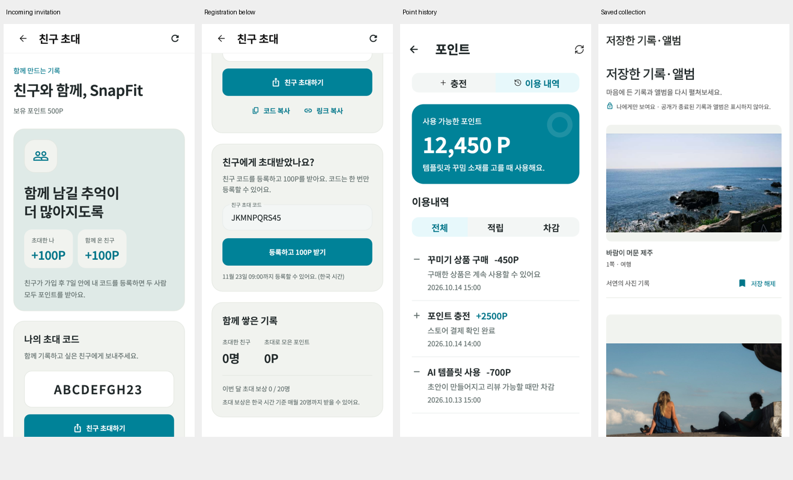

# SnapFit 추가 UX 검토 — 2026-11-16

앞선 편집기·인쇄 검토와 별개로 포인트, 친구 초대, 저장한 기록·앨범을 확인했다. 이번에는 제품 코드 수정 없이 현재 위젯과 로컬 데이터를 재현했다.

## 개선 우선순위

| 순위 | 대상 | 확인한 문제 | 제안 |
|---|---|---|---|
| 1 | 초대 링크로 진입 | 친구 코드가 자동 입력돼도 첫 화면에는 혜택 설명과 **내 초대 코드**가 먼저 보인다. 받은 코드 등록은 아래로 내려가야 보인다. | 유효한 친구 코드를 받은 경우 등록 카드와 기한을 먼저 보여주고, 직접 친구를 초대하는 영역은 뒤에 배치한다. |
| 2 | 포인트 사용 내역 | `꾸미기 상품 구매 -450P`와 일반적인 사용 안내만 보이며 어떤 상품을 샀는지 알 수 없다. AI 사용도 대상 앨범이 표시되지 않는다. | 제공 가능한 상품명·앨범명을 내역에 추가한다. 금액을 일정한 오른쪽 열에 정렬해 내역 비교도 쉽게 한다. |
| 3 | 저장한 기록·앨범 | 앱바와 본문에 같은 제목이 반복되고 소개·공개 안내가 이어져 첫 콘텐츠 진입을 늦춘다. | 모바일은 앱바 제목 하나로 정리하고 소개를 줄인다. 비공개 보관함 안내는 짧게 유지한다. 작품 사진의 비율과 큰 미리보기는 보존한다. |
| 4 | 저장 해제 | 카드마다 `저장 해제`가 있고, 성공하면 목록 갱신으로 항목이 빠지는 코드다. 이 화면에 되돌리기 동작은 없다. | 해제 성공 시 잠시 `저장을 해제했어요 · 되돌리기`를 제공한다. 반복 확인 팝업을 추가할 필요는 없다. |

## 1. 받은 초대를 처리하는 동선부터 보여주기

390×844 화면에서 링크의 친구 코드 `JKMNPQRS45`는 입력란에 정상 반영됐다. 그런데 첫 화면에는 혜택 설명과 본인 코드 `ABCDEFGH23`가 먼저 나오고, 등록 버튼은 보이지 않았다. 자동 입력 실패가 아니라 **목적에 맞는 정보 순서** 문제다.

- 근거: [링크 진입 첫 화면](referral-incoming-link.png), [아래쪽 등록 영역](referral-incoming-entry.png).
- 제안: 등록 가능한 받은 코드가 있을 때에만 등록 영역을 위로 올린다. 입력 기한과 실제 제공 혜택을 함께 보여준다. 코드가 없는 일반 진입은 초대하기 중심으로 유지할 수 있다.
- 등록 불가·이미 혜택을 받은 상태에서는 사용할 수 없는 입력 영역을 올리지 않는다. 보상량·등록 기간·월 한도는 서버 정책을 그대로 따른다.
- 코드 근거: `referral_screen.dart`의 `_content`(436행), reward/share 배치(480행), `ReferralRedeemCard` 배치(515행).

## 2. 포인트를 어디에 썼는지 확인 가능하게

현재 제목과 부연 설명은 거래 종류에 따른 고정 문구다. 여러 상품을 구매하면 이름이 같은 내역이 쌓여 사용자가 구매를 식별하기 어렵다. 이는 실제 문의 건수 측정 결과가 아니라 현재 표시 정보에 기반한 사용성 판단이다.

- 근거: [이용 내역](points-history-390-light.png), [차감 필터](points-history-spent-390-light.png).
- 제안: 구매 당시 상품명이나 연결된 앨범 제목을 제공하고, 제목을 제공할 수 없는 기존 항목은 현재의 일반 문구로 표시한다. 금액은 일정한 끝 위치에 배치하되 큰 글씨에서는 줄바꿈을 허용한다.
- 구현 범위: 현재 `PointLedgerEntry`에는 관련 대상 종류·ID만 있고 상품명 필드가 없다. 대상 정보 조회 또는 서버 응답 보강이 필요한지 먼저 확인해야 한다. 단순 문구 변경만으로 완료할 항목은 아니다. 목록 항목마다 별도의 서버 요청을 보내는 구현은 피한다.
- 코드 근거: `billing_repository.dart`의 `PointLedgerEntry`(123행), title/subtitle(157·174행), `billing_management_screen.dart`의 `_ledgerRow`(805행).

## 3. 보관함 상단의 반복 줄이기

저장 목록의 밝은·어두운 테마 모두 앱바와 본문 제목이 중복된다. 작품 이미지 자체를 줄이기보다 상단 설명을 압축하는 편이 SnapFit의 사진 중심 방향에 맞는다.

- 근거: [모바일 밝은 화면](saved-gallery-phone-light.png), [어두운 화면](saved-gallery-phone-dark.png).
- 제안: 모바일 중복 제목 제거, 설명 축약, 보관함의 비공개 성격을 짧은 안내로 유지한다. 공개가 종료된 작품이 표시되지 않는다는 설명은 도움말 등에서 확인 가능하게 남긴다.
- 데스크톱 캡처는 네이티브 위젯의 넓은 뷰포트 확인이며 실제 웹 브라우저 검증은 아니다. 웹의 독립적인 본문 제목은 모바일과 구분해 판단한다.
- 코드 근거: `social_saved_works_screen.dart`의 앱바(104행 부근), `_heading`(273행).

## 4. 저장 해제 실수에서 바로 회복하기

카드의 저장 해제는 원본 기록 삭제가 아니라 내 보관함에서 빼는 작업이다. 위험을 과장해 매번 확인 창을 띄울 필요는 없지만, 목록에서 사라진 뒤 바로 복구하는 길은 있으면 좋다.

- 근거: 카드의 [저장 해제 버튼](saved-gallery-phone-light.png), `_removeSaved`의 성공 경로(45행). 저장 해제 서버 요청은 이번 검토에서 실행하지 않았다.
- 제안: 성공 피드백과 일시적인 되돌리기를 제공한다. 복구 작업 중 계정이 바뀌거나 원작 공개가 종료된 경우도 기존 계정 보호·오류 처리를 유지한다.

## 검증 범위와 제한

- 합계 **7개 로컬 캡처·상태 확인 사례 통과**: 포인트 3, 초대 3, 저장 목록 1. 저장 목록 사례는 밝은 모바일·넓은 화면·어두운 모바일을 순서대로 확인했다.
- 포인트는 390×844 및 844×390, 글씨 배율 1.0·1.3 사례를 확인했다. 초대는 390×844에서 등록 가능·기간 종료·링크 코드 진입 상태를 확인했다. 이 범위의 실행 로그에서 테스트 실패나 렌더 예외는 없었다.
- 앱 제품 위젯과 기존 테스트의 메모리 저장소·로컬 사진을 사용했다. 초대 코드·금액·날짜·잔액·거래는 가상 데이터이며 현재 운영 가격이나 사용자 계정 상태를 의미하지 않는다.
- 실제 결제, 구매 복원, 코드 등록, 메시지 공유·발송, 저장 해제 요청은 실행하지 않았다. 전체 접근성 감사나 실기기·운영·웹 E2E 검증을 완료한 것은 아니다.
- 캡처용 테스트에서 파일 읽기를 실시간 비동기로 대기하도록 조정하고 캡처 경계를 추가했다. 최초 캡처 도구 오류를 수정한 후 재실행한 최종 로그를 보관했다. 제품 코드·결제 정책은 변경하지 않았다.
- 앱 전체 빌드·배포는 실행하지 않았다.
