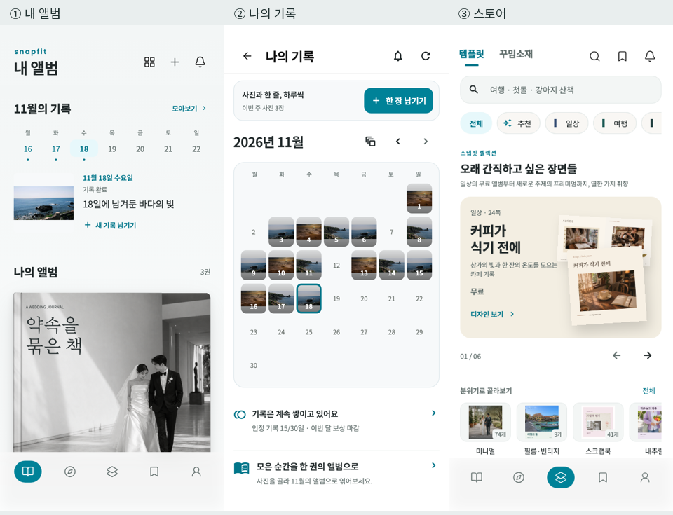

# 다음 디자인 개선사항 — 2026-11-15

현재 코드의 실제 Flutter 위젯과 번들 폰트·사진으로 새로 캡처했다. 화면 데이터와 계정·상품 응답은 로컬 대역이며 운영 사용자 화면이나 실제 가격 응답을 뜻하지 않는다. 이번 작업은 검토이며 제품 코드는 수정하지 않았다.

## 다음 수정 우선순위

| 순위 | 확인한 화면 | 문제와 제안 |
| --- | --- | --- |
| 1 | 01·02·04 하단 메뉴 | 내 앨범·피드·스토어·내 디자인·마이가 아이콘으로만 표시된다. 특히 레이어·책갈피 아이콘은 이름을 모르면 구분하기 어렵다. 현재 5개 메뉴와 선택 색을 유지하면서 짧은 이름을 항상 표시하는 것을 권한다. 작은 화면·큰 글씨에서 터치 영역과 본문 가림도 함께 확인해야 한다. |
| 2 | 04·05 스토어 주제 선택 | 주제가 바뀌어도 기획전과 분위기 영역이 상품 목록보다 먼저 나온다. 현재 카테고리 선택은 상단으로 이동하도록 구현돼 있으며, 캡처 시에도 실제 상품 목록까지 추가 스크롤했다. 전체 탐색의 기획전은 유지하되, 특정 주제를 고른 뒤에는 해당 상품 목록으로 이동하거나 추천 영역을 축약하는 것이 좋다. 필터 자체의 오작동을 확인한 것은 아니다. |
| 3 | 01·03 기록 작성 버튼 | 홈의 기록 완료 상태에는 `새 기록 남기기`, 나의 기록에는 `한 장 남기기`가 표시된다. 둘 다 새 작성 진입이므로 기록이 있는 날에는 `오늘 한 장 더`처럼 추가 행동임을 같은 말로 안내하는 것이 명확하다. 기존 기록 수정으로 동작을 바꾸는 제안이 아니다. |
| 4 | 03 월 제목 옆 겹친 사각형 아이콘 | 코드상 `이번 주 돌아보기`인데 화면에는 아이콘만 보여 복사·보기 방식 전환처럼 읽힐 수 있다. 짧은 `이번 주` 라벨을 붙이거나 달력 아래에 `이번 주 돌아보기` 행으로 옮기는 것을 권한다. 기존 44×44 터치 영역은 유지한다. |

## 화면별 확인 결과

1. **내 앨범 — 기본 배치 유지, 메뉴 명확화 권장.** 주간 달력·오늘 기록·큰 앨범의 순서와 사진 비율이 자연스럽다. 큰 표지를 줄이거나 전체 월 달력을 다시 넣을 이유는 보이지 않는다. [390 화면](screens/01-home.png)
2. **작은 홈 — 스크롤 구조 유지.** 320×568에서는 앨범 표지가 첫 화면 아래에 있다. 오늘 기록이 먼저 보이는 결과이며 이 사실만으로 잘림 오류라고 판단하지 않는다. 하단 메뉴 이름을 추가할 때 이 크기를 함께 검증해야 한다. [320 화면](screens/02-home-compact.png)
3. **나의 기록 — 달력 구조 유지, 행동 이름 보강.** 전체 달력과 월 보상·앨범 만들기 진입은 구분된다. 작성 버튼의 표현과 주간 돌아보기의 발견성을 다듬는 것이 다음 작업이다. [기록 화면](screens/03-record.png)
4. **스토어 첫 화면 — 현재 시각 방향 유지.** 잡지형 기획전, 실제 표지·내지, 검색과 주제 칩의 구분은 좋다. 첫 탐색 화면의 전면 재설계 근거는 없다. [첫 화면](screens/04-store.png)
5. **스토어 여행 선택 — 결과 도달 동선 개선 권장.** 선택된 여행 주제·무료/유료·최신순·개수가 보인다. 추천과 분위기를 거쳐 결과까지 내려오는 길이는 줄일 여지가 있다. [필터 후 목록](screens/05-store-filtered.png)
6. **설정 — 현재 구성 유지.** 계정·테마·알림·안전·고객센터·사용 가이드·약관이 구분돼 있다. 이번 캡처에서는 큰 배치 변경이 필요한 문제를 발견하지 못했다. 독립 설정 화면 캡처이며 실제 마이 탭 전체 여정을 확인한 것은 아니다. [설정](screens/06-settings.png)
7. **알림 — 현재 배치 유지, 실제 분류 동작은 미검증.** 읽음 상태와 날짜·설명·진입 화살표가 있다. 이 화면의 목록은 고정 대역이므로 선택된 분류와 알림 종류의 일치 여부를 평가하지 않았다. 실제 알림 수신·필터·목적지 진입의 정상 여부는 별도 확인이 필요하다. [알림](screens/07-notifications.png)

## 근거와 한계

- 새 캡처 7장, 네이티브 캡처 시나리오 5건 통과. 홈은 390×844·320×568, 나머지는 390×844의 라이트 화면이다. 전체 회귀 테스트 통과를 뜻하지 않는다.
- 스토어의 초기 로딩·스켈레톤 이미지는 채택하지 않았다. 실제 표지·분위기 사진·상품 사진의 로딩이 끝난 파일을 다시 캡처하고 확인했다. 캡처 대기만 보완했으며 앱의 로딩 코드는 바꾸지 않았다.
- 홈과 기록 날짜는 기존 로컬 fixture인 2026-11-18이다. 실제 오늘의 사용자 기록이나 보상을 뜻하지 않는다.
- 하단 메뉴의 Semantics와 주간 돌아보기 Tooltip은 이미 있다. 이번 제안은 시각적 발견성 개선이며 스크린리더 레이블 누락으로 판단하지 않는다.
- 실기기·OS 키보드·큰 글씨·다크 모드·색 대비 수치·스크린리더·실제 서버 흐름은 이번에 검증하지 않았다. 접근성 전체 적합성을 주장하지 않는다.
- 앱 전체 빌드·서버 실행·배포·실제 가입·초대·기록 저장·문의·주문·결제는 하지 않았다. 캡처 중 이동은 로컬 대역 안에서만 수행했다.

추천하는 다음 작업 묶음은 **1번 하단 메뉴 이름과 2번 스토어 결과 접근성**이다. 이후 3·4번 기록 문구와 주간 돌아보기를 함께 정리하면 된다.
