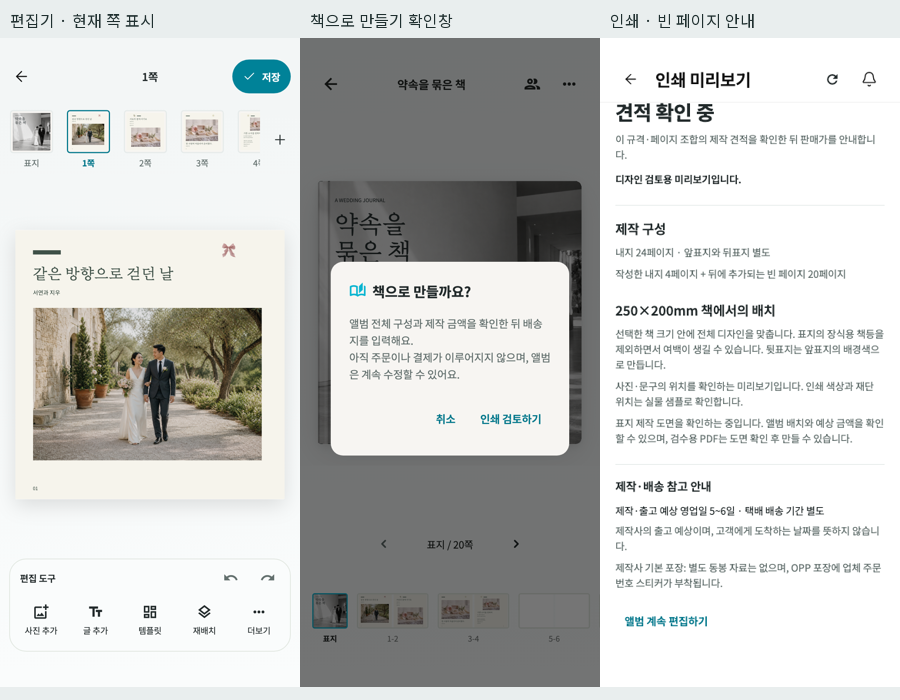

# 편집기·인쇄 연결 화면 후속 검토 — 2026-11-16

직전 2·3·4번 수정 이후, 현재 코드의 실제 Flutter 위젯으로 편집기와 인쇄 연결 화면을 새로 캡처했다. 이번 작업은 다음 개선 대상을 고르는 읽기 전용 검토다. 제품 코드를 수정하지 않았으며 하단 메뉴도 유지했다.

## 다음 개선 우선순위

| 우선순위 | 화면에서 확인한 점 | 권하는 변경 |
| --- | --- | --- |
| 우선 | 모바일 편집기 상단에는 `표지` 또는 `1쪽`만 있고 전체 내지 수가 없다. 상단 썸네일은 가로로 일부만 보인다. | 기존 배치와 큰 캔버스를 유지하면서 `1 / 20쪽`처럼 현재·전체 쪽수를 함께 표시한다. 웹 편집기는 이미 현재/전체 쪽수를 사용한다. 읽기 화면의 쪽수 표시를 다시 바꾸자는 제안이 아니다. |
| 우선 | 제작 구성의 `작성 내지 4페이지 + 뒤에 추가되는 빈 페이지 20페이지`가 일반 작은 설명과 같은 위계다. | 빈 페이지가 추가될 때 가격·제작 구성 가까이에 `24쪽 중 20쪽이 빈 페이지예요`를 먼저 강조하고 기존 `앨범 계속 편집하기` 행동을 가까이 둔다. 의도한 빈 페이지를 강제로 막거나 최소 제작 쪽수 정책을 바꾸지 않는다. |
| 다음 | 편집 도구의 `재배치`는 사진 배치나 페이지 순서 변경으로도 해석될 수 있다. 실제로는 레이어의 앞뒤 순서를 바꾸는 도구다. | `겹침 순서`처럼 기능을 직접 설명하는 이름을 검토한다. 추가 도구의 `레이아웃`과 기존 조작은 유지한다. |
| 다음 | 주문 진입 확인창의 `인쇄 검토하기`는 다음 화면에서 무엇을 확인하는지 추상적이고, 설명이 길어 `배송지를` 같은 단어도 줄 중간에서 갈라진다. | `배치·금액 확인`처럼 다음 행동을 구체적으로 표시하고 안내를 짧게 다듬는다. 아직 주문·결제가 아니며 앨범을 계속 수정할 수 있다는 안내는 보존한다. |

## 화면별 확인

1. **표지 편집 — 유지.** 실제 공개 웨딩 템플릿의 사진·폰트로 큰 편집 지면과 상단 페이지 목록, 하단 편집 도구가 분리돼 있음을 확인했다. 이 구조를 전면 개편할 근거는 없다. [화면](screens/01-editor-cover.png)
2. **내지 편집 — 쪽수 안내 보완.** 1쪽으로 직접 이동한 상태를 캡처했다. 현재 쪽은 강조되지만 전체 내지 수가 헤더에서 보이지 않는다. [화면](screens/02-editor-inner.png)
3. **추가 도구 — 배치 유지.** 꾸미기·레이아웃·배경의 이름과 설명이 있어 선택 방향은 명확하다. 다만 하단 `재배치`와 페이지 `레이아웃`의 개념을 이름으로 더 구분할 여지가 있다. [화면](screens/03-editor-more.png)
4. **실제 주문 진입 확인창 — 문구 보완 후보.** 현행 코드에서 앨범 읽기 화면은 이 확인창을 거쳐 인쇄 미리보기로 연결된다. 로컬 읽기 화면 위에 실제 확인창 함수를 열어 캡처했다. 주문 진행 버튼은 누르지 않았다. [화면](screens/04-print-confirmation.png)
5. **인쇄 미리보기·주문 준비 중 상태 — 구성 확인.** 표지와 이동 버튼, 규격, 제작 구성을 확인했다. 공급한 대역은 판매 견적이 아직 확정되지 않은 상태라 결제 가능한 화면의 검증을 뜻하지 않는다. 대역 문구 `디자인 검토용 미리보기입니다`는 실제 사용자 문구의 문제로 판단하지 않았다. [화면](screens/05-print-preview-preparing.png)
6. **인쇄 상세 — 빈 페이지 안내 보완.** 아래로 이동해 작성 4쪽과 추가 빈 페이지 20쪽, 제작·배송 설명을 확인했다. 빈 페이지 구성은 로컬 예시이며 실제 고객 앨범을 뜻하지 않는다. [화면](screens/06-print-details.png)

## 근거와 한계

- 현재 실행의 새 캡처 6장과 네이티브 캡처 시나리오 5건 통과가 근거다. 과거 이미지를 현재 화면 근거로 재사용하지 않았다.
- 편집기·읽기 배경은 실제 번들 웨딩 디자인의 로컬 계정/앨범 대역이고, 인쇄 화면은 별도의 테스트 앨범·견적 대역이다. 같은 실제 앨범의 저장부터 주문까지 연속 수행한 것이 아니다.
- 390×844 라이트 화면만 캡처했다. 작은 화면·큰 글씨·다크 모드·실기기·스크린리더·색 대비 수치·실제 저장·서버 견적·PDF 생성·결제·배송은 이번 범위에서 검증하지 않았다.
- `AlbumFrozenScreen`은 현재 제품 호출 경로에서 찾지 못해 개선 근거에서 제외하고, 실제 읽기 화면에서 쓰는 `AlbumCompletionConfirmation`을 확인했다. 파일 이름만 보고 옛 화면을 현행 흐름으로 판단하지 않았다.
- 통신 없는 네이티브 실행용 대역에서 이미지를 먼저 로드한 뒤 캡처했다. 초기 이미지 대기 시간 초과가 있었으나 최종 실행은 5건 모두 완료됐다. 최종 커널 컴파일 오류는 0건이다.
- 표지/내지 선택과 도구 열기, 인쇄 상세 스크롤만 수행했다. 앱 전체 빌드·운영 데이터 변경·저장·갤러리·파일 내보내기·실제 주문·배포는 하지 않았다.

다음 수정은 **편집기 전체 쪽수와 빈 페이지 요약 안내**부터 진행하는 것을 권한다. 큰 캔버스와 현재 편집 도구 구조는 유지한다.
