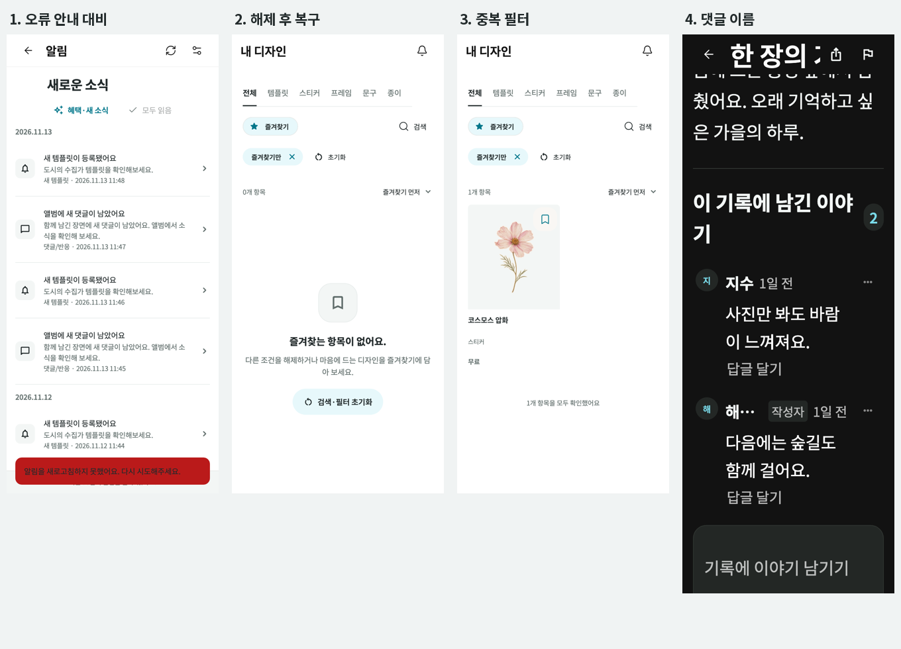

# 피드·알림·내 디자인 UX/UI 검토

2026-11-16. 현재 제품 위젯으로 27개 화면을 새로 캡처하고 8개 동작 시나리오를 확인했다. 제품 코드는 변경하지 않았다. 익숙한 아이콘을 유지하고, 설명과 조작을 반복하는 부분을 줄이는 방향으로 검토했다.

## 개선 우선순위

### 1. 오류 안내의 글자 대비 개선 — 우선

알림의 읽음 처리·새로고침 실패 안내가 라이트 모드에서 빨간 배경에 어두운 글자로 표시된다. 실제 위젯의 배경은 `#BA1A1A`, 본문은 `#222A2B`, 크기 14sp·굵기 400이며 계산 대비는 **2.27:1**이다. 오류를 이해하고 재시도해야 하는 순간에 안내가 잘 읽히지 않는다.

공통 `showErrorSnack`가 배경만 `colorScheme.error`로 바꾸고, 본문은 일반 Snackbar 테마 색을 상속하는 것이 원인이다. 오류 배경과 `colorScheme.onError` 본문 색을 함께 지정하는 개선을 권장한다. 라이트·다크 모두 최종 색 조합을 확인한다. 이번에 직접 확인한 결함은 라이트 모드다.

- 근거: [읽음 처리 실패](screens/notifications-08-mark-failed.png), [새로고침 실패](screens/notifications-09-refresh-failed-retained.png), [실제 색·대비 로그](logs/cap_notifications.log)
- 코드: `lib/core/utils/context_extensions.dart:19`, `lib/core/theme/snapfit_theme.dart:269`

### 2. 보관함에서 즐겨찾기 해제 후 되돌리기 — 우선

내 디자인에 즐겨찾기로 담아 둔 미구매 항목은 북마크를 해제하면 카드가 즉시 사라진다. 즐겨찾기 필터를 풀어도 전체 목록에서 빠져 있으므로, 실수한 경우 스토어에서 해당 디자인을 다시 찾아야 한다.

해제 동작은 유지하면서 짧은 완료 안내와 **되돌리기**를 제공하는 것을 권장한다. 구매한 항목의 보유권이나 상품을 삭제하는 문제는 아니다. 확인창이나 상시 설명은 필요하지 않다.

- 근거: [해제 전](screens/saved-02-favorites.png) → [해제 직후](screens/saved-02b-removed-favorite.png) → [전체 목록 복귀](screens/saved-02c-all-after-removal.png)
- 코드: `lib/shared/widgets/catalog_favorite_widgets.dart:49`, `lib/features/store/presentation/views/material_catalog_screen.dart:733`

### 3. 즐겨찾기 단독 선택의 중복 행 축소 — 보조

선택된 즐겨찾기 버튼 아래에 `즐겨찾기만 ×`와 `초기화`가 다시 표시된다. 같은 상태와 해제 동작이 반복되며, 390dp 화면의 첫 미리보기가 257dp에서 313dp로 **56dp** 내려간다.

내 디자인에서 즐겨찾기만 선택된 경우에는 별도 조건 요약 행을 생략하는 것을 권장한다. 검색·분류·정렬이 결합된 경우의 조건 표시와 초기화는 유지한다.

- 근거: [기본 목록](screens/saved-01-library.png), [단독 즐겨찾기](screens/saved-02-favorites.png)
- 코드: `lib/features/store/presentation/views/material_catalog_screen.dart:197`, `:1008`

### 4. 큰 글자에서 댓글 작성자 이름 우선 — 보조

320dp·글자 1.8배에서는 `해린의 여행 기록`이 `해…`로 줄어든다. 이름·작성자 배지·시간이 한 줄의 제한된 공간을 나눠 쓰기 때문이다. 기본 390dp에서는 전체 이름이 보인다.

공간이 부족할 때 이름을 먼저 배치하고 배지·시간을 다음 줄로 보내는 반응형 배치를 권장한다. 기본 크기의 댓글 디자인과 더보기 아이콘은 유지한다.

- 근거: [390dp 댓글](screens/feed_06_comments_390.png), [320dp·큰 글자 댓글](screens/feed_08_comments_320_large_dark.png)
- 코드: `lib/features/social/presentation/widgets/social_comment_widgets.dart:253`

## 유지할 부분

- 피드의 최신·팔로잉 전환, 두 번째 사진 선택 → 상세 → 뒤로 복귀에서 필터와 사진 위치가 보존된다. 댓글 바로 보기에서 키보드도 자동으로 나타나지 않는다.
- 알림의 일괄 읽음 중 중복 조작 방지, 실패 후 재시도, 새로고침 실패 시 기존 목록과 스크롤 위치 유지가 동작한다. 좁은 다크 화면의 알림 설정 진입·복귀도 확인했다.
- 보관함의 검색·복합 필터 초기화는 실제 목록을 복원한다. 분류·정렬과 기존 아이콘을 바꿀 근거는 없었다.

## 검증 범위

실제 Flutter 화면을 로컬 계정·저장소·수신 설정 대역으로 실행했다. 피드 2개, 보관함 3개, 알림 3개 시나리오가 최종 동일 컴파일 결과에서 모두 통과했다. 무거운 실행은 한 번에 하나씩 진행했다. `lib`의 Dart 파일 821개 해시는 검토 전후 동일하다.

실제 서버·결제·구매·푸시 발송·기기 스크린리더·앱 전체 빌드는 검증 범위에 포함하지 않았다. 가격은 로컬 카탈로그 대역이므로 이번 결과를 가격 검증에 사용하지 않는다. 캡처 환경의 글꼴 대체가 있을 수 있어 템플릿 원본의 일부 네모 글자는 제품 결함에서 제외했다.

초기 피드 캡처는 테스트 환경의 이미지 로딩 대기 문제로 실패했다. 대역의 이미지 사전 로드와 프레임 진행 순서를 고친 뒤 최종 2개 시나리오가 통과했다. 이 실패는 제품 결함으로 분류하지 않았다.

[검증 기록](verification.json) · [제품 소스 해시](source-hashes.json) · [피드 로그](logs/cap_feed.log) · [보관함 로그](logs/cap_saved.log) · [알림 로그](logs/cap_notifications.log)
