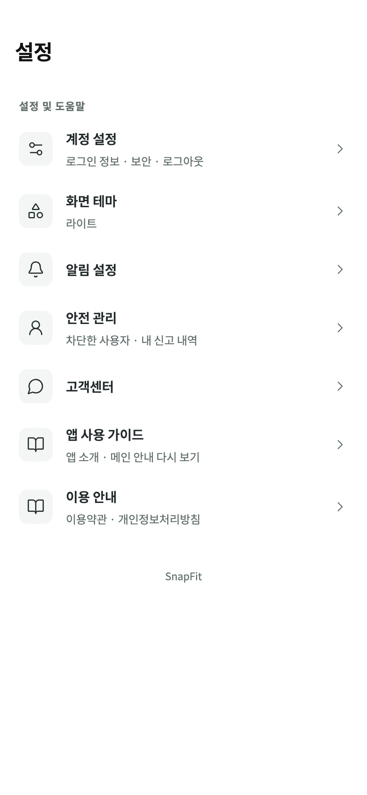
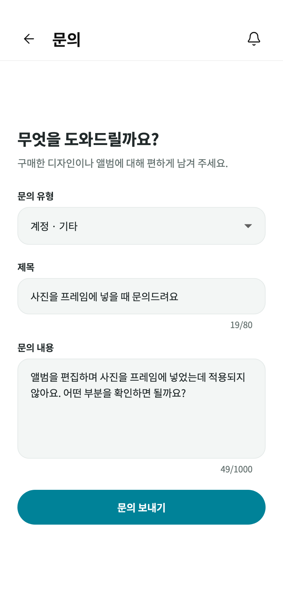
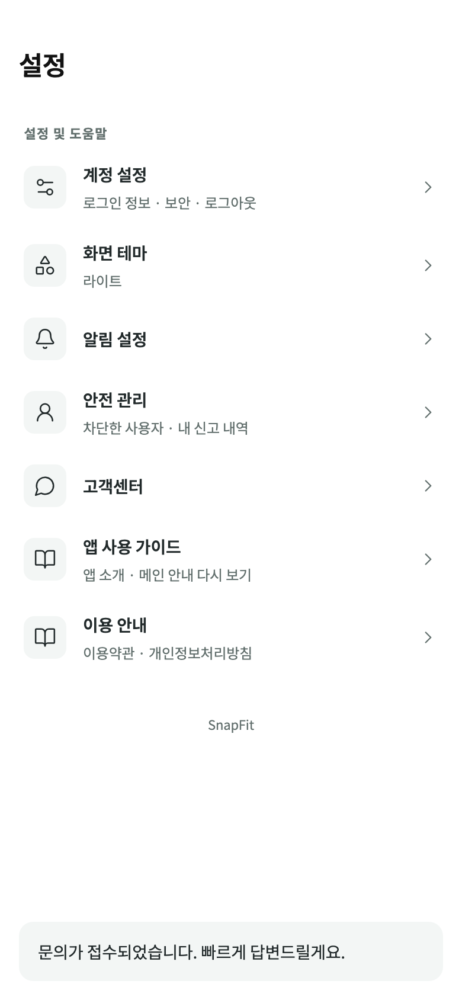
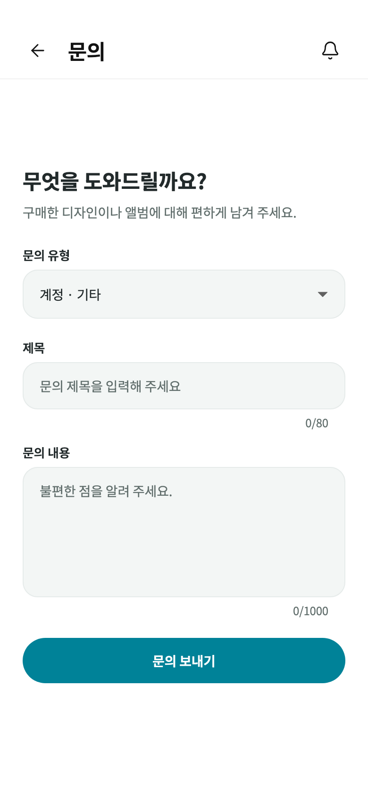

# 다음 개편 우선순위

2026-11-12. 이전에 해결한 사항을 제외하고 현재 문의 흐름을 실제 위젯으로 다시 확인했다. 이번 작업은 점검과 개편 범위 제안이며 제품 코드는 변경하지 않았다.

## 1순위 — 고객센터를 ‘내 문의를 확인하는 곳’으로 개편

현재 고객센터를 열면 곧바로 새 문의 작성이 나온다. 제출하면 접수 안내가 잠깐 표시된 뒤 설정으로 돌아간다. 다시 고객센터를 열어도 빈 작성창이므로 보낸 내용이나 접수 상태를 다시 확인할 수 없다. 작성 화면의 배치보다 접수 이후의 연결이 우선이다.

### 권장 흐름

1. **고객센터 첫 화면:** 내 문의 목록과 새 문의 작성 진입을 제공한다. 목록에는 제목·문의 유형·접수일·실제 서버 상태만 간단하게 표시한다.
2. **접수 완료:** 접수된 내용과 다음 확인 위치를 보여준다. 완료 후 내 문의로 돌아가 방금 보낸 문의를 찾을 수 있게 한다.
3. **문의 상세:** 보낸 내용과 접수 상태를 다시 확인한다. 취소·환불 등 주문별 요청은 기존 주문 내역의 해당 주문과 연결한다.

현재 저장 테이블에는 본인 문의를 읽는 정책과 제목·내용·유형·상태·작성 시각이 있다. 앱의 일반 문의 Repository에는 생성만 있고 목록·상세 조회는 없다. 운영 상태 값과 실제 답변 전달 경로는 추가 확인이 필요하다. 답변 본문 표시·이메일 발송·답변 알림·응답 시간은 구현되었다고 가정하지 않는다.

접수 안내의 ‘빠르게 답변드릴게요’도 실제 운영 경로와 맞춘 뒤 사용해야 한다. 이번 캡처는 이 문구가 노출되는 사실을 확인했으며, 실제 답변 속도나 발송 여부를 검증한 것은 아니다.

### 이번에 확인한 5단계

| 단계 | 현재 화면과 동작 | 판단 |
| --- | --- | --- |
| 1 | 설정 → 고객센터 진입 | 진입은 명확함 |
| 2 | 문의 유형·제목·내용 입력창 | 기본 작성 구조는 유지 가능 |
| 3 | 작성한 내용을 제출 | 가상 접수 1회로 정상 처리 |
| 4 | 설정 복귀와 일시적인 접수 안내 | 지속적인 결과 확인 경로 필요 |
| 5 | 고객센터 재방문 시 새 빈 작성창 | 내 문의 목록·상세 진입 필요 |

각 이미지는 이번 실행에서 저장한 실제 앱 위젯 화면이다. 계정과 입력 내용은 검토용 가상 자료이며 실제 문의는 발송하지 않았다.

#### 1. 설정에서 고객센터 진입

#### 2. 새 문의 작성 화면

#### 3. 제출 직전의 문의

#### 4. 제출 후 설정 복귀

#### 5. 고객센터 재방문

## 2순위 — 편집 저장 후 이어가기 안내의 작은 혼동

이 항목은 **코드에서 확인한 후보이며 이번 화면 캡처로 검증하지 않았다.** 한 쪽을 저장한 뒤 전체 문서의 첫 미완성 내지로 이동할 수 있는데 버튼은 항상 ‘다음 n쪽 채우기’라고 표시한다. 앞쪽에 미완성 쪽이 남아 있으면 이동 방향과 표현이 어긋난다.

현재 페이지 이동 로직은 유지하고 ‘n쪽 이어 채우기’처럼 방향을 강제하지 않는 안내로 정리하는 것이 적절하다. 고객센터보다 낮은 우선순위이며 편집기 전체 개편의 근거는 아니다.

- `lib/features/album/presentation/views/page_editor_screen.dart`: `_showOnePageSaved`, `firstIncompleteAlbumPageIndex`, `one-page-next`.
- 재현 기초: `test/widget/one_page_saved_flow_test.dart`의 실제 편집기와 메모리 저장 fixture.

## 유지할 부분과 검증 한계

- 통합 편집 진입, 전용 사진 채우기 단계 제거, 큰 앨범·작은 선택 목록, 승인한 리더 넘김 방향은 유지한다.
- 이번 코드 재점검에서 제작·편집·주문·알림·설정의 전면 개편을 뒷받침할 새 고우선 문제는 추가로 확정하지 못했다. 모든 화면이 정상임을 보증하는 뜻은 아니다.
- 문의 화면은 실제 네이티브 위젯, 앱 테마와 번들 글꼴, 390×844 화면에서 확인했다. 직접 연결한 기기나 운영 서버 검증은 아니다.
- 작성 화면의 기본 입력 영역은 읽히지만, 제출 이후 확인 경로가 없으면 접수 안내를 놓친 사용자가 결과를 다시 찾기 어렵다. 대비 수치·스크린리더·키보드·큰 글씨·다크 화면의 접근성 전체 검증은 이번 범위에 포함하지 않았다.
- 캡처 시나리오 1개가 5단계를 통과했다. 앱 전체 빌드·설치·운영 DB 변경은 하지 않았다.
