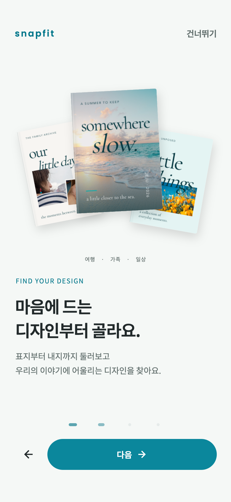
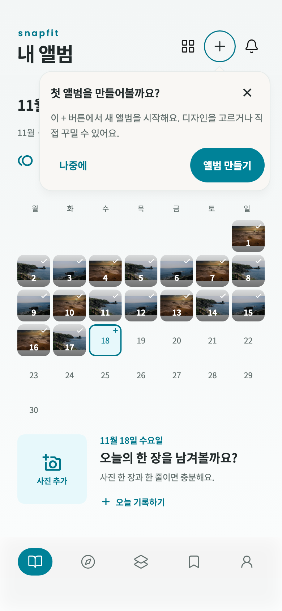
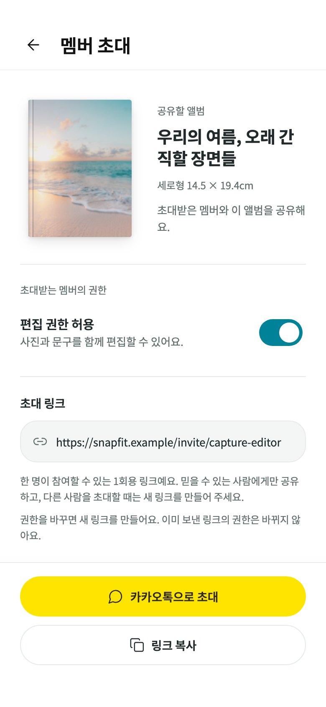
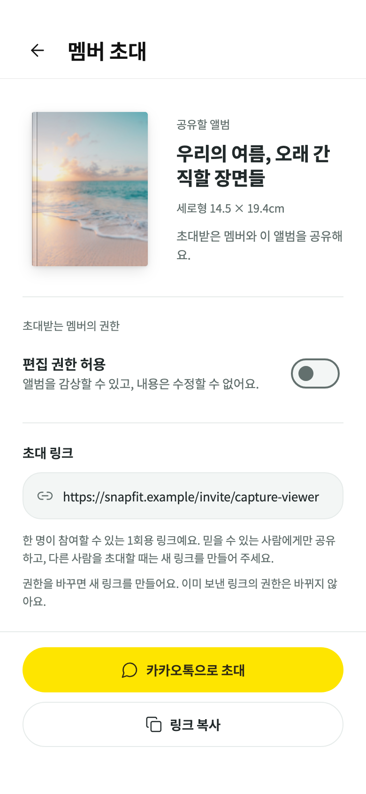
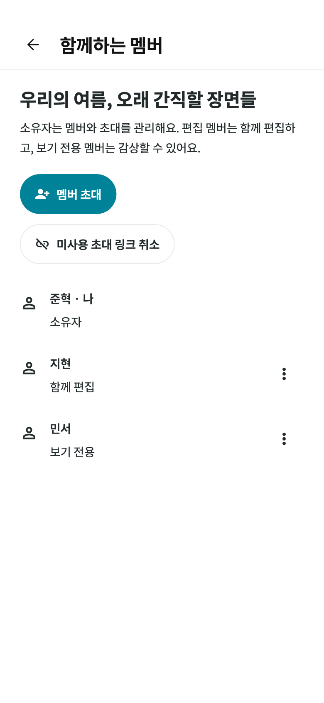
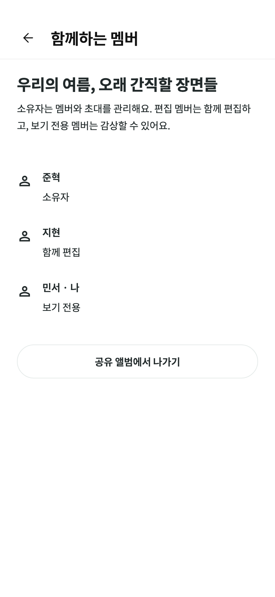

# 첫 사용·초대·멤버 화면 점검 — 2026-11-12

홈 배치와 리더 테스트 수정 이후 남은 화면을 현재 Flutter 위젯으로 확인했다. 이번 작업은 **개선 대상 선정과 구체적인 변경 제안**이며 제품 코드를 수정하지 않았다.

## 우선순위

| 순위 | 실제 확인한 문제 | 제안 | 유지할 것 |
| --- | --- | --- | --- |
| 1 | 첫 홈 안내가 월간 기록 제목·요약·보상 진행을 덮고, 새 앨범 제작을 첫 행동으로 강조한다. 소개 2장도 디자인 선택만 먼저 설명한다. | 첫 안내를 `오늘의 한 장부터 시작해요`로 맞추고 오늘 기록을 주 행동으로 둔다. 달력을 덮는 큰 팝업 대신 기록 영역에 짧게 안내한다. `앨범 바로 만들기`는 보조 선택으로 유지한다. 소개는 매일 모으기와 바로 앨범 만들기의 두 출발점을 설명한다. | 큰 앨범·작은 선택 목록, 작은 새 앨범 버튼, 기존 표지·편집기, 첫 방문/건너뛰기/다시 보기 상태 |
| 2 | 초대 화면은 한 명만 쓰는 링크이며 다음 사람에게는 새 링크를 만들라고 설명하지만, 성공 상태에 새 링크 생성 버튼이 없다. | 초대 링크 제목 옆에 작은 `새 링크 만들기` 행동을 둔다. 현재 편집/보기 권한으로 명시적으로 발급한다. | 복사·공유 시 같은 링크 재사용, 권한 변경 시 새 링크, 기존 링크 권한 안내, 오류 재시도와 계정 전환 보호 |

첫 홈 안내는 이번 달을 채우는 목적과 바로 경쟁하므로 먼저 조정하는 것이 맞다. 앨범부터 만들려는 사용자도 있으므로 사진 기록을 강제하지 않는다. 초대 재발급은 화면을 나갔다 다시 들어오거나 권한을 두 번 바꾸는 우회 없이 다음 사람을 초대하게 하는 작은 개선이다.

## 단계별 확인

### 1. 소개 첫 장 — 기본 구조 유지

사진과 큰 책을 앞세우고 제목·설명·다음 버튼을 분리한 구성은 읽기 쉽다. 단순히 색이나 책 크기를 바꿀 근거는 없다.

### 2. 소개의 시작 행동 — 안내 내용 조정 후보

디자인 선택을 서비스의 첫 행동으로 설명한다. 현재 홈의 매일 기록과 즉시 앨범 제작 두 경로를 함께 이해할 수 있게 문구와 장면을 정리할 필요가 있다. 기존 아트워크의 품질을 낮추거나 설명 카드 수를 늘릴 필요는 없다.

### 3. 첫 홈 안내 — 우선 개선

상단 + 버튼에 붙은 큰 안내가 월간 기록의 제목과 보상 진행을 덮는다. 첫 행동은 `앨범 만들기`로 강조되고, 실제 홈의 오늘 기록은 아래에 별도로 남아 있다. 스크린리더나 전체 접근성 부적합을 주장하는 것이 아니라, 이 캡처에서 확인되는 시각적 가림과 행동 우선순위 문제다.

이 캡처는 소개 완료/홈 안내 미확인 플래그를 합성 계정에 적용한 상태다. 17일 기록과 앨범 3권은 가림과 현재 홈 연결을 보기 위한 데이터이며, 실제 신규 계정이나 개인 데이터가 아니다.

### 4. 편집 권한으로 초대 — 새 링크 행동 보완

앨범, 편집 가능 범위, 초대 링크, 카카오톡/복사 행동이 구분돼 있다. 1회용 안내 아래에 같은 권한으로 다음 링크를 만드는 행동이 없다. 현재 소스의 생성 호출은 최초 진입·권한 변경·오류 재시도다. 오류 상태의 재시도 버튼은 성공 상태의 새 사람 초대를 대신하지 못한다.

### 5. 보기 전용으로 초대 — 권한 표현 유지

권한을 끄면 감상만 가능하고 내용을 수정할 수 없다는 설명이 바로 보인다. 권한 스위치와 복사/공유 구성은 유지하고, 새 링크 행동만 보완한다.

### 6. 소유자의 멤버 관리 — 유지

소유자·함께 편집·보기 전용 역할과 소유자의 초대/미사용 링크 취소 행동이 구분돼 있다. 역할이 적다는 이유로 새 카드나 장식을 추가할 근거는 없다.

### 7. 보기 전용 멤버 — 유지

관리 행동은 없고 본인 역할과 앨범에서 나가기만 노출된다. 실제 권한 변경·내보내기·나가기를 실행한 검증은 아니다.

## 범위와 한계

- 실제 화면, 실제 번들 폰트·사진, 390×844 논리 크기, DPR 2, 안전 영역 위 24px/아래 34px를 사용했다. 계정·멤버·초대 응답은 메모리 대역이다.
- 네이티브 캡처 검사 6개가 통과해 PNG 8장을 만들었고 최종 저장 이미지를 모두 열어 확인했다. 로딩 중 사진이 빈 초기 이미지는 다시 캡처해 교체했다.
- `intro/04-introduction-finish-390x844.png`에는 오프스크린 캡처에서 고정 상단이 빠지는 현상이 남아 있어 전체 배치 평가에서 제외했다. 마지막 소개의 전체 화면 검토는 이 캡처로 완료했다고 주장하지 않는다. 소유자 멤버 장면도 독립 실행으로 다시 캡처해 상단과 본문이 모두 보이는 파일을 채택했다(`owner-recapture.log`, 1건 통과). 나머지 7장이 보고서의 시각 근거다.
- 소개 종료부터 실제 신규 계정의 첫 홈까지 전체 가입 플로우를 연속 실행한 것은 아니다. 각 화면에 명시된 상태를 독립적으로 재현했다.
- 작은 화면·글자 확대·다크·키보드·스크린리더·색 대비 수치는 이번 캡처 범위에 포함하지 않았다. 기존 테스트 존재와 이번 시각 검증을 구분한다.
- 실제 초대 링크 발급·카카오톡 전송·복사·권한 변경·업로드·주문·결제·운영 변경은 하지 않았다. 앱 전체 빌드나 서버 실행도 하지 않았다.
- [검증 기록](verification.json), `intro-capture.log`, `guide-capture.log`, `collab-capture.log`에 실행 결과와 소스 비교를 기록했다.
