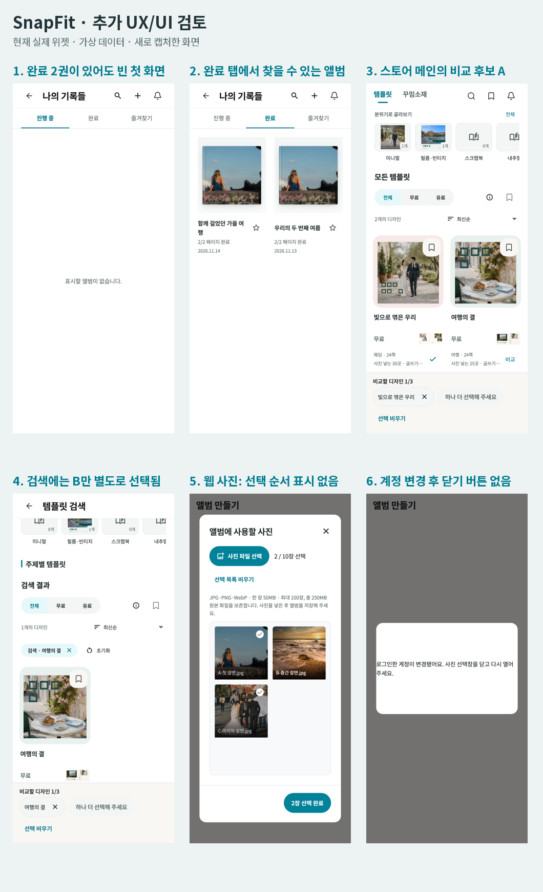

# SnapFit 추가 UX/UI 검토

현재 코드의 **내 앨범 → 목록 확인**, **스토어 → 비교 후보 선택 → 검색 → 복귀**, **웹용 사진 선택 → 자동 배치·계정 변경**을 새로 재현했다. 세 가지 재현 시나리오에서 PNG 8장을 저장·확인했다. 우선 개선할 부분은 네 곳이다. 이번에는 제품 코드를 수정하지 않았다.

## 우선순위

| 순위 | 대상 | 확인한 문제 | 권장 개편 |
| --- | --- | --- | --- |
| 1 | 내 앨범 첫 화면 | 완료 앨범 2권이 있어도 기본 `진행 중` 탭에서는 `표시할 앨범이 없습니다.`가 나온다. | 전체 앨범을 기본으로 보여주고 상태별 개수를 표시한다. 빈 상태에는 현재 조건과 `완료 앨범 보기`를 제공한다. |
| 2 | 스토어의 비교 선택 | 메인에서 고른 A와 검색에서 고른 B를 함께 비교할 수 없다. 검색을 닫으면 B는 없어지고 A만 남는다. | 비교 후보는 스토어 메인·검색에서 공유하고 같은 하단 비교 영역으로 이어 준다. 검색어·카테고리·스크롤은 각 화면의 상태를 유지한다. |
| 3 | 웹 사진 선택 순서 | C → A로 눌러도 A → C로 반환되고 자동 배치된다. 화면에는 선택 체크만 있어 배치 순서를 예측하기 어렵다. | 선택한 순서대로 반환하고 사진에 1·2·3 순서 배지를 표시한다. 네이티브 사진 선택과 규칙을 맞춘다. |
| 4 | 웹 사진 선택의 계정 변경 안내 | `사진 선택창을 닫고 다시 열어주세요`라고 안내하면서 닫기 버튼이 사라진다. 바깥 클릭 닫기도 비활성이다. | 사진을 가리는 보호는 유지하면서 제목·짧은 설명·명시적인 `닫기` 버튼과 안쪽 여백을 제공한다. |

앱에서는 **1·2번을 먼저** 진행하는 편이 좋다. 보관한 앨범을 찾는 일과 여러 디자인을 비교하는 일에서 끊김을 줄인다. 3·4번은 웹용 사진 선택 화면을 함께 보완할 때 묶어 진행할 수 있다.

## 새로 캡처한 단계

| 단계 | 사용자 행동·상태 | 상태 판단 | 증거 |
| --- | --- | --- | --- |
| 1 | 완료 앨범만 있는 목록 첫 진입 | 개선 필요: 전체가 빈 것처럼 읽히는 안내 | [01 첫 진입](screens/01-library-default-completed-only.png) |
| 2 | 같은 목록에서 완료 탭 선택 | 양호: 기존 완료 앨범이 정상 표시됨 | [02 완료 탭](screens/02-library-completed-tab.png) |
| 3 | 완료·진행 중 앨범이 함께 있는 첫 진입 | 기본 상태 필터 확인: 진행 중 1권만 표시 | [03 혼합 목록](screens/03-library-default-mixed.png) |
| 4 | 스토어 메인에서 비교 후보 A 선택 | 양호: 선택 A가 하단에 표시됨 | [04 메인 선택](screens/04-store-main-comparison-selected.png) |
| 5 | 상단 검색에서 B 검색·비교 선택 | 개선 필요: A와 이어지지 않고 B만 표시 | [05 검색 선택](screens/05-store-search-comparison-isolated.png) |
| 6 | 검색을 닫고 메인으로 복귀 | 메인 A 보존은 양호, 검색의 B는 폐기 | [06 복귀](screens/06-store-main-search-selection-discarded.png) |
| 7 | 웹 사진 C·A 선택 후 완료·자동 배치 | 개선 필요: 선택 순서와 반환·배치 순서가 다름 | [07 선택 화면](screens/07-web-photo-selection-order.png), [반환·배치 로그](logs/cap_create.log) |
| 8 | 사진 선택창이 열린 상태에서 계정 변경 | 사진 숨김은 양호, 명시적인 닫기 행동 보강 | [08 변경 안내](screens/08-web-photo-account-changed.png) |

## 1. 내 앨범: 목록의 범위와 빈 상태를 명확하게

프로필의 `내 앨범`은 기본 탭을 지정하지 않고 목록으로 이동한다. 목록은 `진행 중 / 완료 / 즐겨찾기` 중 진행 중을 기본 선택한다. 직접 작성한 내지로 완료 판정을 충족하는 앨범 2권을 넣어도 첫 화면은 빈 안내가 나오며, 완료 탭을 누르면 같은 2권이 보인다. 앨범이 유실되거나 접근할 수 없는 문제는 아니다.

권장 구성은 `전체 / 진행 중 / 완료 / 즐겨찾기`와 개수다. 최소 수정으로 시작한다면 진행 중이 0권이고 완료 앨범이 있을 때 `진행 중인 앨범이 없어요 · 완료 앨범 2권 보기`를 제공할 수 있다. 상태 필터의 결과가 실제 보관량과 혼동되지 않아야 한다.

카드의 시각적 다듬기도 함께 할 만하다. 02·03에서 긴 제목이 두 줄로 나뉘며 마지막 한 글자만 남는 사례가 있다. 제목 옆 즐겨찾기 버튼이 차지하는 공간을 조정하거나 표지 쪽으로 옮겨 제목 두 줄의 폭을 확보하는 안을 검토할 수 있다. 실제 서로 다른 제목 길이와 큰 글씨로 확인하고, 별 버튼의 터치 영역은 유지해야 한다.

근거: [프로필 진입](../../../lib/features/social/presentation/widgets/social_profile_personal_area.dart) 83~106행, [목록 화면](../../../lib/features/album/presentation/views/album_category_screen.dart) 51·89~92·191·222~228·340~347행.

## 2. 스토어: 탐색과 검색을 하나의 비교 작업으로 연결

실제 스토어 허브에서 A를 선택한 뒤 상단 검색으로 B를 찾아 선택했다. 비교 목록의 실제 ID를 확인한 결과 메인에는 A `-9301`, 검색에는 B `-9302`, 복귀한 메인에는 다시 A만 남았다. 같은 화면에서 필터만 바꾸는 경우와 구분되는 별도 검색 경로의 문제다.

검색어와 스크롤을 각각 보존하는 현재 구조는 유용하다. 비교 후보만 허브 범위로 공유하면 `A 선택 → B 검색 → A+B 비교`로 이어갈 수 있다. 하단에는 선택한 표지·이름·선택 수·비교하기를 같은 형태로 유지하고, 검색을 닫아도 후보가 이어진다는 피드백을 제공하는 편이 좋다.

근거: [스토어 비교 상태](../../../lib/features/store/presentation/views/store_screen.dart) 79~81·102~140행, [상단 검색 진입](../../../lib/features/store/presentation/views/store_hub_screen.dart) 83~108행. [선택 ID 로그](logs/cap_store.log).

## 3. 웹 사진 선택: 선택과 배치에 같은 순서 사용

보관 목록 A·B·C에서 C, A 순서로 클릭했다. 확인 버튼의 실제 반환값과 자동 배치 계획은 모두 A, C였다. 선택 ID는 순서가 있는 Set에 보관하지만 반환할 때 원래 보관 목록을 순회하며 다시 구성하기 때문이다. 후속 사진 추가 경로에는 이 순서를 복원하는 정렬이 없다.

사진 위에 선택 순서를 표시하고 반환 순서도 일치시키면 사용자가 이야기를 구성하기 쉽다. 네이티브는 이미 선택 순서를 보존하고 번호를 표시하므로 해당 상호작용을 웹과 맞추면 된다. 번호는 색상이나 체크 상태만으로 순서를 추측하게 하지 않고, 선택 해제·다시 선택 시에도 다시 계산돼야 한다.

근거: [웹 사진 선택](../../../lib/shared/widgets/browser_photo_selection_sheet.dart) 49·523~525행, [네이티브 선택](../../../lib/shared/widgets/album_bottom_sheet.dart) 670~675·807행, [자동 배치](../../../lib/features/album/presentation/widgets/create_flow/template_photo_fill_plan.dart) 47행 부근. 실제 반환·배치 검사는 [캡처 로그](logs/cap_create.log)에 있다.

## 4. 계정 변경 안내: 안내와 행동을 함께 제공

계정이 바뀌면 기존 사진과 선택 상태는 가려진다. 이때 사진 선택 전체 위젯이 설명 문장만 있는 박스로 바뀌어 기존 헤더의 X 버튼도 사라진다. 대화상자는 바깥 클릭 닫기를 허용하지 않는다.

권장 화면은 `계정이 변경됐어요` 제목, `사진 선택창을 닫고 다시 열어주세요` 설명, `닫기` 버튼이다. 본문 좌우 여백도 확보해야 한다. 이 개선은 다른 계정의 사진을 다시 보여주는 방식으로 해결하지 않는다.

이번 재현에서는 정리 목적으로 네이티브 테스트의 시스템 뒤로가기를 사용했다. 실제 브라우저 Escape·뒤로가기까지 검사한 것은 아니므로, 모든 탈출 방법이 막혔다고 판단하지 않는다.

근거: [사진 선택 대화상자](../../../lib/shared/widgets/browser_photo_selection_sheet.dart) 21·267~272·299~301행. [변경 상태 화면](screens/08-web-photo-account-changed.png).

## 중복·오판을 피하기 위해 제외한 후보

- 생성 요청의 무한 대기: 저장소에 25초 제한이 있어 제외했다.
- 생성 실패 후 설정 편집 제한: 동일 생성 명령을 안전하게 복구하는 구조와 연결되어 있어 단순한 편집 차단 문제로 제안하지 않았다.
- 계정 사진이 공개 프로필 사진으로 반영되지 않는 현상: 개인정보 분리를 의도한 설계다. 버그로 제안하지 않았다.
- 프로필 앨범 진입의 버튼별 대기 상태: 기존 `앨범을 확인하고 있어요` 안내가 있어 우선 과제로 올리지 않았다.
- 이미 제공되는 스토어 가격 필터·정렬·카테고리 노출, 포인트·결제·편집기·인쇄의 완료한 개선은 새 과제로 반복하지 않았다.

## 검증 범위

- 실제 Flutter 위젯과 번들 폰트, 가상 앨범·스토어·사진 저장소로 재현했다. 운영 계정·가격·사진을 조회하거나 결제·게시·초대·배송 요청을 실행하지 않았다. 스토어 캡처의 가격과 무료 표시는 재현 대역이며 실제 운영 판매 상태 검증이 아니다.
- 세 시나리오는 현재의 문제 상태와 정상 경로를 기대값으로 확인한다. 재현 통과가 문제 수정 완료를 뜻하지 않는다.
- 새 캡처 8장은 모두 이번 실행 결과다. 예전 캡처를 현재 증거로 재사용하지 않았다. 실행·커널 컴파일·렌더는 직렬로 진행했다. [실행 결과와 이미지·소스 해시](verification.json), `logs/`, `probes/`에 자료를 보관했다.
- 390×844의 밝은 화면을 확인했다. 웹 사진 선택은 **네이티브 headless 엔진에서 웹 전용 위젯을 재현**했다. 실제 브라우저 파일 선택창·드롭·키보드와 실기기 검증은 수행하지 않았다.
- 전체 접근성 준수, 스크린리더 읽기 순서, 키보드 초점, 큰 글씨·다크·가로 화면의 모든 조합을 검사한 것은 아니다. 순서 번호와 명시적인 복구 버튼은 접근성 관점에서도 후속 검증 대상이다.
- 제품 Dart 파일 **821개가 실행 전후 동일**함을 해시로 확인했다. 이번 작업은 검토이며 제품 변경·전체 앱 빌드·배포를 수행하지 않았다.
