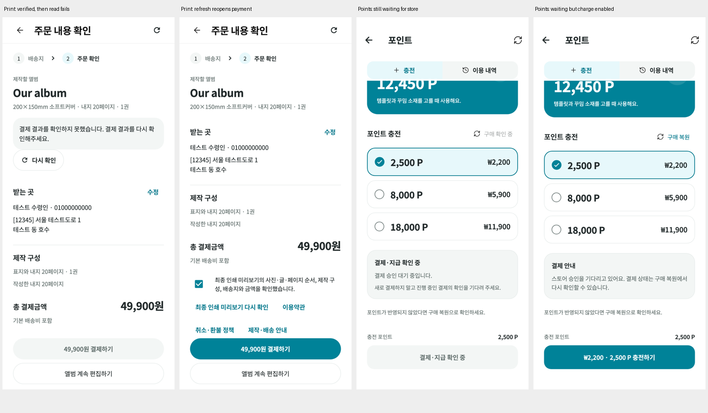
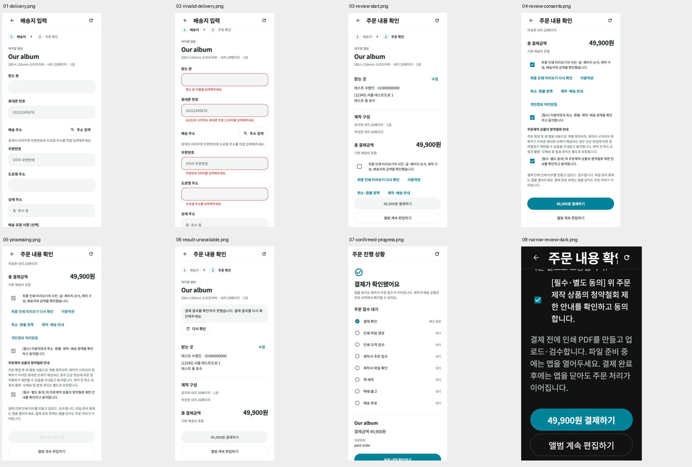

# SnapFit 결제 집중 검토 — 2026-11-16

**판단: 결제 복구에서 우선 수정할 문제 2건, 추가 개선 2건을 확인했다.** 금액·배송지·필수 동의의 기본 화면은 명확하지만, 결제 확인 지연/조회 실패를 다루는 상태와 다음 행동을 보강해야 한다. 이번 작업은 검토만 수행했으며 제품 코드·운영 결제·주문을 변경하지 않았다.

## 확인한 흐름

| 단계 | 사용자 행동 | 검토 결과 | 현재 실행의 화면 |
|---|---|---|---|
| 1 | 포인트 상품 선택·충전·승인 대기 | 상품 선택·가격·구매 복원 진입은 명확. 대기 시간 초과와 목록 갱신 실패 후 결제 재활성화는 수정 필요. | [선택](screens/points-redesign-selected-390-light.png), [대기](screens/11-points-waiting-390-light.png), [시간 초과](screens/12-points-waiting-reopened-390-light.png) |
| 2 | 소재를 포인트로 구매 | 대역에서 구매 가격·현재 잔액·구매 후 잔액과 구매 완료를 확인. 소유 상품 반복 선택의 중복 차감 방어도 테스트됨. | [구매 확인](screens/09-material-confirmation.png), [구매 완료](screens/10-material-owned.png) |
| 3 | 인쇄 배송지 입력·오류 수정 | 주소 검색/직접 입력 경로, 필드 오류, 첫 잘못된 입력 위치 노출은 정상 확인. | [입력](screens/01-delivery.png), [입력 오류](screens/02-invalid-delivery.png) |
| 4 | 인쇄 주문 내용·총액·동의 확인 | 앨범·규격·수령인·배송비 포함·총액 표시 양호. 아직 동의하지 않은 항목 때문에 버튼이 비활성이라는 이유를 더 분명히 알릴 필요. | [주문 확인](screens/03-review-start.png), [동의 완료](screens/04-review-consents.png) |
| 5 | 결제 진행·확인 실패·재시도 | 일반 진행 중 새 결제 차단은 동작. 승인 검증 후 추가 조회 실패 분기에서 기존 성공 상태를 잃고 새 결제를 시작할 수 있음. | [처리 중](screens/05-processing.png), [검증 후 오류](screens/13-paid-but-error.png), [다시 확인 후](screens/14-paid-retry-enabled.png) |
| 6 | 결제 확인·주문 진행 조회 | 대역에서 서버 영수증 확인 이후 완료 화면으로 이동하며 결제 확인과 제작·배송 단계를 구분함. 실제 PG·제작사 접수는 미실행. | [결제 확인·진행](screens/07-confirmed-progress.png) |

## 1. P1 — 결제 확인 후 추가 조회 실패를 결제 실패처럼 처리

**재현 조건:** 서버가 결제와 영수증을 확인한 뒤, 화면에서 추가로 하는 영수증 조회만 네트워크 오류가 난다. 이후 주문 가능 상태가 여전히 READY다.

1. 실제 `PrintPaymentService`는 결제 ID·앨범·금액을 검증한 영수증을 받고 복구 기록을 지운다.
2. 주문 화면은 같은 주문의 영수증을 다시 조회한다. 이 두 번째 조회만 실패하면 완료 화면 대신 일반 오류를 표시한다.
3. 오류의 `다시 확인`은 기존 결제 조회가 아니라 견적·주문 가능 상태 새로고침이다. 오류를 지우고 이전 동의를 유지한다.
4. 결제 버튼이 다시 활성화되고, **사용자가 다시 누르면** 새 UUID와 두 번째 결제 SDK 호출이 시작된다.

이는 자동 이중 결제를 증명한 것이 아니다. 첫 거래를 이미 검증했는데도 신규 결제 시작을 다시 허용하는 앱의 복구 문제다. 서버는 원래 요청 ID에는 같은 거래를 반환하지만 새 UUID는 추가 인쇄 주문으로 허용하므로 이 경계를 대신 막지 않는다.

**최소 개선:** 실제 서비스가 이미 검증한 영수증을 재사용하거나, 추가 주문 조회 실패에도 `결제 확인됨 · 주문 정보 다시 불러오기` 상태와 원래 주문 ID를 보존한다. 이 상태에서는 신규 결제를 막고 기존 주문을 확인하도록 한다. 주입된 결제 콜백의 영수증 검증은 유지한다.

**디자인:** 일반 회색 오류 카드 대신 `결제는 확인됐어요`라는 사실, 원래 주문번호, `주문 다시 불러오기` 행동을 함께 표시한다. 결제 버튼을 다시 제공하지 않는다.

**근거:** `lib/features/profile/data/print_payment_service.dart:391–400`, `lib/features/album/presentation/views/print_order_checkout_screen.dart:453–471,1240–1248`; 새 UUID를 허용하는 서버 경로는 `supabase/migrations/20261014161833_app_pdf_prepayment_and_supabase_fulfillment.sql:244–275`.

**실행 증거:** `probes/probe_double_receipt.dart`, 테스트 `audit double receipt read failure re-enables a fresh production attempt`. 실제 서비스와 메모리 저장소·SDK 대역을 사용해 첫 영수증 검증 → 추가 조회 실패 → 복구 기록 없음 → 버튼 재활성화 → 서로 다른 요청 ID·SDK 대역 호출 2회를 확인했다. 실제 청구나 주문은 생성하지 않았다.

## 2. P1 — 포인트 결제 결과가 미확정인데 충전 버튼을 다시 허용

서로 다른 두 경계가 재현됐다.

- **승인 대기 2분:** 완료·취소 이벤트를 받지 못했는데 watchdog이 구매 잠금을 해제한다. 화면은 `스토어 승인을 기다리고 있어요`라고 안내하면서 충전 버튼을 다시 활성화한다.
- **구매 시작 API의 반환 지연 30초:** 첫 `store.buy` Future가 아직 끝나지 않았는데 timeout으로 시작 실패 문구를 표시하고 새 구매 호출을 허용한다. 일반적인 사용자 승인 대기 전체가 30초 제한이라는 뜻은 아니다.

동일 영수증의 재전달을 막는 기능은 있다. 여기서 확인한 것은 별도의 새 구매 시작을 다시 허용한다는 점이다. **실제 App Store/Google Play가 두 번째 요청을 차단·병합·승인하는지는 실기기에서 확인하지 않았으므로 중복 청구 발생을 확정하지 않는다.**

**최소 개선:** `확인 지연`을 `취소/실패 확정`과 분리한다. 원래 구매 시도와 복구 가능한 정보를 유지하고, 미확정 상태에서는 새 충전보다 `결제 상태 확인·구매 복원`을 우선한다. 신규 결제 재개 조건은 확정된 취소·실패와 플랫폼별 복구 결과에 맞춰 설계해야 한다. 시간만으로 성공·실패를 결정하지 않는다.

**디자인:** 상품 목록보다 진행 중인 거래의 상태를 먼저 보여준다. `확인 중`, `확인 지연`, `완료`, `취소`를 제목과 설명·행동으로 구분하고 색상만으로 구별하지 않는다. 안내와 하단 버튼은 같은 상태를 표시해야 한다.

**근거:** `lib/features/billing/data/point_purchase_service.dart:328–357`, `lib/features/profile/presentation/views/billing_management_screen.dart:673–715,735–797`.

**실행 증거:** `probes/probe_iap_timeout.dart`의 첫 두 사례에서 종료 이벤트/첫 Future 완료 없이 `store.buy` 호출 2회에 도달했다. 화면 대역에서도 대기 안내와 활성 충전 버튼의 동시 노출을 새로 캡처했다.

## 3. P2 — 상품 재조회 실패 뒤에도 이전 목록으로 결제 진입 가능

처음 상품 조회는 성공하고, 이후 새로고침만 실패하면 이전 상품 목록과 `available=true`가 남는다. 선택도 살아 있어 충전 버튼이 활성화된다. 캡처에서는 상품 준비 안내와 충전 버튼이 함께 보인다.

**개선:** 캐시 목록을 보여주더라도 가격·구매 가능 여부를 재확인하지 못했다는 상태를 분리하고, 재조회 성공 전 결제 진입을 제한한다. 재시도 버튼은 상품 재조회로 연결한다.

실제 스토어 SDK가 최종 가격을 다시 보여줄 수 있다. 이번 증거는 잘못된 금액이 청구됐다는 뜻이 아니며, 조회 오류와 구매 가능 상태의 불일치다.

**근거:** `point_purchase_service.dart:269–298`, `billing_management_screen.dart:735–797`; `probes/probe_iap_timeout.dart`의 세 번째 사례 및 [상품 조회 실패 화면](screens/15-points-stale-catalog-390-light.png).

## 4. P2 — 결제 버튼이 회색인 이유와 남은 동의를 안내

주문 확인 첫 화면에서는 첫 확인 항목만 보이고 추가 필수 동의는 아래에 있다. 하단 버튼은 `49,900원 결제하기`라는 금액만 유지한 채 비활성이다. 사용자가 아직 확인할 항목이 몇 개인지 버튼 주변에서 알기 어렵다.

**개선:** 하단 행동 영역 가까이에 `필수 확인 2개가 남았어요` 같은 진행 안내와 다음 미확인 항목으로 이동하는 행동을 둔다. 인쇄 내용 확인·정책 동의·별도 제작 동의를 구분한 기존 선택은 유지한다. 배송지·금액·내용이 변경돼 동의가 초기화되면 그 이유도 바로 알린다.

**근거:** [주문 확인 첫 화면](screens/03-review-start.png), [동의 완료 화면](screens/04-review-consents.png), `print_order_checkout_screen.dart:1590–1710`.

## 유지할 부분

- 총 결제금액과 배송비 포함 여부가 표시되고 결제 버튼에도 금액이 들어간다.
- 배송지 오류는 텍스트와 테두리로 보이며 잘못된 첫 필드로 이동한다. 주소 검색 실패 시 직접 입력 경로가 남는다.
- 금액·앨범·규격이 바뀌면 동의를 다시 받는 구조다.
- SDK 결과만으로 지급/결제를 확정하지 않고 서버 상태·소유자·금액·거래 ID를 대조한다.
- 네이티브 포인트 영수증은 먼저 보존하고 서버 검증 후 스토어 완료 처리한다. 동일 영수증 재전달과 계정 전환 방어가 있다.
- 서버의 원래 거래 ID 재확인·잠금·원장 한 번 지급·환불 검증 등 보호 장치는 소스와 대역 테스트에서 확인했다.

## 작은 화면·접근성 관찰

[320폭·글씨 1.6배·다크 모드](screens/08-narrow-review-dark.png)에서 본문과 결제 버튼을 스크롤로 접근했고 렌더 예외는 없었다. 긴 헤더 제목이 좁은 영역에서 잘려 보이는 위험이 있어 제목 축약·줄바꿈/말줄임 처리를 확인할 필요가 있다. 키보드·스크린리더·초점 순서·실측 명도 대비나 전체 WCAG 준수를 확인한 것은 아니다.

## 낮은 우선순위의 서버 보강

`supabase/functions/_shared/production-print-checkout.ts:181`은 요청 본문을 전부 읽은 뒤 길이를 제한한다. 인증된 큰 요청은 제한 적용 전에 메모리를 사용할 수 있다. IAP·웹 포인트에 이미 있는 제한 길이 스트림 읽기를 재사용할 수 있다. 금액 위조 취약점이나 실제 부하 장애를 발견했다는 의미는 아니다.

## 검증 범위와 실행 결과

- **기존 회귀 207건 통과:** 네이티브/패널 101건 + 서버 106건. 운영용 플래그가 닫힌 웹 충전 사례는 조건에 따라 1건 제외. 별도로 운영 gate=false 구성의 닫힘도 초기 실행에서 확인했다.
- **문제 재현 4건:** 인쇄 1건, 네이티브 IAP 3건. 이 프로브가 통과한 것은 문제 동작이 재현됐다는 뜻이다. 안전성 인증을 뜻하지 않는다.
- **화면 캡처 사례 7건, 현재 이미지 17장:** 390×844 중심으로 작은 화면·큰 글씨·다크 모드도 확인했다. 동일 장면은 같은 흐름 내 가상 상태이며, 앱스토어·PG 화면 자체는 캡처하지 않았다.
- 서버 첫 실행에서 TypeScript parameter property를 Node strip-only 모드가 읽지 못해 2개 모듈을 로드하지 못했다. 나머지 83건 통과 후 해당 2개 모듈만 `--experimental-transform-types`로 재실행해 23건 통과했다. 제품 코드 수정은 없었다.
- 웹 포인트 실결제는 소스에서 출시 gate가 닫혀 있다. 테스트 플래그와 대역에서 패널 복구 계약을 확인했으며 TEST 상태를 현재 운영 결제로 평가하지 않았다.
- 포인트 수량·가격·배송지·거래·주문번호는 가상 데이터다. 소재 미리보기의 빈 영역도 테스트 대역의 내용이므로 상품 이미지 품질 문제로 판단하지 않았다.
- 독립 리뷰에서 P1 조건과 프로브의 실제 서비스 진입을 다시 확인했다. 첫 결제 후 조회만 실패하고 준비 상태가 READY인 조건, 사용자의 두 번째 버튼 클릭이 필요한 점, 실제 청구는 미확인인 점을 명시했다.
- 실기기 App Store/Google Play·실제 PG·리디렉션 복귀·브라우저 종료·운영 주문·지갑·환불·제작사 접수·운영 구성은 실행/조회하지 않았다. 앱 전체 빌드·배포·제품 코드 변경도 하지 않았다.

권하는 순서는 **1 → 2 → 3 → 4**다. 먼저 기존 결제의 성공/미확정 상태를 보존한 뒤, 그 상태에 맞춰 안내 카드와 버튼을 일치시키는 것이 중요하다.
