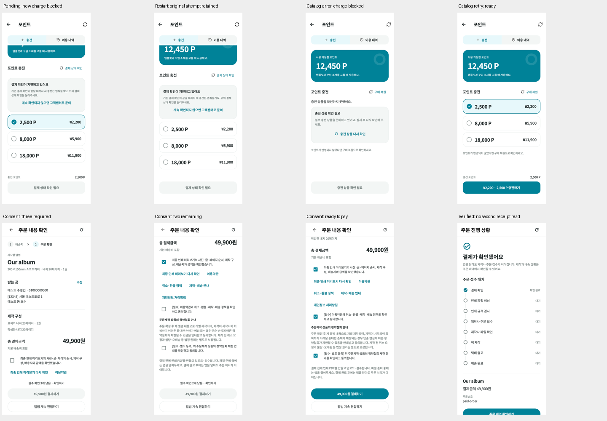

# 결제 복구·안내 개선 적용 — 2026-11-16

사용자가 승인한 결제 검토 1~4번을 앱 코드에 모두 반영했다. 관련 **154개 테스트 통과**, 변경 Dart 10파일 정적 분석 **문제 0건**, 별도 화면 캡처 사례 5건 통과를 확인했다. 앱 전체 빌드·실제 결제·운영 DB 변경·배포는 하지 않았다.

## 적용 내용

| 요청 | 변경 결과 | 확인 |
|---|---|---|
| 1. 확인된 인쇄 결제 보존 | 실제 PrintPaymentService가 이미 서버 검증한 영수증은 완료 화면에 재사용한다. 두 번째 조회 실패 때문에 성공 상태를 잃고 새 결제 버튼이 열리는 경계를 제거했다. 주입된 onPay 경로의 서버 재검증·앨범/금액/계정 검사는 유지한다. | 실제 서비스를 사용하는 대역에서 첫 서버 확인 후 두 번째 조회를 실패하도록 준비해도 완료 화면으로 이동, SDK 호출 1회·추가 조회 0회. |
| 2. 미확정 포인트 결제의 신규 구매 차단 | SDK 구매 시작 응답 지연·승인 대기를 취소나 실패로 간주하지 않는다. 지연 후에는 무한 로딩을 끝내고 상태 확인을 열되 새 충전은 차단한다. 계정별 최소 거래 기록을 기존 영수증과 별도 SecureStorage 키에 보존해 앱 재시작에도 유지한다. | 시간 초과·빈 복원·재시작·저장 실패·늦은 성공/취소·계정 전환·영수증 재전송을 검증. |
| 3. 상품 재조회 실패 보호 | 상품 확인 실패 시 구매 가능한 상태를 닫고 이전 ProductDetails를 직접 전달해도 새 결제를 시작하지 않는다. 상품 재조회 버튼을 제공하고, 성공하면 해당 상품 오류만 지운다. 다른 결제 상태 안내는 보존한다. | 실패 시 신규 SDK 호출 0회, 재조회 성공 후 구매 가능 복귀 및 이전 오류 카드 제거. |
| 4. 필수 동의 안내 | 결제 버튼 가까이에 남은 필수 확인 수와 다음 미확인 항목으로 이동하는 행동을 표시한다. 선택을 자동 체크하지 않는다. 로딩·미확정 결제·주문 불가 상태에서는 동의 안내를 숨겨 상태와 행동이 충돌하지 않게 한다. | 390폭·320폭·844폭, 큰 글씨, 지연 생성된 주문 확인 영역, 준비 중/준비 불가 분기를 검증. |

## 화면 변화

- [확인 지연](screens/01-delayed-charge-blocked-390-light.png): 상태 안내를 상품 선택보다 먼저 표시하고 하단 충전 버튼을 차단한다. 기존 결제 상태 확인과 고객센터 이동 경로를 제공한다.
- [빈 복원 결과](screens/02-empty-restore-keeps-fence-390-light.png): 미완료 구매가 없다는 응답만으로 미확정 결제를 취소로 단정하지 않는다.
- [앱 재시작](screens/03-restarted-pending-checkout-390-light.png): 선택 상품이 초기화돼도 미확정 거래 기록과 새 구매 차단은 유지한다.
- [상품 확인 실패](screens/04-catalog-unverified-blocked-390-light.png) → [재조회 성공](screens/05-catalog-reverified-390-light.png): 새로 확인한 목록으로만 구매를 허용하며 이전 상품 오류 안내는 사라진다.
- [필수 확인 3개](screens/06-consent-guidance-390.png) → [2개](screens/07-consent-two-left-390.png) → [확인 완료](screens/08-consent-complete-390.png): 동의 수와 버튼 상태가 함께 갱신된다.
- [작은 화면·큰 글씨](screens/06-consent-guidance-320.png): 하단 안내와 다음 항목 이동을 확인했다.
- [인쇄 결제 확인](screens/09-confirmed-paid-receipt.png): 실제 서비스가 검증한 영수증을 재사용해 주문 진행 화면으로 이동했다. 해당 주문·거래는 모두 대역이다.

## 결제 상태 보호와 저장 방식

기존 영수증 저장 키·형식은 그대로 두고, 새 키 `snapfit_pending_point_checkouts_v1`에 소유자·상품·시작 시각·상관된 영수증 키 등 최소 상태만 저장한다. SDK 진입 전 기록 저장을 완료하며 읽기·쓰기 실패 시 결제를 시작하지 않는다. 거래 기록 쓰기는 순서대로 처리한다.

서버 검증 여부를 기록해 검증된 거래 키는 정확히 일치할 때만 처리한다. 서버가 소유권 불일치로 거절한 미검증 후보는 연결만 해제하고, 원래 영수증과 대기 중인 구매는 보존한다. 다른 계정에서 늦게 도착한 취소·오류도 명시된 원래 소유자의 거래만 정리하며 현재 계정의 기록·안내를 바꾸지 않는다.

## 남아 있는 플랫폼 검증 한계

**거래를 식별할 수 없는 취소·오류 응답은 자동 해제하지 않는다.** Google Play 등에서 상품/소유자 정보가 없는 응답이 올 수 있고, 빈 복원 결과도 미청구 확정을 뜻하지 않는다. 이런 경우에는 새 결제 차단을 유지하며 상태 확인과 고객센터 경로를 제공한다. 모든 취소가 자동 회복된다고 보장하지 않는다.

실기기 App Store/Google Play의 실제 승인·취소·앱 종료·재실행, 실제 PG 결제와 청구 결과는 이번에 실행하지 않았다. 이번 검증은 메모리 저장소·대역 SDK/서버 응답과 실제 앱 위젯을 사용한다. 스토어 Sandbox 검증을 완료한 것으로 보고하지 않는다.

## 검증 근거

- 포인트 불확실 상태 전용 21건: 응답 지연, 미확정 승인, 빈 복원, 재시작, 영수증 검증·스토어 완료·기록 삭제 실패, 계정 전환, 늦은 결과, 소유권 거절 코드, 기존 기록 호환.
- 기존 IAP 28건, Apple 완료 지연 4건, 인쇄 서비스 19건, 동의 계약 2건, 결제 저장소 10건, 소재 구매 10건, 인쇄 주문 화면 32건, 포인트 화면·반응형 28건: 합계 154건 통과.
- 변경 Dart 10파일 정적 분석 문제 0건. 네이티브 테스트 커널 컴파일 오류 0건.
- 별도 화면 사례 5건, 검토한 캡처 12장. QA 가격·포인트·이름·전화번호·주소·주문번호는 가상 데이터다.
- 독립 리뷰에서 계정 전환 후 취소 이벤트 정리 및 임시 영수증 연결 처리의 경계를 찾아 수정했다. 실제 서버 소유권 거절 코드도 대조했고 추가 차단 문제는 발견되지 않았다.
- 기존 보호 정책과 달라진 테스트는 미확정 상태의 새 구매 차단 및 초기 저장소 읽기 시점에 맞게 갱신했다. 성공하지 않은 결제를 성공으로 표시하거나 검증을 생략하도록 기대값을 약하게 바꾸지 않았다.
- SDK 캐시·소켓 제약 때문에 직접 flutter_tester로 테스트를 직렬 실행했다. 화면 캡처는 현재 UI와 실제 번들 폰트를 사용했다. 임시 캡처에서 이미 체크한 동의를 다시 토글하던 대기를 수정하고 재실행했다.

제품 범위의 정확한 차이는 `product-scoped.patch`, 실행 결과와 원본 해시는 `verification.json`, 로그와 캡처 대역은 `logs/`, `probes/`에 보관했다. 서버 결제·보상·금액·권한 정책, 앱 배포 상태는 변경하지 않았다.
