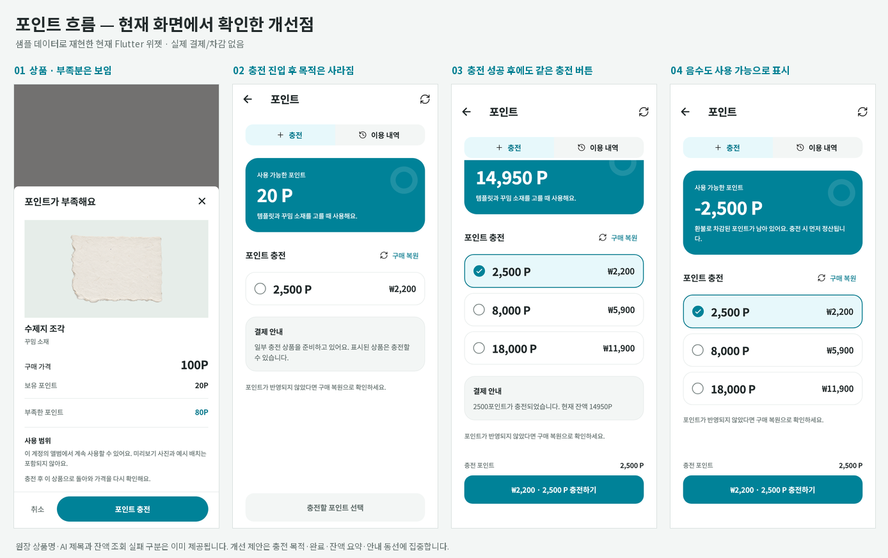
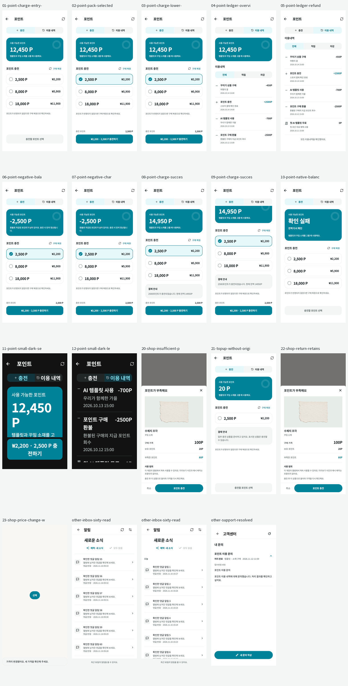

# 포인트와 연결 화면 UX·디자인 검토

현재 Flutter 코드를 기준으로 포인트 충전·구매·원장·알림·고객센터를 새로 재현했다. **12개 재현 사례가 통과했고 현재 위젯 PNG 19장을 확인했다.** 실제 거래나 운영 데이터로 검증한 것은 아니다. 웹 AI와 협업 초대의 만료 정보는 코드 확인 항목으로 따로 구분한다.

상품명·AI 제목이 나오는 원장, 충전 후 서버 검증 결과에 따른 잔액 갱신, 네이티브 잔액 조회 실패/재시도는 이미 제공된다. 이번 우선 과제는 구매 목적의 연결, 충전 완료의 구분, 결제 전 잔액 요약과 안내 동선이다.

## 확인한 단계와 상태

| 단계 | 흐름 | 현재 상태 | 새로 확인한 화면 |
| --- | --- | --- | --- |
| 1 | 상품 구매에서 부족 포인트 확인 | 양호: 상품·가격·잔액·부족분 표시 | [구매 시트](screens/20-shop-insufficient-purpose-390-light.png) |
| 2 | 부족 안내에서 포인트 충전 진입 | 개선: 상품과 부족분이 사라짐 | [충전 진입](screens/21-topup-without-original-purpose-390-light.png) |
| 3 | 충전 상품 선택·금액 확인 | 기본 동작 양호, 충전 후 잔액 요약 보강 | [선택 상태](screens/02-point-pack-selected-390-light.png) |
| 4 | 검증된 충전 성공 | 잔액 갱신 양호, 완료 구분·다음 행동 보강 | [성공 상태](screens/09-point-charge-success-status-390-light.png) |
| 5 | 이용 내역·환불 행 | 상품명·구분 양호, 정책·문의 연결 보강 | [원장](screens/05-point-ledger-refund-390-light.png) |
| 6 | 음수 잔액과 잔액 조회 실패 | 음수 제목/정산 요약 보강, 조회 실패·재시도 양호 | [음수](screens/06-point-negative-balance-selected-390-light.png), [조회 실패](screens/10-point-native-balance-error-390-light.png) |
| 7 | 스토어 가격 변경 | 다른 금액의 구매는 차단, 최신 가격 재확인 행동 부재 | [구매 게이트의 경고](screens/23-shop-price-change-warning-390-light.png) |
| 8 | 알림의 오래된 항목 확인 | 최신 60개 이후 접근 불가 | [상단](screens/other-inbox-sixty-read-top.png), [목록 끝](screens/other-inbox-sixty-read-end.png) |
| 9 | 처리 완료 문의 상세 | 고객이 보낸 내용만 조회, 답변·처리 결과 기능 필요 | [문의 상세](screens/other-support-resolved-own-message.png) |

## 우선 개선 후보

### 1. 충전 목적 카드 — 높음

100P 소재에 잔액이 20P인 구매 시트에서는 부족분 80P와 상품명이 보인다. 실제 충전 화면으로 이동하면 두 정보가 사라진다. 충전 없이 돌아왔을 때 원래 상품과 80P 안내가 다시 나타나며 자동 구매는 일어나지 않음을 재현했다. 선택 상품을 잃어버리는 버그가 아니라, 충전 화면에서 구매 목적이 연결되지 않는 문제다.

충전 상단에 **상품명 / 필요한 포인트 / 현재 잔액 / 부족분**을 작게 묶고, 충전 후 하던 구매로 돌아갈 수 있게 한다. 현재 카탈로그의 실제 충전 상품과 가격을 그대로 쓰며, 충전 복귀 후 서버 가격·소유권 재확인은 유지한다.

근거: `point_shop_access.dart:34–39,85–89`, `billing_management_screen.dart:38–44`. 화면: 단계 1→2.

### 2. 충전 완료 상태와 다음 행동 — 높음

FakeStore의 실제 구매 이벤트 → PointPurchaseService 검증 → 완료 처리 → 잔액 갱신 순서로 재현했다. 잔액은 12,450P에서 14,950P로 갱신되지만 카드 제목은 ‘결제 안내’이고 기존 상품 선택과 동일한 활성 충전 버튼이 남는다. 성공 메시지는 있으므로 성공 안내가 전혀 없다는 뜻은 아니다. 완료 상태와 다시 충전하는 상태를 더 분명하게 나눌 필요가 있다.

**충전 완료 / 이번 충전량 / 현재 잔액**을 강조하고, 주 행동을 ‘하던 구매로 돌아가기’ 또는 ‘이용 내역 보기’로 둔다. 추가 충전은 별도의 보조 행동으로 남긴다. 성공 여부는 문자열 추정이 아니라 검증 완료 상태에서 판단한다.

근거: `billing_management_screen.dart:697–730,793–856`. 화면: 단계 4.

### 3. 결제 전 잔액 요약과 작은 화면 — 보통

환불 회수로 잔액이 -2,500P여도 제목은 ‘사용 가능한 포인트’다. 정산 안내는 이미 있지만, 2,500P를 충전하면 사용할 잔액이 0P가 되는 상황을 사용자가 계산해야 한다. 320×568, 글씨 1.8배에서는 ‘12,450’과 ‘P’가 별도 줄로 떨어지고 충전 버튼의 단어도 중간에서 줄이 나뉜다. 렌더링 오류는 없었으나 읽는 흐름을 보강할 수 있다.

음수일 때는 **포인트 잔액 / 먼저 정산될 포인트**를 구분하고, 선택 상품 아래에 **현재 잔액 → 충전량 → 충전 후 예상 잔액**을 표시한다. 숫자·단위와 버튼의 금액·행동 문구는 큰 글씨에서도 읽히도록 배치를 나눈다. 서버 정산 규칙을 바꾸거나 음수 잔액을 숨기지 않는다.

근거: `point_purchase_visuals.dart:64–82`, `billing_management_screen.dart:390–414,793–856`. 화면: 단계 6, [큰 글씨](screens/11-point-small-dark-selected-320-dark.png).

### 4. 정상 상태에서도 찾을 수 있는 이용·환불 안내 — 보통

원장에서 상품명·AI 제목·포인트 회수 설명은 잘 보인다. 다만 정상 네이티브 충전 화면과 원장에서는 정책·환불 신청 경로·문의로 이어지는 직접 동선이 없다. 고객센터 버튼은 지연 결제 상태에서만 보이고, 웹의 정책 링크는 이미 제공된다.

충전 화면과 내역 하단에 **포인트 이용·취소/환불 안내**를 두고 기존 정책과 문의로 연결한다. 환불 행에서는 포인트 회수 기록과 현금 환불 처리를 혼동하지 않도록 안내한다. 결제 식별정보나 실제 처리 결과가 없는 상태에서 환불 완료·환불액·자동 환불 버튼을 만들지 않는다.

근거: `billing_management_screen.dart:626–695,732–750,860–938`, 기존 정책 `commerce_policy.dart:256–260`. 화면: 단계 5.

### 5. 가격 변경 시 최신 가격 재확인 — 보통

구매 확인 뒤 서버 가격이 바뀌면 구매가 차단되고 ‘가격이 변경됐어요. 새 가격을 확인해 주세요.’라는 메시지가 표시된다. 하지만 구매창은 닫히며 Snackbar에는 새 가격 확인 동작이 없다. 감사 대역에서도 실제 차감 없이 이 결과를 확인했다.

경고에 **새 가격 확인** 행동을 제공해 같은 상품의 최신 구매창을 다시 연다. 사용자가 새 금액을 보고 다시 확정하기 전에는 구매하지 않는다.

근거: `point_shop_access.dart:114–123`, `point_shop_product.dart:97`. 화면: 단계 7. 이 캡처의 빈 배경과 ‘선택’ 버튼은 최소 재현용 호스트이며, 앱 화면이 비는 결함을 뜻하지 않는다.

## 다른 영역

### 6. 알림의 이전 항목 더보기 — 보통

실제 provider는 최신 **60개**를 요청한다. 90일 이내 알림이 더 있어도 이전 목록으로 이동하는 기능이 없다. 최신 60개가 모두 읽음이고 61번째만 미읽음인 fixture에서 전체 미읽음 조회는 1이지만 화면의 ‘모두 읽음’은 비활성화되고 61번째 항목에는 도달하지 못했다.

커서 기반 더보기와 전체 범위의 읽음 처리를 구분한다. ‘최근 90일’ 안내와 실제 접근 범위가 맞아야 한다. 현재 홈에서 전체 미읽음 수를 배지로 표시하는 소비자는 확인하지 못했으므로 ‘홈 배지가 남는다’는 문제로 확대하지 않는다.

근거: `notification_provider.dart:24,33`, `notification_repository.dart:22–50`, `notification_screen.dart:355–361,527–583`. 화면: 단계 8.

### 7. 고객센터의 실제 답변·처리 결과 — 기능 개편

‘처리 완료’ 문의를 펼쳐도 고객이 보낸 제목과 본문만 보인다. 현재 모델에는 운영 답변·처리 결과 필드가 없다. ‘처리 완료’ 자체는 실제 답변 발송을 보장하는 상태가 아니므로, 답변이 유실됐다고 판단할 근거는 없다.

문의 상세에 **실제 답변 / 처리 결과 / 추가 문의**를 연결하면 포인트·환불 문의도 앱 안에서 마무리할 수 있다. 서버와 운영 응답 데이터가 필요하며, 화면에 임의 답변이나 처리 결과를 표시하는 식으로 해결할 수 없다. 기존 접수 이력·계정 보호·이전 문의 더보기·접수 성공 후 조회 실패 구분은 유지한다.

근거: `support_center_screen.dart:342–401`, `support_inquiry.dart:13–15,64–69`. 화면: 단계 9.

### 8. 협업 초대 링크의 만료 안내 — 후순위, 코드 확인

서버는 발급 시점부터 14일 만료를 저장하지만 생성 응답 DTO와 초대 화면에는 만료 시각이 없다. 서버의 실제 `expiresAt`을 전달해 남은 기간과 만료 시점을 보여주면 늦게 전달한 링크에 대한 혼란을 줄일 수 있다. 일회용·권한 변경 안내와 미사용 링크 취소는 이미 있으므로 새 기능인 것처럼 다시 만들 필요가 없다.

근거: `supabase/functions/album-invites/index.ts:84–93`, `data/dto/response/invite_link_response.dart:8–12`, `album_invite_screen.dart:597–604`. 이번에 실제 초대 링크를 생성·발송하지 않았고 새 화면 캡처는 없다.

## 9. 웹 AI의 잔액 표시·충전 취소 복귀 — 표시 정확성 우선, 코드 확인

AI 신규 진입은 현재 웹 `/create/ai` 전용이다. 이 항목을 현재 네이티브 진입 문제로 확대하지 않는다.

잔액 provider가 loading/error이면 생성 확인 화면에 전달할 값을 `0`으로 대체해 실제 0P처럼 보인다. 네이티브 포인트 화면은 ‘확인 실패/다시 확인’을 이미 구분하므로 같은 상태 원칙을 재사용할 수 있다. **확인 중 / 확인 실패 / 실제 잔액**을 구분해야 한다.

또한 충전 이동 후 Navigator 결과나 갱신된 잔액을 기다리지 않고 복귀 시 부족 안내를 지운다. 충전 없이 뒤로 돌아와도 다시 적용을 누르기 전까지 부족 안내가 사라질 수 있다. 기존 디자인은 유지하며 잔액 재확인 중임을 표시하고, 여전히 부족하면 부족분과 충전 행동을 유지하는 편이 좋다.

근거: `album_create_flow_screen.dart:1302,2745–2761,3131–3133`, `ai_album_point_confirmation_step.dart:257`. 이번에는 실제 웹 브라우저 흐름을 재현하지 못했으며 코드 근거에 따른 후속 확인 항목이다. 웹 포인트 충전의 미출시 제한을 우회하는 제안이 아니다.

## 적용 순서와 유지할 조건

네이티브는 1·2·4·5를 먼저 묶고 3의 잔액·큰 글씨 배치를 이어서 다듬는 순서를 권장한다. 6은 독립적인 알림 조회 개선으로 진행할 수 있다. 7은 서버 답변 데이터까지 포함한 개편이고 8은 후순위 안내 개선이다. 웹 AI를 함께 다루면 9의 표시 정확성과 취소 복귀를 병행한다.

현재 카탈로그 가격·포인트 계산·별도 구매 확정·충전 후 가격/소유권 재검증·미확정 거래 보호를 유지하는 범위로 설계한다. 충전 상품을 임의로 만들거나 자동 구매·새로운 환불 규칙을 추가할 필요는 없다.

## 범위와 증거 한계

- 로컬 headless Flutter 엔진에서 실제 위젯과 번들 폰트를 사용했다. 스토어·잔액·원장·알림·문의 데이터는 대역이다. 캡처의 금액은 실제 판매가 검증이나 실제 거래 증빙이 아니다.
- 12개 감사 사례와 PNG 19장만 이번 실행 결과다. 제품 코드는 수정하지 않았으며 감사 대상 주요 소스의 해시가 실행 전후 동일함을 확인했다.
- 390×844와 320×568·다크·1.8배 글씨를 재현했다. 큰 글씨의 줄바꿈은 개선 후보지만 스크린리더·실기기 조작성·전체 접근성 적합성을 확인한 것은 아니다.
- 실기기 결제 SDK·구매 복원·현금 환불·운영 DB·배포·실제 초대 발송은 실행하지 않았다. 웹 AI와 초대 만료는 위 한계를 구분한 코드 검토 항목이다.
- 원장의 상품명·AI 제목, 저장 목록 및 인쇄 주문 등 이미 처리한 개선을 중복 과제로 포함하지 않았다.

원본 캡처는 `screens/`, 실행 로그는 `logs/`, 재현 대역은 `probes/`에 있다. [실행 결과·소스 및 이미지 해시](verification.json)를 함께 보관한다.
