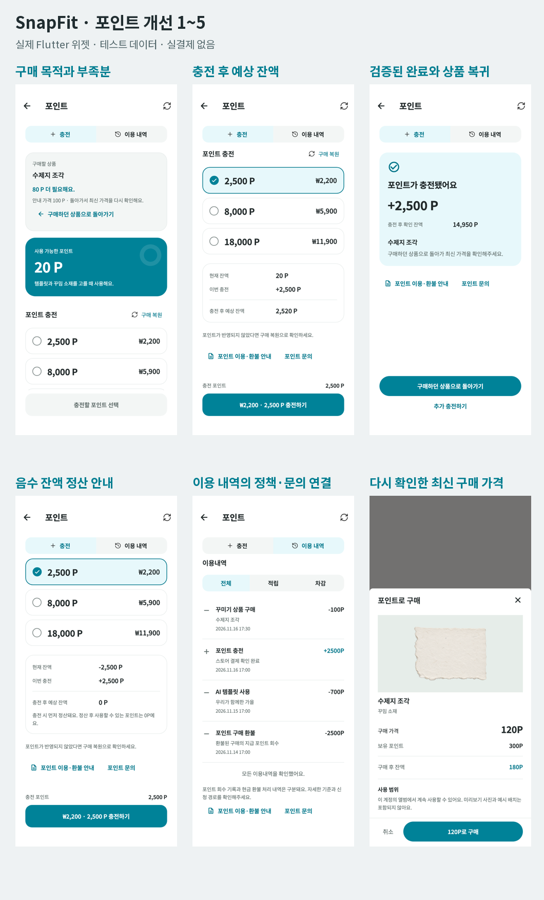
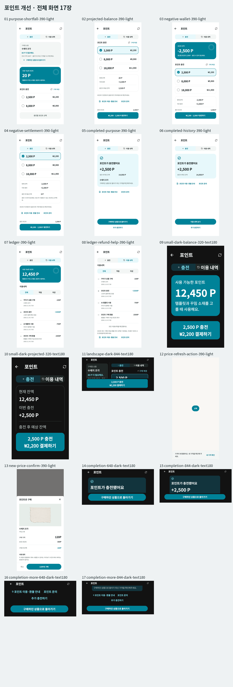

# 포인트 개선 1~5 적용 결과

승인한 다섯 항목을 현재 Flutter 코드에 반영했다. **관련 테스트 129건, 화면 재현 11건이 통과했고 새 PNG 17장을 확인했다.** 수정한 제품·테스트 파일 10개의 정적 분석은 `No issues found!`이며 테스트용 커널 컴파일 오류는 0건이다.

## 달라진 동작

| 항목 | 적용한 동작 | 확인한 증거 |
| --- | --- | --- |
| 1. 구매 목적 유지 | 부족 안내에서 충전으로 이동하면 상품명·안내 가격·부족분을 표시한다. 현재 계정에서만 보이며 원래 상품으로 돌아가면 서버 가격·잔액·소유권을 다시 확인한다. | [목적 카드](screens/01-point-purpose-shortfall-390-light.png), `shop`, `wallet` 테스트 |
| 2. 검증된 충전 완료 | 서버 검증·스토어 완료·영수증 정리 이후의 계정별 결과로 완료 카드와 지급량·확인 잔액을 표시한다. 다음 행동은 원래 상품 복귀 또는 이용 내역이며 추가 충전은 별도 선택이다. | [완료·복귀](screens/05-point-completed-purpose-390-light.png), `completions`, `wallet` 테스트 |
| 3. 잔액과 큰 글씨 | 음수 잔액은 정산할 포인트를 설명한다. 선택 상품의 포인트를 더한 예상 잔액을 표시하며 조회 중·실패를 0P로 대체하지 않는다. 숫자와 P는 함께 표시한다. 큰 글씨의 결제 버튼은 두 줄로 나눈다. | [예상 잔액](screens/02-point-projected-balance-390-light.png), [정산 안내](screens/04-point-negative-settlement-390-light.png), [320·글씨 1.8배](screens/09-point-small-dark-balance-320-text180.png) |
| 4. 이용·환불 안내 | 정상 충전과 이용 내역에서 기존 정책과 고객센터로 연결한다. 환불 행에는 포인트 회수 기록과 현금 환불 처리가 구분된다는 안내를 제공한다. | [원장 안내](screens/08-point-ledger-refund-help-390-light.png), 실제 기존 정책 화면으로 이동하는 `wallet` 테스트 |
| 5. 가격 재확인 | 가격 변경 경고의 `새 가격 확인`을 선택하면 같은 구매 요청에서 서버 가격을 다시 조회한다. 사용자가 새 가격을 확인하고 별도로 확정해야 구매한다. | [재확인 행동](screens/12-point-price-refresh-action-390-light.png), [최신 120P 확인](screens/13-point-new-price-confirm-390-light.png), `shop` 테스트 |

완료 결과와 안내용 구매 맥락은 별도 불변 모델로 분리했다. 화면 문구를 해석해 성공 여부를 추정하지 않는다. 이미 지급된 거래의 복구는 신규 `+P`로 표시하지 않으며, 이전 성공 문구가 화면 재진입이나 다른 계정에 남지 않도록 구분한다. 이후 발생한 실제 카탈로그 오류는 보존한다.

## 작은 화면에서 추가로 수정한 부분

648×320·글씨 1.8배·안전 영역 조건에서 완료 화면의 두 고정 버튼과 사이드바·탭이 본문을 26dp만 남기는 것을 새 캡처로 확인했다. 해당 완료 상태에서는 사이드바·탭을 숨기고 복귀 버튼 하나만 고정했다. 추가 충전은 스크롤할 수 있는 본문 끝으로 옮겼다.

실제 본문 높이는 **648×320에서 157dp, 844×390에서 227dp**다. 완료 제목, 확인 잔액, 추가 충전에 접근할 수 있고 복귀 버튼은 계속 터치 가능함을 검사했다. 세로 화면의 완료 배치는 유지한다.

- [648 가로 완료](screens/14-point-completion-648-dark-text180.png)
- [844 가로 완료](screens/15-point-completion-844-dark-text180.png)
- [648 추가 충전 접근](screens/16-point-completion-more-648-dark-text180.png)
- [844 추가 충전 접근](screens/17-point-completion-more-844-dark-text180.png)

## 검증 결과

| 구분 | 통과 | 로그 |
| --- | ---: | --- |
| 새 지갑 UI·완료·계정 전환·복귀·가로 화면 | 11 | [wallet](logs/wallet.log) |
| 검증 결과·실패·복구·기존 지급·계정 보호 | 11 | [completions](logs/completions.log) |
| 상품 구매·충전 복귀·가격 변경·계정·화면·중복 요청 | 14 | [shop](logs/shop.log) |
| 기존 스토어 구매·영수증 검증·복구 | 28 | [iap](logs/iap.log) |
| 미확정 거래·계정·소유권 보호 | 21 | [uncertainty](logs/uncertainty.log) |
| Apple 스토어 완료 지연 보호 | 4 | [apple](logs/apple.log) |
| 기존 반응형·로딩·오류·상품 갱신 | 28 | [responsive](logs/responsive.log) |
| 기존 AI 복귀와 내역 | 5 | [aireturn](logs/aireturn.log) |
| 원장 필터·더보기·재시도·큰 글씨 | 7 | [ledger](logs/ledger.log) |
| **테스트 합계** | **129** | |
| 실제 위젯 화면 재현 | 11 | [포인트 10건](logs/cap_points.log), [가격 변경 1건](logs/cap_shop.log) |

구현 전 기존 UI에서 완료 구분·음수 잔액 제목·정책 연결·숫자와 단위 한 줄 표시의 네 검사가 실패함을 확인했다. 새 가격 확인 행동도 기존 코드에서 실패했다. 가로 화면 본문 높이 검사도 수정 전에 실패한 뒤 통과했다. 관련 RED 로그를 함께 보관한다.

기존 반응형 테스트 두 곳은 변경된 정산 문구와 추가 요약 카드 아래의 지연 결제 복구 버튼에 스크롤로 접근하도록 맞췄다. 구매 차단·지연 결제·서버 재검증 검사는 유지했다.

독립 검토에서도 완료 결과 생성 시점, 이전 성공 문구 차단, 현재 계정 제한, 조회 실패 표시, 가격 재확인·별도 확정, 짧은 화면의 버튼 중복 생성 여부를 확인했으며 새 차단 문제는 발견하지 못했다.

## 코드와 재현 자료

- 제품: `billing_management_screen.dart`, `point_purchase_visuals.dart`, `point_purchase_service.dart`, `point_shop_access.dart`, 새 `PointPurchaseCompletion`·`PointTopUpContext`.
- 테스트: 새 `point_purchase_completion_test.dart`·`point_wallet_improvements_test.dart`, 기존 구매 흐름·반응형 테스트 보강.
- [이번 작업만의 변경](changes.patch)은 작업 시작 시 파일 사본과 비교했다. 기존 미커밋 변경을 포함하는 HEAD 전체 diff와 구분한다.
- [검증 수치·소스 및 이미지 해시](verification.json), [정적 분석](logs/analyze-final.log), [최종 커널 컴파일](logs/compile-final.log).
- `probes/`에 직렬 실행기·캡처 대역·폰트 및 에셋 목록을 보관했다. SDK 캐시 쓰기·테스트 소켓 제약을 피하기 위해 기존 로컬 Flutter 엔진에서 동일한 Dart 테스트와 실제 위젯을 실행했다. 실행기는 기록된 작업 경로의 패키지 설정과 준비된 에셋을 사용한다. 일반 `flutter test` CLI 실행 결과나 전체 앱 빌드 결과로 대체해 해석하지 않는다.
- 무거운 컴파일·분석·테스트·렌더는 한 번에 하나씩 실행했다.

## 확인 범위

실제 Flutter 위젯과 번들 폰트를 사용했지만 스토어·지갑·상품·원장은 테스트 대역이다. 캡처의 금액·포인트는 실제 운영 가격이나 거래 증빙이 아니다. 가격 변경 캡처의 빈 배경과 `선택` 버튼은 구매 게이트를 재현하는 최소 호스트다.

실스토어 결제·실기기 구매 복원·현금 환불·운영 DB 쓰기·전체 앱 빌드·배포는 실행하지 않았다. 알림·운영 답변·초대 만료·웹 AI의 별도 개선 후보 6~9번은 이번 1~5번 적용 범위에 포함하지 않는다.
