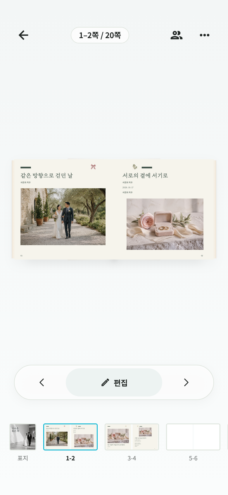
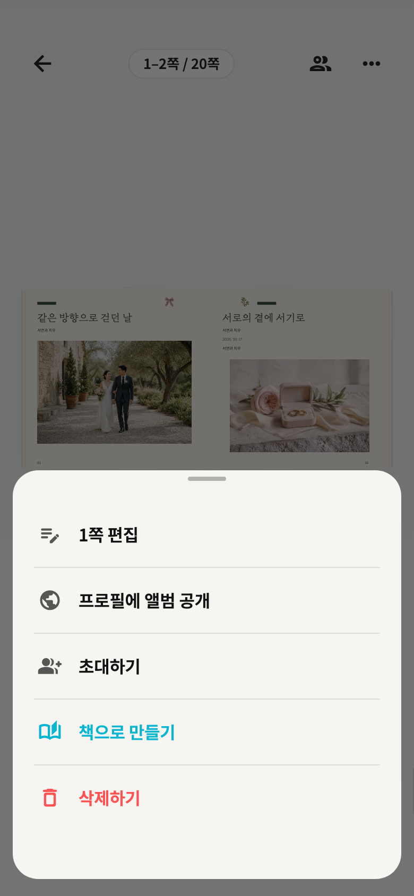
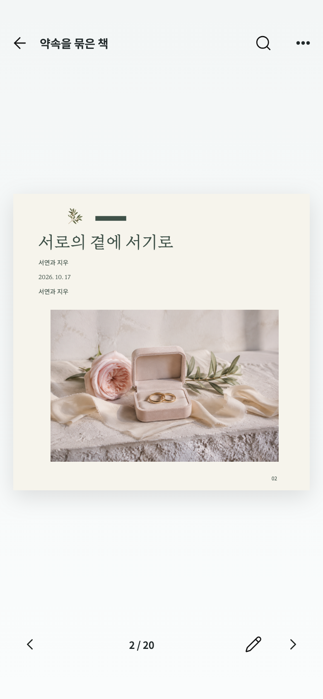
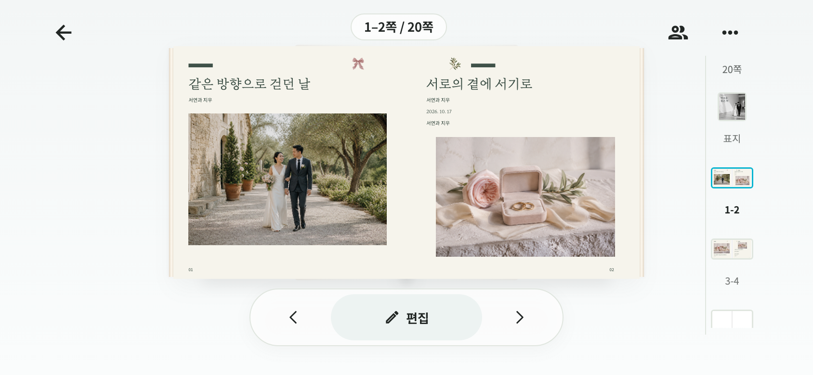

# 읽기 화면 점검

2026-11-12 KST. 현재 제품 위젯을 새로 실행해 확인했다. 제품 코드는 변경하지 않았다.
실제 폰트·템플릿 사진과 합성 소유자의 메모리 앨범을 사용했으며 운영 앨범·DB·주문은 접근하지 않았다.

## 판단과 개선 순서

1. 세로에서 두 쪽을 동시에 작게 보여 주는 배치가 우선 문제다. 사진뿐 아니라 글을 읽기 어렵고, 화면 위아래가 넓게 비어 있다. 표지는 단독으로 크게, 세로 내지는 한 쪽씩 크게, 가로는 펼침을 유지하는 방향을 권한다.
2. 상시 썸네일과 중앙 편집 도크가 시선을 나눠 가진다. 페이지 이동은 간결하게 유지하고 전체 페이지 목록은 필요할 때 펼치는 방식으로 정리할 수 있다. 감상 중 조작부 숨기기도 검토할 만하다.
3. 편집이 읽기 화면에서 가장 크게 강조된다. 중앙 편집 버튼과 더보기의 N쪽 편집을 통합하고, 어느 쪽을 편집할지 명시하는 작은 동작으로 두는 편이 낫다.

## 1. 세로 내지 — 개선 우선

책의 질감과 원래 사진 비율은 유지된다. 하지만 390×844 세로에서 두 쪽을 동시에 표시해 한 쪽의 본문이 작다. 상·하단 빈 공간과 항상 보이는 큰 편집 버튼을 함께 확인했다. 작은 본문은 저시력 사용자의 읽기를 어렵게 할 수 있다.

## 2. 더보기 — 주요 동작은 정리되어 있음

현재 쪽 편집·공개·초대·책 주문·삭제로 구성되어 있다. 삭제의 색상 구분은 명확하다. 현재 쪽 편집이 이미 제공되므로 본문의 큰 편집 버튼을 반복 강조할 필요는 낮다. 이 화면에서 쓸데없는 관리 기능을 더 추가하지 않는다.

## 3. 한 쪽 상세 — 큰 페이지의 기준으로 활용 가능

내지를 누르면 한 쪽이 크게 열리고 사진과 글의 읽기 크기가 개선된다. 확대·더블탭·핀치 기능은 이미 구현되어 있으므로 확대 기능이 없다는 진단은 하지 않는다. 별도 상세 진입 없이 기본 읽기 화면에서 이 크기를 제공하는 방향을 우선 검토한다.

## 4. 가로 펼침 — 유지할 강점

가로에서는 두 쪽이 넓게 펼쳐지고 시각적 비율이 자연스럽다. 펼침 자체를 없애기보다 화면 방향에 맞게 기본 읽기 방식을 조정하는 편이 낫다. 썸네일과 편집 도크의 상시 노출은 세로와 함께 정리할 수 있다.

## 확인 범위

새 캡처 실행 3건 통과, 파일 4장을 직접 열어 확인했다. 실제 AlbumReaderScreen과 상세·메뉴의 현재 코드가 근거다. 이번 점검은 로컬 위젯과 캡처 기준이며, 실제 기기의 손가락 조작감·스크린리더·성능이나 실제 브라우저 동작을 완료 검증한 것은 아니다. 접근성 전체 적합성을 주장하지 않는다. 앱 빌드·서버 실행·제품 파일 수정은 하지 않았다.
