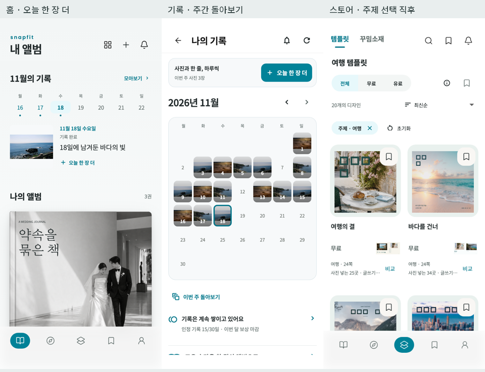

# 선택한 개선사항 2·3·4 반영 — 2026-11-15

사용자가 지정한 2·3·4번을 반영했다. 하단 메뉴 파일은 작업 전 스냅샷과 바이트 단위로 동일하다.

| 항목 | 반영한 동작 |
| --- | --- |
| 2. 스토어 결과 접근 | 주제를 고르면 기존 필터·결과 앵커로 이동한다. 기획전으로 돌아가게 하던 네이티브 카테고리 선택의 상단 이동 덮어쓰기 한 줄을 제거했다. 초기 추천 구성, 선택 조건, 가격·정렬, 비교 선택, 페이지 단위 로딩과 숨긴 탭의 복귀 처리를 유지한다. |
| 3. 기록 작성 문구 | 홈과 기록 화면의 작성 버튼을 오늘 기록이 없으면 `오늘 기록하기`, 있으면 `오늘 한 장 더`로 맞췄다. 기록 화면은 선택한 월과 관계없이 서버의 현재 주·오늘을 사용한다. 버튼은 계속 새 기록 작성으로 연결된다. |
| 4. 주간 돌아보기 | 월 제목 옆 아이콘을 달력 아래의 `이번 주 돌아보기` 텍스트 버튼으로 옮겼다. 44px 이상 터치 영역과 기존 주간 사진·계정 보호·진입 동작을 유지한다. |

## 검증

- 관련 기능 검증 **76건 통과, 실패 0건**. 홈 21, 기록·회고 15, 스토어 필터 9, 메인 스토어 24, 일일 기록 기본 화면 7. 웹 전용 테스트 1건은 네이티브 실행 범위에서 제외했다.
- 변경한 제품·테스트 8개 파일은 `dart --suppress-analytics analyze`에서 `No issues found!`다. 포맷과 해당 파일의 `git diff --check`도 통과했다.
- 변경 전에는 오늘 기록 문구 1건·일일 작성 문구 2건·주간 회고 표시 1건·메인 스토어 선택 조건 표시 1건이 새 기대 동작에 실패했다. 변경 후 통과를 확인했다.
- 320px 폭, 짧은 가로 화면, 1.8~2.0배 글씨, 라이트·다크, 달 경계의 주간 사진, 계정 전환, 저장 후 결과 화면, 필터 초기화·비교 보존·페이지 로딩을 포함한다.
- 실제 Flutter 위젯과 번들 폰트·이미지로 캡처했다. 스토어는 로딩 스켈레톤이 사라진 뒤 촬영했고 최종 이미지를 직접 확인했다. 화면 데이터와 계정·상품 응답은 메모리 대역이다. 홈·기록의 날짜는 기존 fixture인 2026-11-18이며 실제 오늘의 사용자 기록을 뜻하지 않는다.
- 작성자와 별도의 읽기 전용 코드 검토에서 차단할 발견 사항이 없었다. 전체 저장소의 기존 변경과 섞지 않고 작업 전 파일 스냅샷과 비교한 [변경 내역](scoped.patch)을 사용했다.

## 실행상의 보완과 한계

일반 Flutter 테스트 명령은 이 환경에서 SDK 캐시 쓰기와 로컬 서버 소켓이 제한돼 통신 없는 네이티브 실행기를 사용했다. 기록 테스트의 원본 이미지 선로딩과 스토어 테스트의 이미지 대기는 임시 복사본에서 보완했으며 테스트 본문의 단언과 제품 코드는 동일했다. 이 보완으로 앞선 이미지 대기 시간 초과를 해소한 뒤 최종 검증을 완료했다.

일부 기존 스토어 테스트는 추천/주제 선반을 결과 컨트롤로 취급하거나 자동 이동 후에도 상단 선반이 마운트돼 있어야 한다고 가정했다. 실제 결과 컨트롤인 정렬 메뉴를 기준으로 확인하고, 결과 이동을 먼저 검증한 다음 위로 돌아가 추천 구성이 보존됐는지 검사하도록 정리했다. 짧은 가로 화면에서 큰 글씨를 쓰면 활성 조건 칩은 추가 스크롤이 필요할 수 있으므로 제목의 자동 노출과 조건 유지, 일반 크기에서의 조건 칩 노출을 구분해 검사했다.

전체 저장소 테스트·실기기·실제 OS 키보드/스크린리더·실제 서버 주문이나 저장은 확인하지 않았다. 앱 전체 빌드, 서버 실행, 배포, 운영 데이터 변경, 커밋은 하지 않았다. 변경 전부터 있던 다른 작업은 보존했다.
