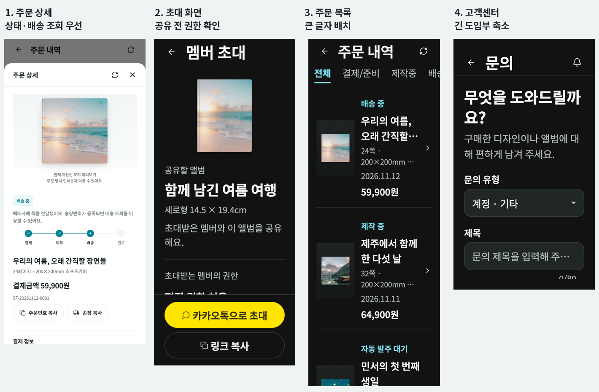

# 주문·초대·고객센터 디자인 검토

2026-11-16. 실제 Flutter 위젯의 새 화면 24장과 8개 로컬 시나리오를 확인했다. 제품 코드는 변경하지 않았다.

우선 개편할 곳은 **주문 상세와 초대 화면의 정보 순서**다. 중요한 상태와 선택을 먼저 보여주고, 큰 표지·반복 안내가 차지하는 공간을 줄이는 방향을 권장한다.

## 1. 주문 상세를 상태·배송 조회 중심으로 재편 — 우선

주문 상세 첫 화면에는 260dp 표지 영역과 현재 저장본 안내가 먼저 나온다. 배송 중인 주문의 `배송 조회`는 결제 정보·받는 곳·제작 이력 아래에 있다. 반면 주문번호·송장 복사는 비교적 먼저 보인다. 주문 상태와 배송을 확인하려는 목적에 맞춰 우선순위를 바꿀 가치가 크다.

| 현재 순서 | 권장 순서 |
| --- | --- |
| 큰 표지와 주의문 → 상태·단계 → 제목·금액·복사 → 결제·배송지·제작 이력 → 배송 조회 | 작은 앨범 요약 → 현재 상태·단계 → 배송 조회·문의 → 접어 둔 결제·배송지·상세 이력 |

배송 중일 때는 이미 제공하는 배송 조회를 상단에 둔다. 제작 중에는 현재 제작 단계를 먼저 보여준다. 현재 저장된 표지와 주문 당시 인쇄본이 다를 수 있다는 안내는 유지하되 작은 표지에 맞는 보조 정보로 정리한다.

- 근거: [배송 상세 첫 화면](screens/orders-02-shipping-detail-top-390.png), [조회 버튼 위치](screens/orders-04-shipping-detail-actions-390.png), [큰 글자 첫 화면](screens/orders-07-shipping-detail-top-320-large-dark.png)
- 위치: `order_album_artwork.dart:72`, `order_history_screen.dart:1025`, `:1333`

## 2. 초대 권한을 공유 전에 확인할 수 있게 배치 — 우선

320dp·글자 1.6배에서는 표지·앨범 제목·설명이 첫 화면 대부분을 차지한다. 하단의 카카오톡 초대·링크 복사 버튼은 활성화되어 있지만, 현재 `함께 편집 / 보기 전용` 권한 선택은 본문 아래로 밀린다.

큰 글자에서도 앨범 요약을 작게 유지하고 **권한 선택 → 공유 행동** 순서가 보이도록 재배치하는 편이 좋다. 권한 선택을 먼저 올리면 설명을 추가하지 않고도 현재 공유 조건을 확인할 수 있다. 권한 변경 시 새 링크를 만들며 기존 링크의 권한은 바뀌지 않는 현재 동작·안내는 보존한다.

- 근거: [큰 글자 초대 첫 화면](screens/invite-viewer-320-large-dark.png), [아래쪽 링크·안내](screens/invite-viewer-320-large-dark-bottom.png)
- 위치: `album_invite_screen.dart:187`, `:211`, `_albumIdentity`, `_linkSettings`

## 3. 주문 목록의 제목·규격에 넓은 공간 확보 — 보조

고정 92/112dp 표지 옆에 상태·제목·규격·날짜·금액이 모두 쌓인다. 390dp의 긴 제목은 마지막 `들`이 혼자 다음 줄에 남고, 320dp·큰 글자에서는 제목과 규격이 크게 잘린다.

좁은 폭·큰 글자에서는 표지를 줄이고 제목·상태에 넓은 공간을 준다. 날짜·규격·금액은 아래쪽 전체 폭 행으로 분리하는 적응형 배치를 권장한다. 현재 목록의 얇은 구분선과 상태 필터는 유지할 만하다.

- 근거: [390dp 주문 목록](screens/orders-01-mixed-list-390.png), [320dp·큰 글자 목록](screens/orders-06-mixed-list-320-large-dark.png)
- 위치: `order_history_screen.dart:651–729`

## 4. 고객센터의 도입부·반복 제목 축소 — 보조

문의 작성의 `무엇을 도와드릴까요?`가 큰 글자에서는 `무엇을 도와드릴까 / 요?`로 나뉜다. 긴 보조문구까지 합쳐 첫 화면에 문의 내용 입력란이 보이지 않는다. 상단을 `문의 작성`으로 정리하고 본문은 문의 유형·제목·내용부터 시작하면 더 직접적이다.

문의 내역을 펼치면 헤더의 제목 아래에 같은 제목이 한 번 더 나온다. 펼친 상태에서는 제목 전문을 한 번 표시하고, 접수번호와 문의 내용이 이어지도록 정리하는 편이 좋다. 긴 제목을 확인할 수 있는 기능은 보존해야 한다.

- 근거: [큰 글자 작성 화면](screens/support-07-compose-320-large-dark.png), [기본 문의 펼침](screens/support-02-history-expanded-390.png), [큰 글자 문의 펼침](screens/support-06-expanded-320-large-dark.png)
- 위치: `support_inquiry_screen.dart:248–266`, `support_center_screen.dart:352`, `:391`

## 유지할 부분

- 일반 멤버 목록의 본인·역할 표시와 멤버 관리 메뉴는 명확하다. 큰 글자에서도 긴 이름·나가기 버튼에 스크롤로 도달한다.
- 고객센터의 입력 라벨·문자수·유형 선택과 단일 전송 버튼은 정돈돼 있다. 큰 글자에서도 전송 버튼이 온전히 보이는 위치까지 이동한다.
- 주문의 상태 필터, 진행 단계, 새로고침·닫기 아이콘은 유지한다.

## 확인한 단계와 상태

| 단계 | 화면 | 판정 |
| --- | --- | --- |
| 1 | [문의 목록](screens/support-01-history-390.png) | 정보 순서·구분선 유지 |
| 2 | [문의 펼침](screens/support-02-history-expanded-390.png) | 반복 제목 축소 |
| 3 | [문의 작성](screens/support-03-compose-390.png) | 기본 폼은 정돈됨 |
| 4 | [문의 유형 선택](screens/support-04-category-390.png) | 유지 |
| 5 | [입력 완료·전송 버튼](screens/support-05-compose-filled-390.png) | 정상 도달, 전송하지 않음 |
| 6 | [큰 글자 문의 펼침](screens/support-06-expanded-320-large-dark.png) | 반복 제목의 공간 부담 |
| 7 | [큰 글자 작성 상단](screens/support-07-compose-320-large-dark.png) | 도입부 축소 |
| 8 | [큰 글자 작성 하단](screens/support-08-compose-action-320-large-dark.png) | 입력·버튼 도달 유지 |
| 9 | [주문 목록](screens/orders-01-mixed-list-390.png) | 긴 제목 배치 개선 |
| 10 | [배송 상세 상단](screens/orders-02-shipping-detail-top-390.png) | 상태·행동 우선순위 개선 |
| 11 | [배송 상세 중간](screens/orders-03-shipping-detail-status-390.png) | 정보 밀도 정리 |
| 12 | [배송 상세 하단](screens/orders-04-shipping-detail-actions-390.png) | 배송 조회를 앞쪽으로 이동 |
| 13 | [제작 중 상세](screens/orders-05-production-detail-status-390.png) | 현재 단계 중심으로 정리 |
| 14 | [큰 글자 주문 목록](screens/orders-06-mixed-list-320-large-dark.png) | 제목·규격 폭 확보 |
| 15 | [큰 글자 상세 상단](screens/orders-07-shipping-detail-top-320-large-dark.png) | 표지 영역 축소 |
| 16 | [큰 글자 상세 중간](screens/orders-08-shipping-detail-status-320-large-dark.png) | 상태·정보 순서 정리 |
| 17 | [소유자 멤버 목록](screens/members-owner-390.png) | 유지 |
| 18 | [멤버 관리 메뉴](screens/members-owner-role-menu-390.png) | 역할·행동 구분 유지 |
| 19 | [보기 전용 멤버 목록](screens/members-viewer-390.png) | 유지 |
| 20 | [큰 글자 멤버 목록](screens/members-viewer-320-large-dark.png) | 유지 |
| 21 | [큰 글자 목록 하단](screens/members-viewer-320-large-dark-bottom.png) | 긴 이름·나가기 도달 유지 |
| 22 | [기본 편집 초대](screens/invite-editor-390.png) | 기본 기능 유지 |
| 23 | [큰 글자 보기 전용 초대](screens/invite-viewer-320-large-dark.png) | 공유 전 권한 확인 개선 |
| 24 | [큰 글자 초대 링크](screens/invite-viewer-320-large-dark-bottom.png) | 링크 정책 안내 유지 |

## 검증 범위

문의 2개·주문 3개·공유 관리 3개 시나리오가 통과했고, 새 PNG 24장을 확인했다. 제품 Dart 파일 821개의 해시는 검토 전후 동일하다. 캡처 도중 화면 밖의 멤버 행은 목록을 스크롤해 구성한 뒤 확인하도록 재현 도구를 수정했으며 제품 결함으로 분류하지 않았다.

실제 위젯·로컬 대역·가상 앨범과 주문 정보를 사용했다. 운영 계정, 현재 판매 금액, 실제 주문 상태를 조회한 결과는 아니다. 문의 전송·실제 초대 공유·멤버 변경·주문 취소·결제·외부 배송 조회는 실행하지 않았다. 실기기 키보드·스크린리더·웹 E2E·전체 빌드·배포는 범위에 포함하지 않았다.

[검증 기록](verification.json) · [소스 해시](source-hashes.json) · [문의 로그](logs/cap_support.log) · [주문 로그](logs/cap_orders.log) · [공유 로그](logs/cap_members.log)
