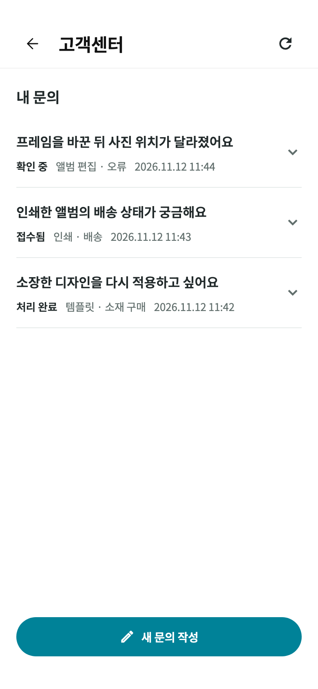
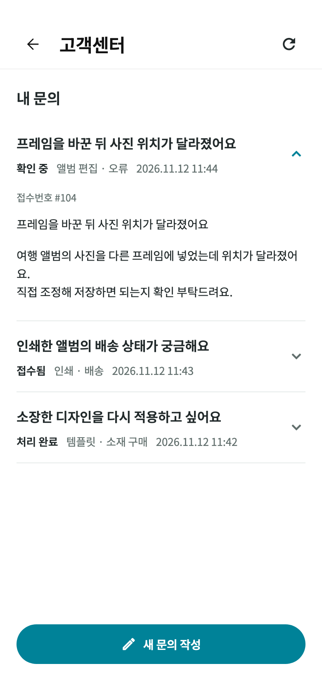
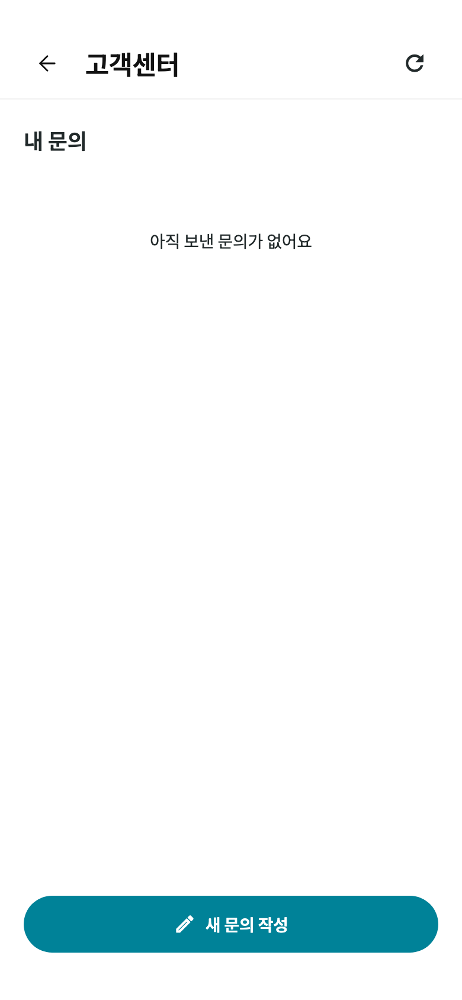
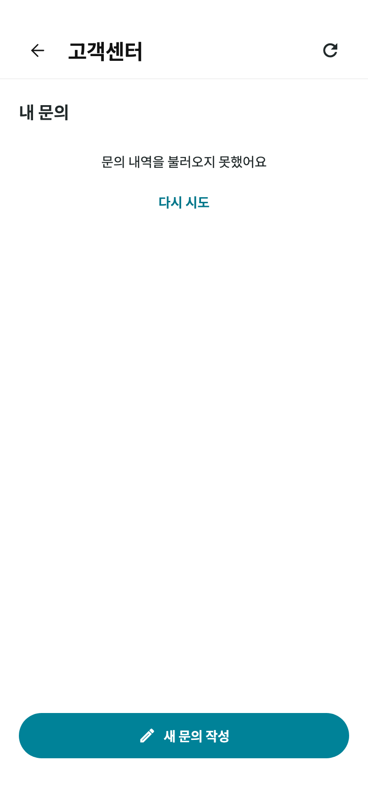
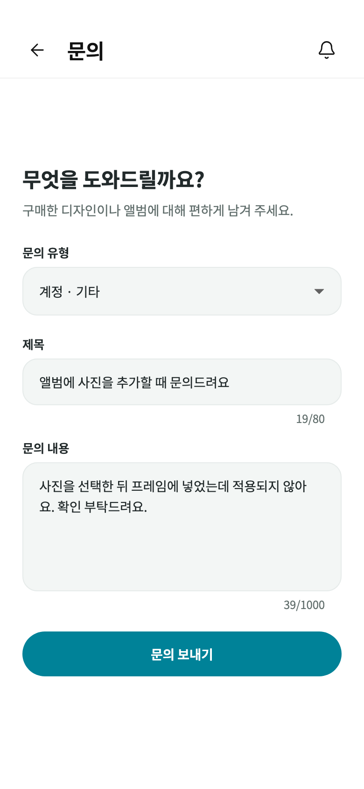
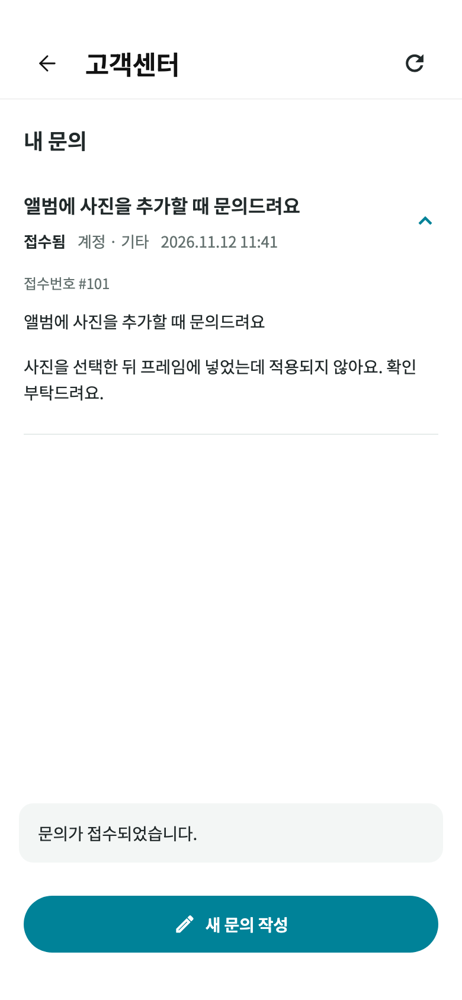
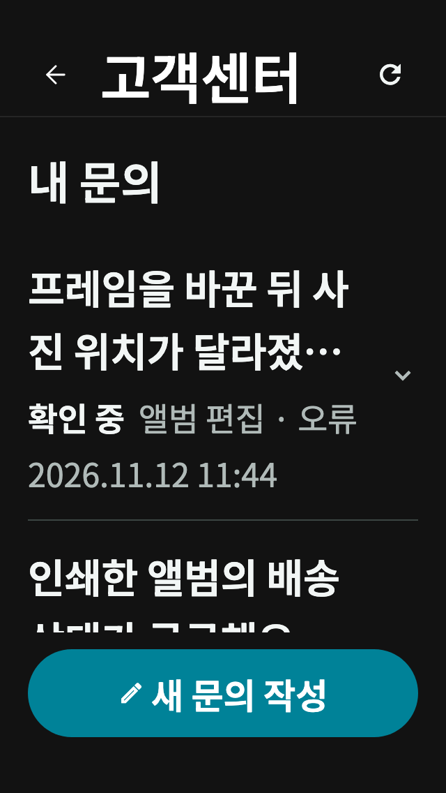
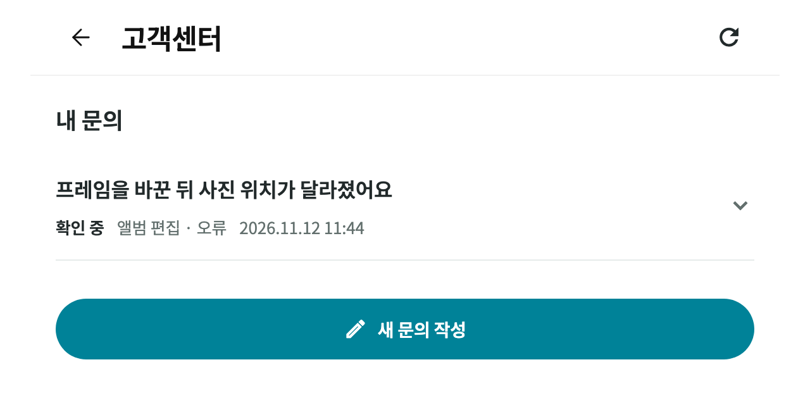

# 고객센터 개편 결과

2026-11-12. 설정의 고객센터를 문의 내역 중심으로 연결하고, 승인한 편집 저장 후 이어가기 안내를 함께 수정했다.

## 변경한 흐름

| 단계 | 변경 후 동작 |
| --- | --- |
| 1. 고객센터 진입 | 내 문의 목록과 새 문의 작성이 보인다. |
| 2. 문의 확인 | 제목·유형·접수일·실제 저장된 상태를 읽고, 행을 펼쳐 보낸 내용과 접수번호를 확인한다. |
| 3. 새 문의 작성 | 기존 입력 화면과 작성 중 나가기·중복 제출 보호를 사용한다. |
| 4. 접수 완료 | 목록을 다시 불러온다. 완료 버튼·헤더 뒤로가기·시스템 뒤로가기로 닫아도 확인된 접수는 유지한다. |
| 5. 조회 실패 | 접수 성공과 목록 조회 실패를 구분한다. 기존 목록·펼친 내용·추가 조회 커서를 보존하고 다시 시도한다. |

문의는 20개씩 조회하며, ID 내림차순 커서로 이전 문의를 추가한다. ‘접수됨’, ‘확인 중’, ‘처리 완료’는 서버 상태에 대응한다. 알 수 없는 상태는 ‘상태 확인 필요’로 표시하며 ‘답변 완료’로 추정하지 않는다.

SDK 세션과 화면 계정이 모두 같은 경우만 조회한다. 계정 교체·로그아웃·A→B→A 이후에는 기존 목록과 작성 중인 문의를 숨기고, 늦은 응답이나 저장해 둔 버튼 콜백으로 다시 표시·제출하지 못하게 했다.

편집기 저장 후 안내는 **‘n쪽 이어 채우기’**로 수정했다. 실제로 앞쪽 미완성 쪽으로 돌아가는 경우에도 의미가 맞으며 페이지 선택 로직은 그대로다.

## 화면

아래는 실제 앱 위젯·앱 테마·번들 글꼴로 캡처한 가상 자료다. 실제 고객 문의나 계정 자료가 아니다.

### 내 문의 목록

### 보낸 내용 펼쳐보기

### 빈 목록과 조회 실패

### 기존 문의 작성과 접수 후 목록 복귀

### 큰 글씨·다크 및 가로 화면

## 검증

| 회귀 영역 | 통과 | 실패 |
| --- | ---: | ---: |
| 실제 HTTP 기반 문의 Repository | 21 | 0 |
| 고객센터 목록·계정 경계·반응형 | 13 | 0 |
| 접수 후 실패·늦은 응답·시스템 뒤로가기 | 4 | 0 |
| 편집 저장 후 페이지 이동 | 4 | 0 |
| 기존 문의 작성·테마·키보드 | 18 | 0 |
| 기존 작성 중 나가기 보호 | 23 | 0 |
| 기존 보조 화면 | 18 | 0 |
| 설정 | 5 | 0 |
| 기존 주문 문의 연결 | 7 | 0 |

관련 회귀 **113개**, 캡처 시나리오 **6개** 통과. 화면 **8장**을 저장하고 확인했다. 변경 범위 13개 파일의 정적 분석은 오류 0·경고 0이며, 기존 편집기 글꼴 진입의 `no_logic_in_create_state` 정보 메시지 1건은 유지했다.

추가 리뷰에서 발견한 ‘다른 화면 뒤에서 접수가 완료된 후 시스템 뒤로가기로 닫으면 목록 갱신이 빠짐’을 새 테스트로 재현하고 수정했다. 확인된 접수를 callback으로 부모에 전달해 route 반환 값과 별도로 보존한다. 최종 독립 리뷰에서 추가 blocking은 없었다.

기존 보조 화면 테스트 4개가 실제 인증 초기화의 25초 타이머를 남기던 fixture도 게스트 인증 fake로 격리했다. 제품 동작이나 테스트의 타이머 검사를 완화하지 않았다. Repository 쿼리 기대값은 설치된 Postgrest의 실제 `id.desc.nullslast` 출력에 맞췄다.

## 운영·실기 확인 범위

- 기존 `support_inquiries`와 본인 조회 정책을 사용하는 앱 코드를 연결했다. 필요한 고객용 7개 열만 조회하고 명시적 `user_id` 필터를 유지한다.
- 운영 DB의 현재 열·권한·상태 제약은 직접 조회하지 못했다. Supabase 앱 도구의 연결 식별자가 없고 로컬 CLI 접근 토큰도 없어 메타데이터 쿼리를 실행하지 않았다. 로컬 마이그레이션과 서버 함수에서 열·정책·상태를 확인했다.
- 실제 답변 본문·이메일 발송·답변 알림은 이번에 새로 구현하지 않았다. 근거 없는 답변 시간 약속을 접수 안내에서 제거했다.
- 운영 DB 변경·실제 문의 발송·앱 전체 빌드·설치는 하지 않았다. 연결 기기의 직접 조작이나 배포 완료를 뜻하지 않는다.
- 스크린리더·키보드·대비 수치의 전체 접근성 검증은 별도다. 이번에는 좁은 화면, 큰 글씨, 가로 배치, 입력과 상태 전환의 동작을 확인했다.

실행 로그, 소스 해시, 캡처 코드와 실행기는 같은 폴더의 `logs/`, `verification.json`, `probes/`에 보존했다.
