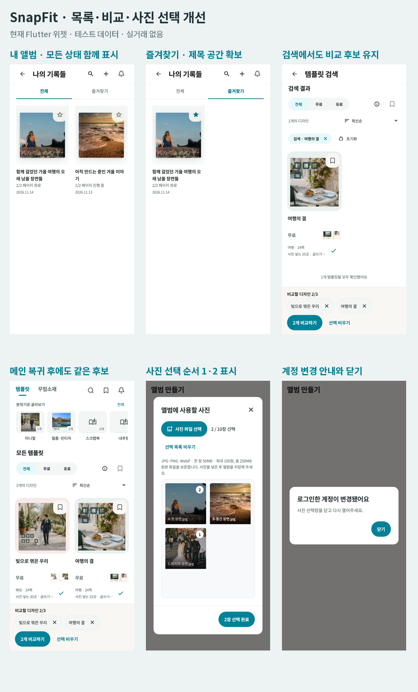
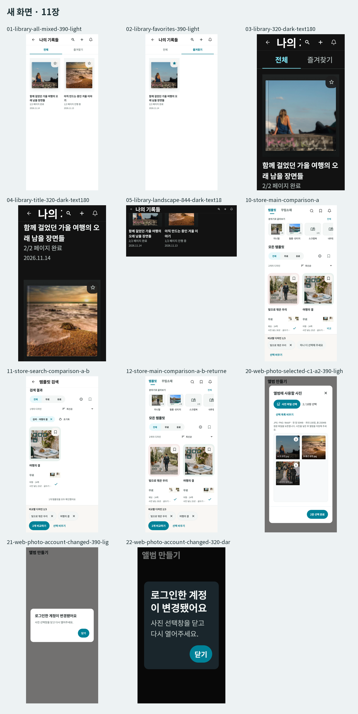

# 앨범 목록·비교·사진 선택 개선 결과

승인한 네 항목과 앨범 카드 배치를 적용했다. 사용자의 최신 지시에 따라 **내 앨범을 진행 중·완료 상태로 나누지 않고 전체 목록을 기본 표시**한다. 기존 검색과 개인 즐겨찾기는 유지한다.

관련 테스트 **127건**, 화면 재현 **7건**이 통과했고 새 PNG **11장**을 확인했다. 변경한 제품 5개·저장소 테스트 5개 파일의 정적 분석은 `No issues found!`, 최종 테스트용 커널 컴파일 오류는 0건이다.

## 적용한 동작

| 대상 | 달라진 동작 | 새 화면 |
| --- | --- | --- |
| 내 앨범 | 진행 중·완료 탭을 없애고 전체·즐겨찾기만 제공한다. 완료 앨범과 작성 중 앨범을 기본 화면과 검색에서 함께 찾는다. | [전체 목록](screens/01-library-all-mixed-390-light.png), [즐겨찾기](screens/02-library-favorites-390-light.png) |
| 앨범 카드 | 별 버튼을 표지 위로 옮겨 제목 전체 폭·두 줄을 확보했다. 별 터치 영역 44px 이상, 기존 쪽수와 공유 역할 표시는 유지한다. | [320·다크·글씨 1.8배](screens/03-library-320-dark-text180.png), [제목 영역](screens/04-library-title-320-dark-text180.png), [가로](screens/05-library-landscape-844-dark-text180.png) |
| 스토어 비교 | 메인에서 고른 A와 검색에서 고른 B를 같은 비교 영역에서 이어서 확인한다. 삭제·비우기도 양쪽에 반영한다. 최대 3개 제한과 개별 검색어·스크롤·필터는 유지한다. | [검색에서 A+B](screens/11-store-search-comparison-a-b.png), [메인 복귀 후 A+B](screens/12-store-main-comparison-a-b-returned.png) |
| 웹 사진 순서 | 클릭한 순서 C→A가 반환과 자동 배치에도 C→A로 이어진다. 사진 위 번호와 음성 안내도 같은 순서를 사용한다. | [C=1, A=2](screens/20-web-photo-selected-c1-a2-390-light.png) |
| 계정 변경 안내 | 기존 사진을 가리는 보호를 유지하고 제목·짧은 설명·안쪽 여백·닫기를 제공한다. 닫기는 사진을 반환하지 않는다. | [닫기 안내](screens/21-web-photo-account-changed-390-light.png), [작은 화면·큰 글씨](screens/22-web-photo-account-changed-320-dark-text180.png) |

## 구현과 보호 조건

- `album_category_screen.dart`: 상태별 필터를 제거했다. 공유 소유자 구분·계정 전환 후 가림·새로고침 오류 처리는 기존 경로를 유지한다. 실제 호출자는 기본 탭 0만 사용하므로 완료 탭 인덱스에 의존하는 진입은 없다.
- `store_hub_screen.dart`, `store_screen.dart`, `template_design_comparison.dart`: 허브가 작은 비교 컨트롤러를 소유하고 메인·검색에 전달한다. 공개 템플릿 최대 3개만 보관하며 별도 허브나 단독 스토어와는 공유하지 않는다. 외부 컨트롤러 교체·구독 해제·폐기와 현재 가격 표시를 검사했다. 전역 상태·추가 상품 조회·구매 요청을 추가하지 않았다.
- `browser_photo_selection_sheet.dart`: 선택 Set의 순서로 반환하고 같은 순서를 번호·접근성 안내에 사용한다. 해제 후 재선택·가져온 사진 자동 선택·최대 선택 수를 검사했다. 일반 처리 중 조작 차단과 계정 보호는 유지한다. 계정이 바뀌고 창을 닫은 뒤 늦게 도착한 파일 결과도 다른 계정에 반영되지 않는다.
- 독립 소스 리뷰에서 목록·공유·컨트롤러 수명·가격 표시·사진 소유자·늦은 결과 경로를 확인했으며 새 차단 문제는 발견하지 못했다.

## 검증

| 범위 | 통과 | 로그 |
| --- | ---: | --- |
| 앨범 통합 목록·검색·계정·큰 글씨 | 6 | [library](logs/library.log) |
| 스토어 비교 연결·한도·컨트롤러 수명 | 5 | [store](logs/store.log) |
| 사진 순서·번호·한도·계정 변경·늦은 결과 | 8 | [photos](logs/photos.log) |
| 기존 개인 작업실·목록·회전·주문 동선 | 28 | [personal](logs/personal.log) |
| 기존 스토어 허브 반응형 | 6 | [hub](logs/hub.log) |
| 기존 검색·주제·가격·스크롤 유지 | 9 · 건너뜀 1 | [filters](logs/filters.log) |
| 기존 비교 선택·표시·접근성·가격 | 9 | [comparison](logs/comparison.log) |
| 기존 비교·디자인 진입 동선 | 4 | [journey](logs/journey.log) |
| 비교 가격 새로고침 | 1 | [price](logs/price.log) |
| 기존 웹 사진 선택·템플릿 적용 | 3 | [photo_old](logs/photo_old.log) |
| 멤버·공유 목록·계정 변경 | 11 | [members](logs/members.log) |
| 기존 프로필 개인 영역 | 25 | [profile](logs/profile.log) |
| 사진 가져오기·포맷·계정 보호 | 7 | [imports](logs/imports.log) |
| 사진 저장·업로드 실패 보호 | 5 | [storage](logs/storage.log) |
| 앨범 새 화면 재현 | 4 | [cap_library](logs/cap_library.log) |
| 비교 연결 새 화면 재현 | 1 | [cap_store](logs/cap_store.log) |
| 사진 선택·닫기 새 화면 재현 | 2 | [cap_create](logs/cap_create.log) |

구현 전 목록 6건·비교 3건·사진 4건이 기존 동작에서 실패함을 확인했다. 새 회귀 테스트는 총 19건이다. 이후 컨트롤러 교체와 늦은 파일 결과까지 포함해 검증했다. 기존 웹 전용 필터 테스트 1건은 네이티브 실행 조건에 따라 건너뛰었다.

검증 과정에서 지연 생성된 검색 입력칸·탭으로 복귀하는 테스트 Finder와 접근성 핸들의 해제 시점을 바로잡았다. 비교 미리보기는 기존의 제한된 프레임 대기 helper로 실제 편집 레이어가 준비된 뒤 검사한다. 상품·선택·계정·가격 관련 기대값은 완화하지 않았다.

기존 개인 작업실 원본 실행은 60초 안에 완료되지 않았다. 이를 전체 통과로 계산하지 않았다. 임시 어댑터에서 동일한 28개 사례와 69개 `expect`를 유지하고, 이미지 준비를 `runAsync`와 프레임 진행으로 제한해 재현했다. 어댑터의 28건이 통과한 결과를 표에 포함했다. 일반 `flutter test` CLI 실행 결과와 구분한다.

[검증 수치와 소스·이미지 해시](verification.json), [이번 작업의 변경](changes.patch), [정적 분석](logs/analyze.log), [최종 커널 컴파일](logs/compile-green.log)을 함께 보관한다. `probes/`에는 직렬 실행기·캡처 대역·개인 작업실 어댑터·폰트 및 에셋 목록이 있다. 기존 미커밋 변경과 구분하기 위해 패치는 HEAD 대신 작업 시작 시 파일 사본과 비교했다.

## 확인 범위

실제 Flutter 위젯과 번들 폰트·사진을 사용했고 앨범·상품·계정·파일·저장소는 테스트 대역이다. 캡처의 무료 표시·포인트·날짜는 운영 상태나 실제 거래 증빙이 아니다.

웹 사진 선택은 네이티브 headless 엔진에서 웹 전용 위젯을 재현했다. 실제 브라우저의 파일 선택창·드롭·키보드, 실제 기기와 전체 접근성 준수는 확인하지 않았다. 실결제·운영 DB 쓰기·앱 전체 빌드·배포는 실행하지 않았다. 무거운 작업은 한 번에 하나씩 실행했다.
